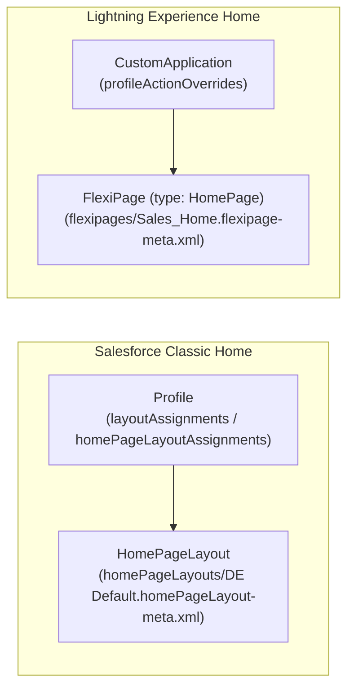

## Why `HomePageLayout` Still Appears in Modern CI/CD Pipelines

In Lightning Experience, home pages are built in Lightning App Builder and stored as [FlexiPage](/docs/metadata/flexipage-metadata-type/) metadata (`<type>HomePage</type>`). However, **`HomePageLayout`** (`homePageLayouts/<Name>.homePageLayout-meta.xml`) represents the **Salesforce Classic Home Page Layout**, and it frequently surfaces in modern DevOps pipelines for one critical reason:

- **[`Profile`](/docs/metadata/profile-metadata-type/) Dependencies (`homePageLayoutAssignments`):** Every `Profile` metadata file can contain a `<homePageLayoutAssignments>` element referencing a `HomePageLayout` (such as `DE Default`). If you deploy a `Profile` to a Scratch Org or Sandbox where that `HomePageLayout` is missing, the deployment fails unless you either deploy the `HomePageLayout` or strip the assignment.



---

## Key Metadata Fields on `HomePageLayout`

| Field | Type | Required | Description |
|---|---|---|---|
| `narrowComponents` | `string[]` | No | Components displayed in the left narrow sidebar column (e.g., `standard-CreateNew`, `standard-RecentItems`, `standard-MessagesAndAlerts`). |
| `wideComponents` | `string[]` | No | Components displayed in the main wide body column (e.g., `standard-Dashboard`, `standard-Calendar`, `standard-Tasks`). |

---

## Real-World XML Example (`homePageLayouts/DE Default.homePageLayout-meta.xml`)

```xml
<?xml version="1.0" encoding="UTF-8"?>
<HomePageLayout xmlns="http://soap.sforce.com/2006/04/metadata">
    <narrowComponents>standard-StandardSearch</narrowComponents>
    <narrowComponents>standard-CreateNew</narrowComponents>
    <narrowComponents>standard-RecentItems</narrowComponents>
    <wideComponents>standard-Dashboard</wideComponents>
    <wideComponents>standard-Tasks</wideComponents>
    <wideComponents>standard-Calendar</wideComponents>
</HomePageLayout>
```

---

## Classic `HomePageLayout` vs. Lightning `FlexiPage` (`HomePage`)

| Feature | `HomePageLayout` (Classic) | `FlexiPage` (`type: HomePage`) |
|---|---|---|
| **Metadata Folder** | `homePageLayouts/` | `flexipages/` |
| **Target UI** | Salesforce Classic only | Lightning Experience & Mobile |
| **Component Types** | `HomePageComponent` & `standard-*` widgets | LWC (`LightningComponentBundle`), Aura, Dashboards, Flows |
| **Assignment Mechanism** | `Profile` (`homePageLayoutAssignments`) | Org Default, `CustomApplication` (`actionOverrides`), or App + Profile (`profileActionOverrides`) |

> [!TIP]
> **How to Assign Lightning Home Pages in Metadata:** If you want to deploy a Lightning Experience Home Page assignment via SFDX, do **not** use `HomePageLayout`. Instead, deploy a [FlexiPage](/docs/metadata/flexipage-metadata-type/) with `<type>HomePage</type>` and reference it inside your [CustomApplication](/docs/metadata/custom-application-metadata-type/) (`<profileActionOverrides><actionName>Tab</actionName><content>Sales_Home</content><pageOrSobjectType>standard-home</pageOrSobjectType>...</profileActionOverrides>`).
