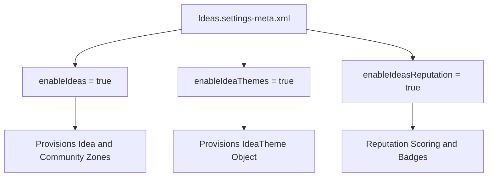

## Architectural Overview

`IdeasSettings` governs the configuration of Salesforce Ideas, a collaborative innovation platform used internally and across Experience Cloud communities. Ideas enables employees, partners, and customers to submit suggestions, vote, comment, and track implementation statuses.

In enterprise architecture, `IdeasSettings` activates the underlying `Idea` and `IdeaTheme` data models, configures reputation score thresholds, and enables multi-language idea portals. Deploying these settings reliably ensures that customer-facing communities initialize with consistent voting rules and moderation guardrails.



## Directory and File Conventions

`IdeasSettings` is stored in the standard `settings` directory:

| Property | Value |
| :--- | :--- |
| **Metadata Type Name** | `Settings` (member: `Ideas`) |
| **SFDX Directory** | `force-app/main/default/settings/` |
| **File Name** | `Ideas.settings-meta.xml` |
| **Scratch Org Key** | `ideasSettings` |

## Key Metadata Fields

The `IdeasSettings` XML schema defines community innovation parameters:

| Field Name | Type | Required | Description |
| :--- | :--- | :--- | :--- |
| `enableIdeas` | `boolean` | No | Master toggle that enables Salesforce Ideas across the org. |
| `enableIdeaThemes` | `boolean` | No | Enables Idea Themes to organize ideas around specific business initiatives. |
| `enableIdeasReputation` | `boolean` | No | Enables user points, levels, and reputation badges for community participation. |
| `enableMultiLanguageIdeas` | `boolean` | No | Allows users to submit and filter ideas across localized languages. |

> [!NOTE]
> Enabling Ideas provisions the standard `Idea` object. Custom fields, record types, and validation rules on `Idea` depend on `enableIdeas` being true.

## Declarative XML and Package Manifest Examples

Below is a production `Ideas.settings-meta.xml` configuration:

```xml title="force-app/main/default/settings/Ideas.settings-meta.xml"
<?xml version="1.0" encoding="UTF-8"?>
<IdeasSettings xmlns="http://soap.sforce.com/2006/04/metadata">
    <enableIdeas>true</enableIdeas>
    <enableIdeasReputation>true</enableIdeasReputation>
    <enableIdeaThemes>true</enableIdeaThemes>
    <enableMultiLanguageIdeas>false</enableMultiLanguageIdeas>
</IdeasSettings>
```

### Scratch Org Definition (`config/project-scratch-def.json`)

```json title="config/project-scratch-def.json"
{
  "orgName": "Ideas and Innovation Scratch Org",
  "edition": "Enterprise",
  "features": ["Ideas"],
  "settings": {
    "ideasSettings": {
      "enableIdeas": true,
      "enableIdeaThemes": true,
      "enableIdeasReputation": true
    }
  }
}
```

### Package Manifest (`package.xml`)

```xml title="manifest/package.xml"
<?xml version="1.0" encoding="UTF-8"?>
<Package xmlns="http://soap.sforce.com/2006/04/metadata">
    <types>
        <members>Ideas</members>
        <name>Settings</name>
    </types>
    <version>68.0</version>
</Package>
```

## Retrieval and Deployment via SF CLI

Retrieve and deploy settings via Salesforce CLI:

```bash
# Retrieve Ideas settings
sf project retrieve start --metadata "Settings:Ideas"

# Deploy Ideas settings to scratch org or sandbox
sf project deploy start --metadata "Settings:Ideas" --target-org dev-sandbox
```

> [!TIP]
> Always deploy `IdeasSettings` before deploying custom fields on the `Idea` object or Apex triggers referencing `Idea`.

## Senior Architect Best Practices and Gotchas

- **Build Sequencing**: Custom code or permission sets referencing `IdeaComment` or `IdeaTheme` will throw compile errors if `IdeasSettings` is not deployed first.
- **Experience Cloud Integration**: After enabling Ideas in settings, assign members to specific Community Zones via data seeding or setup automation.
- **Spam Mitigation**: When enabling Ideas in public-facing communities, implement reCAPTCHA and moderation rules to prevent automated spam generation.
