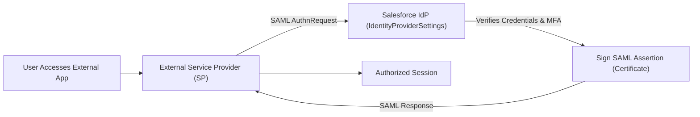

## Architectural Overview

`IdentityProviderSettings` configures Salesforce to serve as an Identity Provider (IdP). By acting as an IdP, Salesforce authenticates users and issues digitally signed SAML 2.0 assertions or OpenID Connect tokens to external service providers (e.g., Workday, AWS Console, ServiceNow, or custom connected apps).

In enterprise identity architectures, configuring Salesforce as an IdP allows organizations to leverage Salesforce multi-factor authentication (MFA), login flows, and session management policies as the centralized security perimeter for enterprise cloud applications.



## Directory and File Conventions

`IdentityProviderSettings` resides in the standard `settings` directory:

| Property | Value |
| :--- | :--- |
| **Metadata Type Name** | `Settings` (member: `IdentityProvider`) |
| **SFDX Directory** | `force-app/main/default/settings/` |
| **File Name** | `IdentityProvider.settings-meta.xml` |
| **Scratch Org Key** | `identityProviderSettings` |

## Key Metadata Fields

The `IdentityProviderSettings` metadata schema exposes the core IdP configuration:

| Field Name | Type | Required | Description |
| :--- | :--- | :--- | :--- |
| `enableIdentityProvider` | `boolean` | No | Master activation toggle enabling Salesforce as an Identity Provider. |
| `certificate` | `string` | No | Developer name of the `Certificate` used to sign SAML assertions. |

> [!NOTE]
> The certificate specified in `<certificate>` must already exist in the target org or be included in the same deployment payload under `Certificate`.

## Declarative XML and Package Manifest Examples

Below is a production `IdentityProvider.settings-meta.xml` file referencing a corporate signing certificate:

```xml title="force-app/main/default/settings/IdentityProvider.settings-meta.xml"
<?xml version="1.0" encoding="UTF-8"?>
<IdentityProviderSettings xmlns="http://soap.sforce.com/2006/04/metadata">
    <enableIdentityProvider>true</enableIdentityProvider>
    <certificate>SelfSigned_IdP_Cert</certificate>
</IdentityProviderSettings>
```

### Scratch Org Definition (`config/project-scratch-def.json`)

```json title="config/project-scratch-def.json"
{
  "orgName": "Identity Provider Testing Scratch Org",
  "edition": "Enterprise",
  "settings": {
    "identityProviderSettings": {
      "enableIdentityProvider": true
    }
  }
}
```

### Package Manifest (`package.xml`)

```xml title="manifest/package.xml"
<?xml version="1.0" encoding="UTF-8"?>
<Package xmlns="http://soap.sforce.com/2006/04/metadata">
    <types>
        <members>SelfSigned_IdP_Cert</members>
        <name>Certificate</name>
    </types>
    <types>
        <members>IdentityProvider</members>
        <name>Settings</name>
    </types>
    <version>68.0</version>
</Package>
```

## Retrieval and Deployment via SF CLI

Commands to retrieve and deploy identity provider settings:

```bash
# Retrieve IdentityProvider settings and certificate
sf project retrieve start --metadata "Settings:IdentityProvider" "Certificate:SelfSigned_IdP_Cert"

# Deploy settings to staging environment
sf project deploy start --manifest manifest/package.xml --target-org staging-org
```

> [!TIP]
> Always verify that `My Domain` is deployed and active in the destination org before enabling Identity Provider settings.

## Senior Architect Best Practices and Gotchas

- **Certificate Expiration Governance**: Monitor the signing certificate referenced in `IdentityProviderSettings`. An expired certificate immediately breaks SSO across all integrated connected applications.
- **Connected App Dependencies**: Connected apps configured for SAML SSO require `enableIdentityProvider` to be active; deploy the settings before or alongside connected apps.
- **My Domain Prerequisite**: Salesforce cannot issue SAML assertions without a verified My Domain sub-domain.
- **Assertion Encryption**: For high-security endpoints, combine IdP settings with assertion encryption certificates configured within the target `ConnectedApp`.
