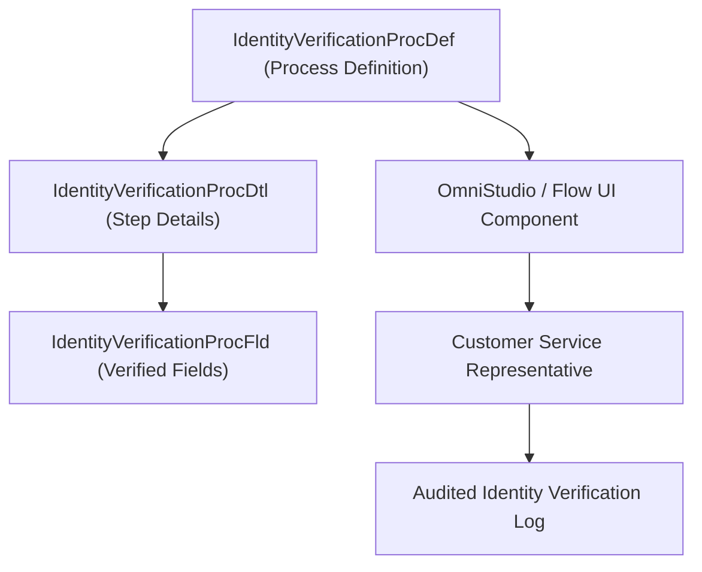

## Architectural Overview

`IdentityVerificationProcDef` (Identity Verification Process Definition) is a specialized metadata type within Salesforce Industries (Financial Services Cloud, Health Cloud, and Public Sector Solutions). It serves as the top-level orchestrator for customer identity verification flows in contact centers.

When an inbound caller contacts a bank, insurer, or clinic, customer service agents must verify their identity against regulatory compliance mandates (e.g., GLBA, HIPAA, GDPR) before sharing account or medical records. `IdentityVerificationProcDef` encapsulates the rules, search targets, and thresholds needed to validate callers, logging an audit trail of every verification attempt.



## Directory and File Conventions

`IdentityVerificationProcDef` files reside in `identityVerificationProcDefs/`:

| Property | Value |
| :--- | :--- |
| **Metadata Type Name** | `IdentityVerificationProcDef` |
| **SFDX Directory** | `force-app/main/default/identityVerificationProcDefs/` |
| **File Suffix** | `.identityVerificationProcDef-meta.xml` |
| **API Version** | 68.0 |

## Key Metadata Fields

The XML representation of `IdentityVerificationProcDef` includes:

| Field Name | Type | Required | Description |
| :--- | :--- | :--- | :--- |
| `masterLabel` | `string` | Yes | Display label for the verification procedure. |
| `description` | `string` | No | Architectural description of the regulatory use case. |
| `status` | `string` | Yes | Lifecycle status of the process (`Active` or `Draft`). |

> [!NOTE]
> `IdentityVerificationProcDef` acts as the root parent for `IdentityVerificationProcDtl` (details) and `IdentityVerificationProcFld` (fields).

## Declarative XML and Package Manifest Examples

Below is a complete `IdentityVerificationProcDef` definition for a Banking Customer Care verification process:

```xml title="force-app/main/default/identityVerificationProcDefs/Banking_Customer_Verification.identityVerificationProcDef-meta.xml"
<?xml version="1.0" encoding="UTF-8"?>
<IdentityVerificationProcDef xmlns="http://soap.sforce.com/2006/04/metadata">
    <masterLabel>Banking Customer Verification</masterLabel>
    <description>Standard GLBA compliant caller identity verification for retail banking</description>
    <status>Active</status>
</IdentityVerificationProcDef>
```

### Package Manifest (`package.xml`)

```xml title="manifest/package.xml"
<?xml version="1.0" encoding="UTF-8"?>
<Package xmlns="http://soap.sforce.com/2006/04/metadata">
    <types>
        <members>Banking_Customer_Verification</members>
        <name>IdentityVerificationProcDef</name>
    </types>
    <types>
        <members>*</members>
        <name>IdentityVerificationProcDtl</name>
    </types>
    <types>
        <members>*</members>
        <name>IdentityVerificationProcFld</name>
    </types>
    <version>68.0</version>
</Package>
```

## Retrieval and Deployment via SF CLI

Retrieve and deploy identity verification process definitions:

```bash
# Retrieve verification process definitions
sf project retrieve start --metadata "IdentityVerificationProcDef:Banking_Customer_Verification"

# Deploy complete verification suite to an environment
sf project deploy start --metadata "IdentityVerificationProcDef" "IdentityVerificationProcDtl" "IdentityVerificationProcFld" --target-org fsc-org
```

> [!TIP]
> Ensure the Financial Services Cloud or Health Cloud feature licenses are provisioned in scratch orgs to compile Identity Verification metadata types.

## Senior Architect Best Practices and Gotchas

- **Parent-Child Integrity**: Always deploy `IdentityVerificationProcDef` before or alongside child `IdentityVerificationProcDtl` records to satisfy foreign key metadata constraints.
- **Flow Integration**: Identity verification processes are typically launched from Service Console record pages via Screen Flows or OmniStudio OmniScripts.
- **Audit Compliance**: Verify that the process logs records to the `IdentityVerificationEvent` or audit logging tables for statutory compliance reviews.
