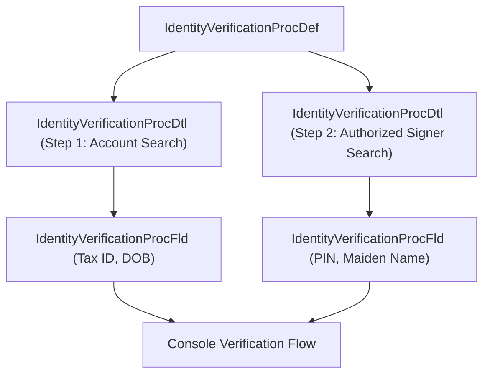

## Architectural Overview

`IdentityVerificationProcDtl` (Identity Verification Process Detail) configures an individual step, search action, or verification group within a parent `IdentityVerificationProcDef`. In Salesforce Industries, verifying an identity often requires querying multiple entities (e.g., searching for an Account, then locating an authorized Contact or Power of Attorney representative).

`IdentityVerificationProcDtl` defines which object is searched, what matching logic is applied, the sequence in which steps execute, and how verification outcomes determine whether the customer service representative can proceed.



## Directory and File Conventions

`IdentityVerificationProcDtl` files are stored in `identityVerificationProcDtls/`:

| Property | Value |
| :--- | :--- |
| **Metadata Type Name** | `IdentityVerificationProcDtl` |
| **SFDX Directory** | `force-app/main/default/identityVerificationProcDtls/` |
| **File Suffix** | `.identityVerificationProcDtl-meta.xml` |
| **API Version** | 68.0 |

## Key Metadata Fields

The XML schema for `IdentityVerificationProcDtl` defines step parameters:

| Field Name | Type | Required | Description |
| :--- | :--- | :--- | :--- |
| `masterLabel` | `string` | Yes | Label describing this verification step. |
| `identityVerificationProcDef` | `string` | Yes | Parent `IdentityVerificationProcDef` API developer name. |
| `searchObject` | `string` | Yes | API name of the target sObject being queried (e.g., `Account` or `Contact`). |
| `sequence` | `integer` | Yes | Execution order of this step within the overall verification procedure. |

> [!NOTE]
> Ensure the parent `IdentityVerificationProcDef` and target `searchObject` exist before deploying process details.

## Declarative XML and Package Manifest Examples

Below is a detail record defining an Account search step for retail banking:

```xml title="force-app/main/default/identityVerificationProcDtls/Account_Search_Step.identityVerificationProcDtl-meta.xml"
<?xml version="1.0" encoding="UTF-8"?>
<IdentityVerificationProcDtl xmlns="http://soap.sforce.com/2006/04/metadata">
    <masterLabel>Account Search Step</masterLabel>
    <identityVerificationProcDef>Banking_Customer_Verification</identityVerificationProcDef>
    <searchObject>Account</searchObject>
    <sequence>1</sequence>
</IdentityVerificationProcDtl>
```

### Package Manifest (`package.xml`)

```xml title="manifest/package.xml"
<?xml version="1.0" encoding="UTF-8"?>
<Package xmlns="http://soap.sforce.com/2006/04/metadata">
    <types>
        <members>Banking_Customer_Verification</members>
        <name>IdentityVerificationProcDef</name>
    </types>
    <types>
        <members>Account_Search_Step</members>
        <name>IdentityVerificationProcDtl</name>
    </types>
    <version>68.0</version>
</Package>
```

## Retrieval and Deployment via SF CLI

Commands to retrieve and deploy verification step details:

```bash
# Retrieve verification process detail
sf project retrieve start --metadata "IdentityVerificationProcDtl:Account_Search_Step"

# Deploy details alongside parent process definition
sf project deploy start --manifest manifest/package.xml --target-org uat-sandbox
```

> [!TIP]
> Group process definitions, details, and fields into modular DX packages to simplify deployment across industry sandboxes.

## Senior Architect Best Practices and Gotchas

- **Circular Dependencies**: Detail components strictly depend on parent `IdentityVerificationProcDef`. Deploying detail records alone to a fresh org without their parent will fail.
- **Search Optimization**: Ensure fields configured for search indexing on the `searchObject` have appropriate custom indexes to guarantee sub-second verification response times.
- **Data Protection Compliance**: When configuring steps that query sensitive objects, ensure field-level security and profile access are properly restricted.
