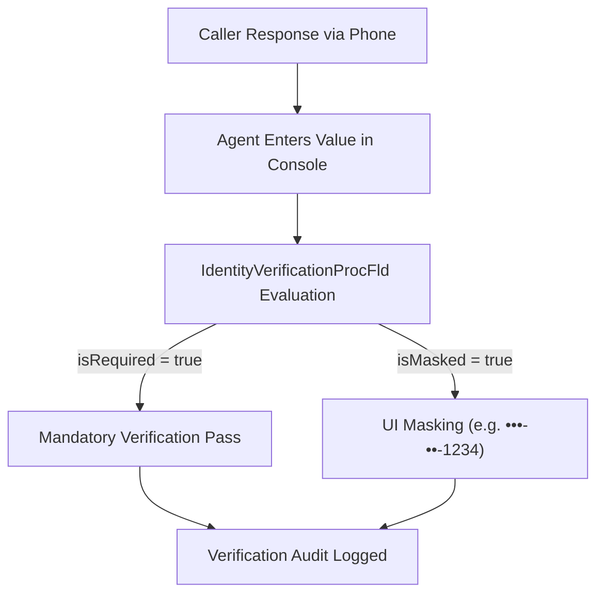

## Architectural Overview

`IdentityVerificationProcFld` (Identity Verification Process Field) represents the most granular component in the Salesforce Industries Identity Verification metadata suite. While `IdentityVerificationProcDef` establishes the overarching workflow and `IdentityVerificationProcDtl` configures the verification steps, `IdentityVerificationProcFld` designates the specific fields compared during customer verification.

In banking, healthcare, and telecommunications, identity verification requires challenging callers with knowledge-based authentication questions (e.g., date of birth, billing postal code, tax identifier, or security passcodes). `IdentityVerificationProcFld` defines whether each field is mandatory, optional, or masked on the agent screen to protect personally identifiable information (PII).



## Directory and File Conventions

`IdentityVerificationProcFld` files are located in `identityVerificationProcFlds/`:

| Property | Value |
| :--- | :--- |
| **Metadata Type Name** | `IdentityVerificationProcFld` |
| **SFDX Directory** | `force-app/main/default/identityVerificationProcFlds/` |
| **File Suffix** | `.identityVerificationProcFld-meta.xml` |
| **API Version** | 68.0 |

## Key Metadata Fields

The XML schema for `IdentityVerificationProcFld` configures field verification criteria:

| Field Name | Type | Required | Description |
| :--- | :--- | :--- | :--- |
| `masterLabel` | `string` | Yes | Human-readable label for the verification field. |
| `identityVerificationProcDtl` | `string` | Yes | API developer name of the parent `IdentityVerificationProcDtl`. |
| `fieldName` | `string` | Yes | API name of the target sObject field being verified. |
| `isRequired` | `boolean` | No | Indicates whether this field must match for verification to succeed. |
| `isMasked` | `boolean` | No | Masks the field value on screen to protect sensitive customer data. |
| `sequence` | `integer` | Yes | Order in which the field prompt appears to the service representative. |

> [!NOTE]
> The target field designated by `fieldName` must exist on the sObject defined in the parent `IdentityVerificationProcDtl`.

## Declarative XML and Package Manifest Examples

Below is an XML definition configuring a masked Tax ID verification field:

```xml title="force-app/main/default/identityVerificationProcFlds/Account_Tax_Id_Verification.identityVerificationProcFld-meta.xml"
<?xml version="1.0" encoding="UTF-8"?>
<IdentityVerificationProcFld xmlns="http://soap.sforce.com/2006/04/metadata">
    <masterLabel>Account Tax ID Verification</masterLabel>
    <identityVerificationProcDtl>Account_Search_Step</identityVerificationProcDtl>
    <fieldName>Tax_Identification_Number__c</fieldName>
    <isRequired>true</isRequired>
    <isMasked>true</isMasked>
    <sequence>1</sequence>
</IdentityVerificationProcFld>
```

### Package Manifest (`package.xml`)

```xml title="manifest/package.xml"
<?xml version="1.0" encoding="UTF-8"?>
<Package xmlns="http://soap.sforce.com/2006/04/metadata">
    <types>
        <members>Account_Tax_Id_Verification</members>
        <name>IdentityVerificationProcFld</name>
    </types>
    <version>68.0</version>
</Package>
```

## Retrieval and Deployment via SF CLI

Retrieve and deploy verification field metadata:

```bash
# Retrieve verification field metadata
sf project retrieve start --metadata "IdentityVerificationProcFld:Account_Tax_Id_Verification"

# Deploy all verification fields
sf project deploy start --metadata "IdentityVerificationProcFld" --target-org uat-org
```

> [!TIP]
> Deploy custom fields and field-level security permissions before deploying `IdentityVerificationProcFld` to avoid unresolved field reference errors.

## Senior Architect Best Practices and Gotchas

- **Deployment Ordering**: Strictly order deployments: `CustomField` -> `IdentityVerificationProcDef` -> `IdentityVerificationProcDtl` -> `IdentityVerificationProcFld`.
- **Masking Compliance**: Always enable `<isMasked>true</isMasked>` for sensitive attributes (SSN, national IDs, PINs) to comply with PCI-DSS and privacy mandates.
- **Field Changes**: If a verified custom field is renamed or removed, updating the corresponding `IdentityVerificationProcFld` is mandatory before deleting the field.
