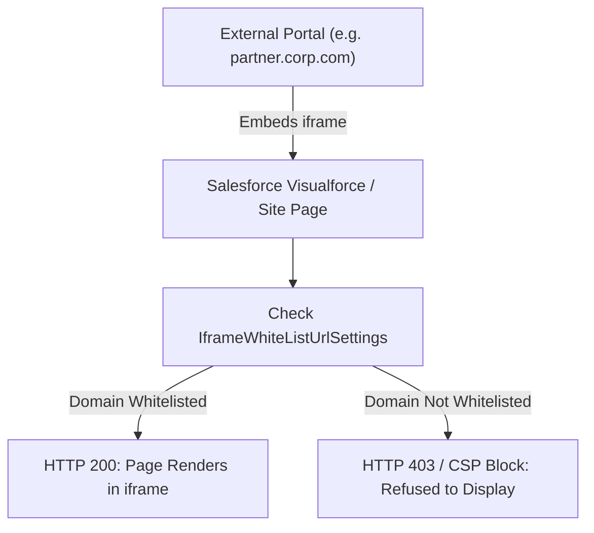

## Architectural Overview

`IframeWhiteListUrlSettings` manages clickjack protection policies and defines external domains permitted to embed Salesforce pages within HTML iframes. Clickjacking is a malicious attack where an attacker embeds a legitimate application into a transparent iframe on a malicious website, tricking users into clicking invisible buttons or executing unauthorized transactions.

By default, Salesforce enforces strict clickjack protection on Visualforce pages, Lightning Out applications, and Experience Cloud sites. `IframeWhiteListUrlSettings` configures trusted domains allowed as frame ancestors, translating directly into HTTP response headers such as `Content-Security-Policy: frame-ancestors` and `X-Frame-Options`.



## Directory and File Conventions

`IframeWhiteListUrlSettings` belongs to the standard `settings` metadata type:

| Property | Value |
| :--- | :--- |
| **Metadata Type Name** | `Settings` (member: `IframeWhiteListUrl`) |
| **SFDX Directory** | `force-app/main/default/settings/` |
| **File Name** | `IframeWhiteListUrl.settings-meta.xml` |
| **Scratch Org Key** | `iframeWhiteListUrlSettings` |

## Key Metadata Fields

The `IframeWhiteListUrlSettings` XML schema defines trusted iframe origins:

| Field Name | Type | Required | Description |
| :--- | :--- | :--- | :--- |
| `enableIframeWhiteList` | `boolean` | No | Toggles enforcement of the custom iframe domain whitelist. |
| `whitelistedUrls` | `string[]` | No | Collection of trusted external origin URLs allowed to frame Salesforce pages. |

> [!NOTE]
> Modern Experience Cloud and Lightning apps also utilize the `CspTrustedSite` and `TrustedUrl` metadata types to manage Content Security Policy directives.

## Declarative XML and Package Manifest Examples

Below is a production `IframeWhiteListUrl.settings-meta.xml` configuration allowing an enterprise corporate portal to frame Salesforce:

```xml title="force-app/main/default/settings/IframeWhiteListUrl.settings-meta.xml"
<?xml version="1.0" encoding="UTF-8"?>
<IframeWhiteListUrlSettings xmlns="http://soap.sforce.com/2006/04/metadata">
    <enableIframeWhiteList>true</enableIframeWhiteList>
</IframeWhiteListUrlSettings>
```

### Scratch Org Definition (`config/project-scratch-def.json`)

```json title="config/project-scratch-def.json"
{
  "orgName": "Clickjack Protection Scratch Org",
  "edition": "Enterprise",
  "settings": {
    "iframeWhiteListUrlSettings": {
      "enableIframeWhiteList": true
    }
  }
}
```

### Package Manifest (`package.xml`)

```xml title="manifest/package.xml"
<?xml version="1.0" encoding="UTF-8"?>
<Package xmlns="http://soap.sforce.com/2006/04/metadata">
    <types>
        <members>IframeWhiteListUrl</members>
        <name>Settings</name>
    </types>
    <version>68.0</version>
</Package>
```

## Retrieval and Deployment via SF CLI

Retrieve and deploy iframe whitelist settings:

```bash
# Retrieve IframeWhiteListUrl settings
sf project retrieve start --metadata "Settings:IframeWhiteListUrl"

# Deploy settings to production
sf project deploy start --metadata "Settings:IframeWhiteListUrl" --target-org production-org
```

> [!TIP]
> Complement `IframeWhiteListUrlSettings` with `SecuritySettings` to ensure clickjack protection is enabled with appropriate restriction levels across all pages.

## Senior Architect Best Practices and Gotchas

- **Protocol Matching**: Ensure whitelisted URLs explicitly include the `https://` protocol scheme. HTTP origins will be rejected by modern browser security policies.
- **Port Matching**: For local testing or development proxies, include the port number (e.g., `https://localhost:8443`) in trusted URL configurations.
- **Subdomain Explicit Configuration**: Avoid overly permissive top-level domains. Whitelist specific, fully qualified domain names (FQDNs) to minimize clickjack attack vectors.
