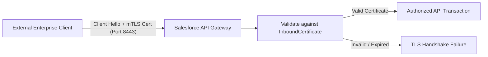

## Architectural Overview

`InboundCertificate` represents a public X.509 cryptographic certificate imported into Salesforce to authenticate inbound connections. Unlike outbound certificates (which hold private keys used by Salesforce to sign requests or establish TLS sessions to external servers), `InboundCertificate` holds public certificates presented by external systems.

Its primary architectural use cases include mutual TLS (mTLS) authentication on port 8443, validating signed SAML authentication requests, and verifying XML or JWT digital signatures from enterprise API gateways. Managing `InboundCertificate` metadata via version control allows automated lifecycle management of corporate public key infrastructure (PKI).



## Directory and File Conventions

`InboundCertificate` files are stored in the `inboundCertificates` directory:

| Property | Value |
| :--- | :--- |
| **Metadata Type Name** | `InboundCertificate` |
| **SFDX Directory** | `force-app/main/default/inboundCertificates/` |
| **File Suffix** | `.inboundCertificate-meta.xml` |
| **API Version** | 68.0 |

## Key Metadata Fields

The XML schema for `InboundCertificate` defines public certificate properties:

| Field Name | Type | Required | Description |
| :--- | :--- | :--- | :--- |
| `masterLabel` | `string` | Yes | Human-readable label for the inbound certificate. |
| `content` | `base64` | Yes | Base64-encoded binary content of the public X.509 certificate (.crt or .cer). |
| `description` | `string` | No | Description identifying the external calling system or PKI authority. |

> [!NOTE]
> Do not upload certificates containing private keys into `InboundCertificate`. Only DER or PEM-encoded public certificates should be provided.

## Declarative XML and Package Manifest Examples

Below is an illustrative `InboundCertificate` metadata file:

```xml title="force-app/main/default/inboundCertificates/Payment_Gateway_mTLS.inboundCertificate-meta.xml"
<?xml version="1.0" encoding="UTF-8"?>
<InboundCertificate xmlns="http://soap.sforce.com/2006/04/metadata">
    <masterLabel>Payment Gateway mTLS Certificate</masterLabel>
    <description>Public X.509 certificate for inbound API mutual TLS verification</description>
    <content>MIIBIjANBgkqhkiG9w0BAQEFAAOCAQ8AMIIBCgKCAQEA3f...</content>
</InboundCertificate>
```

### Package Manifest (`package.xml`)

```xml title="manifest/package.xml"
<?xml version="1.0" encoding="UTF-8"?>
<Package xmlns="http://soap.sforce.com/2006/04/metadata">
    <types>
        <members>Payment_Gateway_mTLS</members>
        <name>InboundCertificate</name>
    </types>
    <version>68.0</version>
</Package>
```

## Retrieval and Deployment via SF CLI

Retrieve and deploy inbound certificates:

```bash
# Retrieve an inbound certificate
sf project retrieve start --metadata "InboundCertificate:Payment_Gateway_mTLS"

# Deploy inbound certificates to sandbox
sf project deploy start --metadata "InboundCertificate" --target-org dev-org
```

> [!TIP]
> Establish an automated pipeline that validates certificate expiration dates in Git before deploying renewals to production orgs.

## Senior Architect Best Practices and Gotchas

- **Expiration Rotation Planning**: Rotate certificates 30–60 days before expiration. Because mTLS blocks handshakes immediately upon expiration, plan overlapping dual-certificate trust windows.
- **Base64 Formatting**: Ensure base64 certificate content strings are sanitized of carriage returns or unwanted header/footer delimiters (`-----BEGIN CERTIFICATE-----`) when embedding in XML.
- **Port 8443 Enforcement**: Inbound mutual TLS requires external API clients to connect to the dedicated Salesforce mutual authentication domain on port 8443 (`https://mycompany.my.salesforce.com:8443`).
