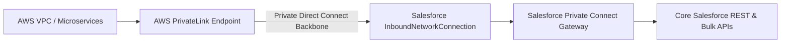

## Architectural Overview

`InboundNetworkConnection` represents an inbound private network connection managed under Salesforce Private Connect. Modern enterprise cloud architectures require zero-trust network topology where integration traffic between public clouds (e.g., AWS, Azure) and Salesforce never traverses the public internet.

Using `InboundNetworkConnection`, architects establish an AWS VPC endpoint connection or Azure Private Link endpoint directly into the Salesforce multi-tenant infrastructure. External microservices can invoke Salesforce REST or GraphQL APIs over private IP addresses, satisfying stringent financial and healthcare data security regulations.



## Directory and File Conventions

`InboundNetworkConnection` files reside in `inboundNetworkConnections/`:

| Property | Value |
| :--- | :--- |
| **Metadata Type Name** | `InboundNetworkConnection` |
| **SFDX Directory** | `force-app/main/default/inboundNetworkConnections/` |
| **File Suffix** | `.inboundNetworkConnection-meta.xml` |
| **API Version** | 68.0 |

## Key Metadata Fields

The XML representation of `InboundNetworkConnection` defines the private cloud linkage:

| Field Name | Type | Required | Description |
| :--- | :--- | :--- | :--- |
| `masterLabel` | `string` | Yes | Human-readable label for the inbound connection. |
| `connectionType` | `string` | Yes | Type of network connection (e.g. `AwsPrivateLink` or `AzurePrivateLink`). |
| `status` | `string` | Yes | Lifecycle status such as `Provisioning`, `Ready`, or `Disconnected`. |
| `serviceRegion` | `string` | Yes | Cloud region where the private endpoint resides (e.g. `us-east-1`). |

> [!NOTE]
> Private Connect requires an add-on license and network allocation credits in production and sandbox orgs.

## Declarative XML and Package Manifest Examples

Below is a declarative XML definition of an AWS PrivateLink inbound network connection:

```xml title="force-app/main/default/inboundNetworkConnections/AWS_Production_PrivateLink.inboundNetworkConnection-meta.xml"
<?xml version="1.0" encoding="UTF-8"?>
<InboundNetworkConnection xmlns="http://soap.sforce.com/2006/04/metadata">
    <masterLabel>AWS Production PrivateLink</masterLabel>
    <connectionType>AwsPrivateLink</connectionType>
    <serviceRegion>us-east-1</serviceRegion>
    <status>Ready</status>
</InboundNetworkConnection>
```

### Package Manifest (`package.xml`)

```xml title="manifest/package.xml"
<?xml version="1.0" encoding="UTF-8"?>
<Package xmlns="http://soap.sforce.com/2006/04/metadata">
    <types>
        <members>AWS_Production_PrivateLink</members>
        <name>InboundNetworkConnection</name>
    </types>
    <version>68.0</version>
</Package>
```

## Retrieval and Deployment via SF CLI

Retrieve and deploy inbound network connections:

```bash
# Retrieve inbound network connection definition
sf project retrieve start --metadata "InboundNetworkConnection:AWS_Production_PrivateLink"

# Deploy network connection metadata
sf project deploy start --metadata "InboundNetworkConnection" --target-org prod-org
```

> [!TIP]
> Coordinate deployments with cloud infrastructure engineers: PrivateLink connections require cross-account endpoint approval in the AWS or Azure management console.

## Senior Architect Best Practices and Gotchas

- **Cross-Cloud Handshake**: Deploying the metadata initiates the Salesforce side of the connection. The external cloud provider (AWS/Azure) must accept the connection request before status flips to `Ready`.
- **Region Constraints**: Ensure the `serviceRegion` matches the specific AWS/Azure region where the enterprise VPC endpoint service is provisioned.
- **Sandbox Testing**: Dedicated Private Connect licenses must be provisioned in sandboxes to validate private routing before production deployment.
