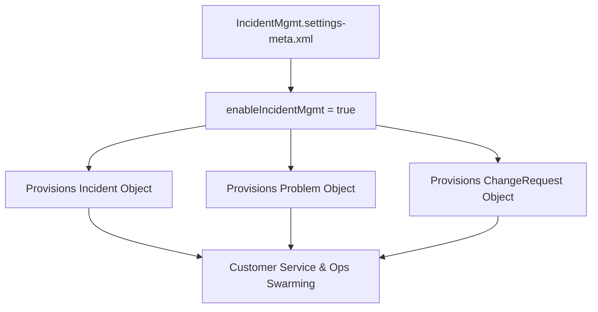

## Architectural Overview

`IncidentMgmtSettings` manages the core configuration for Service Cloud Incident Management. Aligned with the ITIL (Information Technology Infrastructure Library) framework, Incident Management equips operations and customer support organizations to respond to large-scale disruptions, analyze root causes, and deploy emergency fixes.

Deploying `IncidentMgmtSettings` activates the standard `Incident`, `Problem`, and `ChangeRequest` relational objects. In DevOps automation, activating these settings is a mandatory first step before deploying custom fields, automated page layouts, broadcast alert components, or Flow orchestrations designed for incident swarming.



## Directory and File Conventions

`IncidentMgmtSettings` is stored in the standard `settings` directory:

| Property | Value |
| :--- | :--- |
| **Metadata Type Name** | `Settings` (member: `IncidentMgmt`) |
| **SFDX Directory** | `force-app/main/default/settings/` |
| **File Name** | `IncidentMgmt.settings-meta.xml` |
| **Scratch Org Key** | `incidentMgmtSettings` |

## Key Metadata Fields

The `IncidentMgmtSettings` schema contains administrative toggles:

| Field Name | Type | Required | Description |
| :--- | :--- | :--- | :--- |
| `enableIncidentMgmt` | `boolean` | No | Master activation toggle for Incident, Problem, and Change Request objects. |

> [!NOTE]
> Enabling Incident Management provisions relationships to `Case` and `Asset`, allowing support teams to link customer issues to widespread incident records.

## Declarative XML and Package Manifest Examples

Below is an enterprise `IncidentMgmt.settings-meta.xml` configuration:

```xml title="force-app/main/default/settings/IncidentMgmt.settings-meta.xml"
<?xml version="1.0" encoding="UTF-8"?>
<IncidentMgmtSettings xmlns="http://soap.sforce.com/2006/04/metadata">
    <enableIncidentMgmt>true</enableIncidentMgmt>
</IncidentMgmtSettings>
```

### Scratch Org Definition (`config/project-scratch-def.json`)

```json title="config/project-scratch-def.json"
{
  "orgName": "Service Cloud Incident Management Scratch Org",
  "edition": "Enterprise",
  "settings": {
    "incidentMgmtSettings": {
      "enableIncidentMgmt": true
    }
  }
}
```

### Package Manifest (`package.xml`)

```xml title="manifest/package.xml"
<?xml version="1.0" encoding="UTF-8"?>
<Package xmlns="http://soap.sforce.com/2006/04/metadata">
    <types>
        <members>IncidentMgmt</members>
        <name>Settings</name>
    </types>
    <version>68.0</version>
</Package>
```

## Retrieval and Deployment via SF CLI

Retrieve and deploy settings via Salesforce CLI:

```bash
# Retrieve Incident Management settings
sf project retrieve start --metadata "Settings:IncidentMgmt"

# Deploy settings to staging environment
sf project deploy start --metadata "Settings:IncidentMgmt" --target-org staging-org
```

> [!TIP]
> Assign the Incident Management user permission set license to service agents who need access to broadcast alerts and change management layouts.

## Senior Architect Best Practices and Gotchas

- **Schema Dependencies**: Any custom fields, OmniStudio cards, or Flow definitions referencing `Incident` or `Problem` will fail deployment if `IncidentMgmtSettings` is not enabled first.
- **Incident Swarming Integration**: Combine Incident Management with Slack Service Cloud Swarming to automatically launch incident triage channels when severity thresholds are met.
- **Broadcast Alert Permissions**: Ensure agents have appropriate permissions configured on the `BroadcastTopic` and `BroadcastCommunication` objects to publish incident notices.
