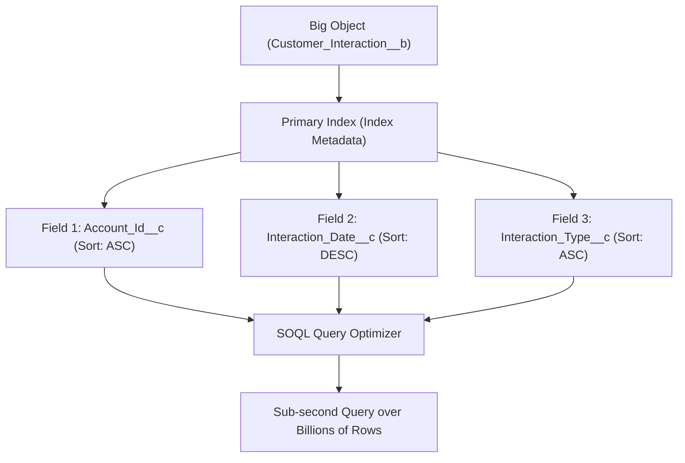

## Architectural Overview

The `Index` metadata type defines database indexes in the Salesforce data architecture, most prominently serving as the composite primary key definition for Big Objects (`CustomObject` with suffix `__b`). Big Objects store hundreds of millions to billions of records in Salesforce Apache HBase-backed big data storage.

Because Big Objects do not support relational table scans, every query must be filtered deterministically using the composite primary key defined by `Index`. Field ordering within an `Index` dictates exact SOQL query capabilities: queries must filter indexed fields in sequence from left to right without skipping leading index components.



## Directory and File Conventions

In decomposed source format, Big Object indexes are placed inside an `indexes` directory within the object folder:

| Property | Value |
| :--- | :--- |
| **Metadata Type Name** | `Index` |
| **Parent Component** | `CustomObject` (`__b` Big Object) |
| **SFDX Directory** | `force-app/main/default/objects/<BigObjectName>__b/indexes/` |
| **File Suffix** | `.index-meta.xml` |
| **API Version** | 68.0 |

## Key Metadata Fields

The XML schema for `Index` defines indexing properties and fields:

| Field Name | Type | Required | Description |
| :--- | :--- | :--- | :--- |
| `label` | `string` | Yes | Human-readable label for the database index. |
| `fields` | `IndexField[]` | Yes | Ordered collection of custom fields that form the composite primary key. |

Each `fields` entry contains:
- `name`: API name of the indexed custom field.
- `sortDirection`: Sort order, either `ASC` (ascending) or `DESC` (descending).

> [!NOTE]
> All custom fields included in a Big Object `Index` must be marked as required (`<required>true</required>`) in their respective field definitions.

## Declarative XML and Package Manifest Examples

Below is an index definition for a `Customer_Interaction__b` Big Object:

```xml title="force-app/main/default/objects/Customer_Interaction__b/indexes/Customer_Interaction_PK.index-meta.xml"
<?xml version="1.0" encoding="UTF-8"?>
<Index xmlns="http://soap.sforce.com/2006/04/metadata">
    <label>Customer Interaction Primary Key</label>
    <fields>
        <name>Account_Id__c</name>
        <sortDirection>ASC</sortDirection>
    </fields>
    <fields>
        <name>Interaction_Date__c</name>
        <sortDirection>DESC</sortDirection>
    </fields>
</Index>
```

### Package Manifest (`package.xml`)

```xml title="manifest/package.xml"
<?xml version="1.0" encoding="UTF-8"?>
<Package xmlns="http://soap.sforce.com/2006/04/metadata">
    <types>
        <members>Customer_Interaction__b</members>
        <name>CustomObject</name>
    </types>
    <types>
        <members>Customer_Interaction__b.Customer_Interaction_PK</members>
        <name>Index</name>
    </types>
    <version>68.0</version>
</Package>
```

## Retrieval and Deployment via SF CLI

Commands to retrieve and deploy Big Objects and their indexes:

```bash
# Retrieve Big Object and its indexes
sf project retrieve start --metadata "CustomObject:Customer_Interaction__b" "Index:Customer_Interaction__b.Customer_Interaction_PK"

# Deploy Big Object schema and indexes
sf project deploy start --metadata "CustomObject:Customer_Interaction__b" --target-org uat-org
```

> [!TIP]
> Ensure all custom fields referenced in the index are deployed in the same transaction as the Big Object index.

## Senior Architect Best Practices and Gotchas

- **Immutability After Deployment**: Once a Big Object index is deployed to production, it cannot be modified or reordered. Changes require creating a new Big Object definition and migrating data.
- **SOQL Query Ordering**: SOQL queries on Big Objects must filter by fields in the exact order defined in the index. You cannot filter on field 2 without specifying an equality filter on field 1.
- **Field Requiredness**: Every field that is part of a Big Object index must be configured with `<required>true</required>`. Missing requiredness flags will trigger deployment failures.
