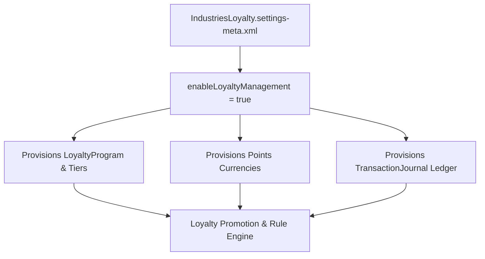

## Architectural Overview

`IndustriesLoyaltySettings` is the global settings metadata type for Salesforce Loyalty Management. In modern omni-channel customer engagement, loyalty programs incentivize consumer behavior across retail, travel, hospitality, and financial services.

Deploying `IndustriesLoyaltySettings` activates the underlying Loyalty Management data model: `LoyaltyProgram`, `LoyaltyProgramMember`, `LoyaltyTierGroup`, `LoyaltyProgramCurrency`, and the transaction-processing `TransactionJournal` ledger. In continuous integration pipelines, enabling these settings is a prerequisite before deploying loyalty business rules, promotion flows, or transactional accounting integrations.



## Directory and File Conventions

`IndustriesLoyaltySettings` is stored in the standard `settings` directory:

| Property | Value |
| :--- | :--- |
| **Metadata Type Name** | `Settings` (member: `IndustriesLoyalty`) |
| **SFDX Directory** | `force-app/main/default/settings/` |
| **File Name** | `IndustriesLoyalty.settings-meta.xml` |
| **Scratch Org Key** | `industriesLoyaltySettings` |

## Key Metadata Fields

The `IndustriesLoyaltySettings` XML schema defines loyalty configuration attributes:

| Field Name | Type | Required | Description |
| :--- | :--- | :--- | :--- |
| `enableLoyaltyManagement` | `boolean` | No | Master activation toggle provisioning the core Loyalty Management schema. |

> [!NOTE]
> Loyalty Management requires a valid Loyalty Management license in production and sandbox environments.

## Declarative XML and Package Manifest Examples

Below is an enterprise `IndustriesLoyalty.settings-meta.xml` file:

```xml title="force-app/main/default/settings/IndustriesLoyalty.settings-meta.xml"
<?xml version="1.0" encoding="UTF-8"?>
<IndustriesLoyaltySettings xmlns="http://soap.sforce.com/2006/04/metadata">
    <enableLoyaltyManagement>true</enableLoyaltyManagement>
</IndustriesLoyaltySettings>
```

### Scratch Org Definition (`config/project-scratch-def.json`)

```json title="config/project-scratch-def.json"
{
  "orgName": "Loyalty Management Scratch Org",
  "edition": "Enterprise",
  "settings": {
    "industriesLoyaltySettings": {
      "enableLoyaltyManagement": true
    }
  }
}
```

### Package Manifest (`package.xml`)

```xml title="manifest/package.xml"
<?xml version="1.0" encoding="UTF-8"?>
<Package xmlns="http://soap.sforce.com/2006/04/metadata">
    <types>
        <members>IndustriesLoyalty</members>
        <name>Settings</name>
    </types>
    <version>68.0</version>
</Package>
```

## Retrieval and Deployment via SF CLI

Commands to retrieve and deploy loyalty settings:

```bash
# Retrieve Loyalty Management settings
sf project retrieve start --metadata "Settings:IndustriesLoyalty"

# Deploy settings to an integration sandbox
sf project deploy start --metadata "Settings:IndustriesLoyalty" --target-org integration-org
```

> [!TIP]
> Ensure permissions for Loyalty Management administration and execution are deployed to your integration users alongside these settings.

## Senior Architect Best Practices and Gotchas

- **Ledger Performance Tuning**: High-frequency loyalty transactions generate massive volumes of `TransactionJournal` records. Design asynchronous processing strategies and archive plans using Big Objects or Data Cloud.
- **Rule Engine Dependencies**: Loyalty program promotions leverage Business Rules Engine (BRE) expression sets. Ensure BRE settings and schemas are deployed in synchronization with loyalty settings.
- **Scratch Org Licensing**: Ensure your Dev Hub is authorized to provision Loyalty Management scratch org features when setting up CI/CD pipelines.
