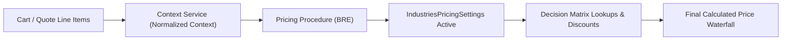

## Architectural Overview

`IndustriesPricingSettings` is the foundational settings metadata type for Salesforce Industries Pricing and next-generation Revenue Cloud. High-volume B2B quoting, telecommunications, insurance, and manufacturing require calculating complex pricing waterfalls (discounts, tier volume breaks, contract rates, and attribute-based pricing) in milliseconds.

`IndustriesPricingSettings` activates integration with Salesforce Context Service and Business Rules Engine (BRE) Pricing Procedures. Enabling this metadata allows declarative pricing designers to create calculation matrices and pricing recipes that run deterministically across Cart, Asset, and Contract lifecycles.



## Directory and File Conventions

`IndustriesPricingSettings` is stored in the standard `settings` directory:

| Property | Value |
| :--- | :--- |
| **Metadata Type Name** | `Settings` (member: `IndustriesPricing`) |
| **SFDX Directory** | `force-app/main/default/settings/` |
| **File Name** | `IndustriesPricing.settings-meta.xml` |
| **Scratch Org Key** | `industriesPricingSettings` |

## Key Metadata Fields

The `IndustriesPricingSettings` XML schema defines pricing engine toggles:

| Field Name | Type | Required | Description |
| :--- | :--- | :--- | :--- |
| `enableIndustriesPricing` | `boolean` | No | Master activation toggle for the Industries Pricing runtime engine. |

> [!NOTE]
> Industries Pricing requires Revenue Cloud, Industries CPQ, or Communications/Energy/Insurance Cloud licensing.

## Declarative XML and Package Manifest Examples

Below is a production `IndustriesPricing.settings-meta.xml` configuration:

```xml title="force-app/main/default/settings/IndustriesPricing.settings-meta.xml"
<?xml version="1.0" encoding="UTF-8"?>
<IndustriesPricingSettings xmlns="http://soap.sforce.com/2006/04/metadata">
    <enableIndustriesPricing>true</enableIndustriesPricing>
</IndustriesPricingSettings>
```

### Scratch Org Definition (`config/project-scratch-def.json`)

```json title="config/project-scratch-def.json"
{
  "orgName": "Enterprise Pricing Engine Scratch Org",
  "edition": "Enterprise",
  "settings": {
    "industriesPricingSettings": {
      "enableIndustriesPricing": true
    }
  }
}
```

### Package Manifest (`package.xml`)

```xml title="manifest/package.xml"
<?xml version="1.0" encoding="UTF-8"?>
<Package xmlns="http://soap.sforce.com/2006/04/metadata">
    <types>
        <members>IndustriesPricing</members>
        <name>Settings</name>
    </types>
    <version>68.0</version>
</Package>
```

## Retrieval and Deployment via SF CLI

Retrieve and deploy settings via Salesforce CLI:

```bash
# Retrieve Industries Pricing settings
sf project retrieve start --metadata "Settings:IndustriesPricing"

# Deploy settings to staging environment
sf project deploy start --metadata "Settings:IndustriesPricing" --target-org staging-org
```

> [!TIP]
> Always deploy `IndustriesPricingSettings` before deploying `ContextDefinition` or `PricingProcedure` metadata.

## Senior Architect Best Practices and Gotchas

- **Pipeline Ordering**: Strict deployment sequence: `IndustriesPricingSettings` -> `ContextDefinition` -> `CalculationMatrix` -> `PricingProcedure`.
- **Context Cache Optimization**: Enable Context Service caching in setup to avoid redundant queries when pricing large line-item carts.
- **Testing Waterfall Logic**: Use apex or REST testing endpoints to validate pricing procedure outputs against representative contract scenarios before promoting to production.
