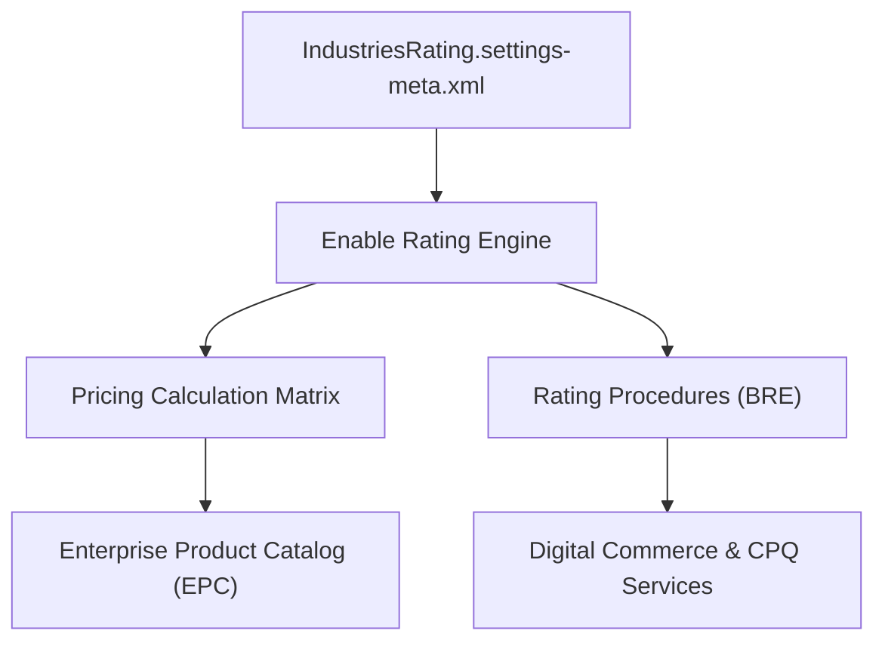

## Architectural Overview

The `IndustriesRatingSettings` metadata type represents organization-wide configuration switches for the Salesforce Industries rating and pricing calculation engines. In vertical industry clouds—including Communications Cloud, Media Cloud, Energy & Utilities Cloud, and Insurance Cloud—complex product modeling and dynamic pricing depend on rating procedures, decision matrices, and calculation procedures.

Architecturally, `IndustriesRatingSettings` dictates whether the runtime environment delegates rating calculations to the native Business Rules Engine (BRE), legacy calculation matrices, or high-throughput rating web services. Without activating these settings, downstream metadata deployments containing calculation procedures, pricing plans, and OmniStudio rating integration procedures fail during compilation.



## Directory and File Conventions

In Salesforce DX source format, `IndustriesRatingSettings` is a singleton settings type located within the `settings` directory:

| Property | Value |
| :--- | :--- |
| **Metadata Type Name** | `Settings` (member: `IndustriesRating`) |
| **SFDX Source Folder** | `force-app/main/default/settings/` |
| **File Name** | `IndustriesRating.settings-meta.xml` |
| **Packaging / Manifest Type** | `Settings` |

## Key Metadata Fields

The XML representation of `IndustriesRatingSettings` provides declarative flags that toggle rating engines and caching infrastructure:

| Field Name | Type | Required | Description |
| :--- | :--- | :--- | :--- |
| `enableIndustriesRating` | `boolean` | No | Enables the core rating service engine for Industries Cloud transactions. |
| `enableRatingCache` | `boolean` | No | Enables high-performance caching for calculation matrices and rating matrix lookups. |
| `enableMatrixVersioning` | `boolean` | No | Allows concurrent versioning of pricing and rating calculation matrices. |

> [!NOTE]
> Rating settings require the Industries CPQ or Industry Cloud Foundation license. If deployed to an org lacking the respective license, the deployment engine emits `FeatureNotEnabled` faults.

## Declarative XML and Package Manifest Examples

### Source XML (`IndustriesRating.settings-meta.xml`)

```xml title="force-app/main/default/settings/IndustriesRating.settings-meta.xml"
<?xml version="1.0" encoding="UTF-8"?>
<IndustriesRatingSettings xmlns="http://soap.sforce.com/2006/04/metadata">
    <enableIndustriesRating>true</enableIndustriesRating>
    <enableRatingCache>true</enableRatingCache>
    <enableMatrixVersioning>true</enableMatrixVersioning>
</IndustriesRatingSettings>
```

### Package Manifest (`package.xml`)

```xml title="manifest/package.xml"
<?xml version="1.0" encoding="UTF-8"?>
<Package xmlns="http://soap.sforce.com/2006/04/metadata">
    <types>
        <members>IndustriesRating</members>
        <name>Settings</name>
    </types>
    <version>68.0</version>
</Package>
```

## Retrieval and Deployment

To retrieve `IndustriesRatingSettings` using the Salesforce CLI:

```bash
# Retrieve settings directly using metadata type notation
sf project retrieve start --metadata Settings:IndustriesRating

# Retrieve using manifest
sf project retrieve start --manifest manifest/package.xml
```

To deploy `IndustriesRatingSettings` to a target sandbox or scratch org:

```bash
# Deploy to specified target environment
sf project deploy start \
  --metadata Settings:IndustriesRating \
  --target-org staging-sandbox \
  --wait 10
```

## Senior Architect Deployment Best Practices and Gotchas

### Dependency Sequencing in CI/CD Pipelines

Deploy `IndustriesRating.settings-meta.xml` in an early foundational phase of your CI/CD pipeline. Pricing matrices (`CalculationMatrix`), expression sets, and OmniStudio components often have an implicit dependency on the rating subsystem:

1. **Phase 1**: Org Settings (`Settings:Industries`, `Settings:IndustriesRating`).
2. **Phase 2**: Custom Objects, Standard Picklist Modifications, and Custom Metadata Types.
3. **Phase 3**: Calculation Matrices, Expression Sets, and Rating Procedures.
4. **Phase 4**: EPC Catalog, Products, and CPQ Rules.

> [!WARNING]
> Attempting to deploy `CalculationMatrix` or rating-dependent Flow definitions before `IndustriesRating.settings-meta.xml` is applied will cause compilation errors stating that the rating service is unavailable.

### Scratch Org Provisioning

When creating scratch orgs for automated CI test runs, ensure your `project-scratch-def.json` includes the requisite industry features:

```json title="config/project-scratch-def.json"
{
  "orgName": "Industries Rating Dev Org",
  "edition": "Enterprise",
  "features": ["IndustriesCPQ", "OmniStudioDesigner"],
  "settings": {
    "industriesRatingSettings": {
      "enableIndustriesRating": true,
      "enableRatingCache": true
    }
  }
}
```

> [!TIP]
> Setting `enableRatingCache` to `true` significantly decreases API latency during high-volume CPQ rating operations, but remember to flush the cache during test suite setup to prevent stale matrix evaluations.
