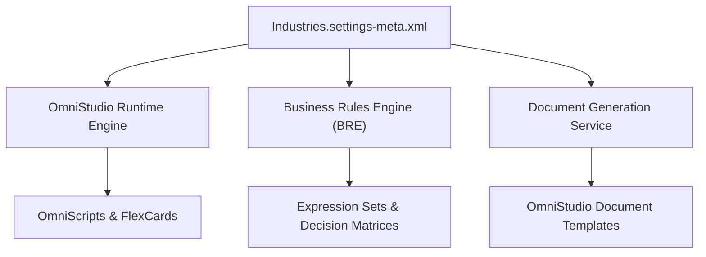

## Architectural Overview

The `IndustriesSettings` metadata type is the master control switch for Salesforce Industry Cloud architectures. Whether building solutions for Health Cloud, Financial Services Cloud, Communications Cloud, or Manufacturing Cloud, `IndustriesSettings` configures the underlying Industry Foundation Services (IFS).

From an architectural perspective, this metadata type enables shared cross-cloud capabilities, such as OmniStudio (OmniScripts, FlexCards, Integration Procedures, and DataRaptors/Data Mappers), Business Rules Engine (BRE), Data Processing Engine (DPE), Document Generation, and Actionable Relationship Center (ARC). Without configuring `IndustriesSettings`, deployment pipelines attempting to push OmniStudio or industry-specific metadata definitions will encounter severe unresolved symbol errors.



## Directory and File Conventions

In Salesforce DX projects, `IndustriesSettings` is defined as a singleton settings file under the `settings` directory:

| Property | Value |
| :--- | :--- |
| **Metadata Type Name** | `Settings` (member: `Industries`) |
| **SFDX Source Folder** | `force-app/main/default/settings/` |
| **File Name** | `Industries.settings-meta.xml` |
| **Packaging / Manifest Type** | `Settings` |

## Key Metadata Fields

The `IndustriesSettings` XML structure contains boolean switches that activate specific Industry Cloud subsystems:

| Field Name | Type | Required | Description |
| :--- | :--- | :--- | :--- |
| `enableIndustriesFeature` | `boolean` | No | Master toggle that enables Industry Foundation capabilities within the organization. |
| `enableOmniStudioMetadata` | `boolean` | No | Enables native OmniStudio metadata types (OmniScript, FlexCard) in the org. |
| `enableBusinessRulesEngine` | `boolean` | No | Activates the core Business Rules Engine for complex declarative logic. |
| `enableDocumentGeneration` | `boolean` | No | Unlocks server-side and client-side OmniStudio document template generation. |

> [!NOTE]
> In recent releases, OmniStudio transitioned from managed package custom objects (`vlocity_cmt__*` or `omnistudio__*`) to standard Core Metadata types. Enabling `enableOmniStudioMetadata` is mandatory when migrating to standard OmniStudio.

## Declarative XML and Package Manifest Examples

### Source XML (`Industries.settings-meta.xml`)

```xml title="force-app/main/default/settings/Industries.settings-meta.xml"
<?xml version="1.0" encoding="UTF-8"?>
<IndustriesSettings xmlns="http://soap.sforce.com/2006/04/metadata">
    <enableIndustriesFeature>true</enableIndustriesFeature>
    <enableOmniStudioMetadata>true</enableOmniStudioMetadata>
    <enableBusinessRulesEngine>true</enableBusinessRulesEngine>
    <enableDocumentGeneration>true</enableDocumentGeneration>
</IndustriesSettings>
```

### Package Manifest (`package.xml`)

```xml title="manifest/package.xml"
<?xml version="1.0" encoding="UTF-8"?>
<Package xmlns="http://soap.sforce.com/2006/04/metadata">
    <types>
        <members>Industries</members>
        <name>Settings</name>
    </types>
    <version>68.0</version>
</Package>
```

## Retrieval and Deployment

To retrieve `IndustriesSettings` via the Salesforce CLI:

```bash
# Retrieve via metadata parameter
sf project retrieve start --metadata Settings:Industries

# Retrieve using manifest
sf project retrieve start --manifest manifest/package.xml
```

To deploy `IndustriesSettings` to a target sandbox:

```bash
# Deploy to designated environment
sf project deploy start \
  --metadata Settings:Industries \
  --target-org uat-sandbox \
  --wait 10
```

## Senior Architect Deployment Best Practices and Gotchas

### Staged CI/CD Pipeline Execution

When building modular enterprise packaging or branch-based deployment pipelines:

1. **Settings Step**: Deploy `Industries.settings-meta.xml` before any OmniStudio or Bre metadata.
2. **Permission Sets**: Assign the `OmniStudioAdmin` or `RulesEngineDesigner` permission set licenses.
3. **Artifact Deployment**: Deploy OmniScripts, FlexCards, Integration Procedures, and Decision Matrices.

> [!WARNING]
> Deploying OmniScripts or Integration Procedures in the same deployment transaction as `Industries.settings-meta.xml` in an unconfigured org often triggers metadata resolution failures because the platform metadata registry activates asynchronously.

### Scratch Org Strategy

For scratch org automation, specify the Industry Cloud features alongside the settings definition in `project-scratch-def.json`:

```json title="config/project-scratch-def.json"
{
  "orgName": "Industry Cloud CI Org",
  "edition": "Enterprise",
  "features": ["IndustriesFoundation", "OmniStudioDesigner"],
  "settings": {
    "industriesSettings": {
      "enableIndustriesFeature": true,
      "enableOmniStudioMetadata": true,
      "enableBusinessRulesEngine": true
    }
  }
}
```

> [!TIP]
> Ensure that any CI/CD runner validating Pull Requests creates scratch orgs using an edition and feature list that matches your production org shape to catch missing Industries settings early.
