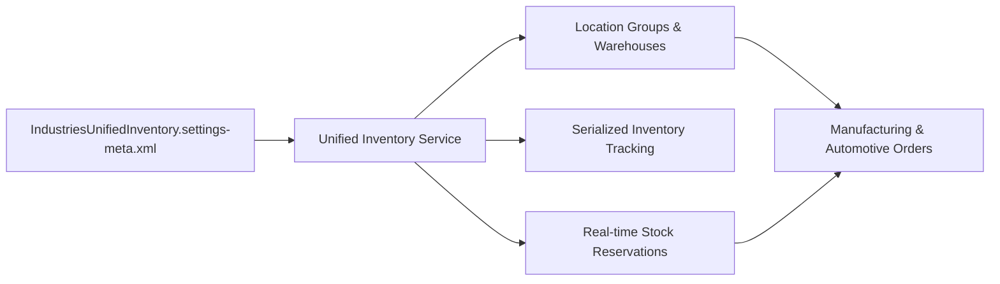

## Architectural Overview

The `IndustriesUnifiedInventorySettings` metadata type controls organization-level parameters for Unified Inventory Management within Salesforce Industry Clouds. In complex vertical ecosystems—such as Manufacturing Cloud, Automotive Cloud, Energy & Utilities Cloud, and Communications Cloud—inventory is distributed across field warehouses, service vehicles, dealer networks, and third-party logistics (3PL) partners.

Architecturally, `IndustriesUnifiedInventorySettings` provides real-time stock reconciliation, location grouping, serialized product tracking, and inventory reservation services. Enabling this metadata type provisions the standard schema and platform events necessary to orchestrate stock reservation across order management and field service fulfillment pipelines.



## Directory and File Conventions

In Salesforce DX source format, this setting is represented as a single XML file within the `settings` directory:

| Property | Value |
| :--- | :--- |
| **Metadata Type Name** | `Settings` (member: `IndustriesUnifiedInventory`) |
| **SFDX Source Folder** | `force-app/main/default/settings/` |
| **File Name** | `IndustriesUnifiedInventory.settings-meta.xml` |
| **Packaging / Manifest Type** | `Settings` |

## Key Metadata Fields

The XML schema for `IndustriesUnifiedInventorySettings` provides configuration options for inventory calculation and reservations:

| Field Name | Type | Required | Description |
| :--- | :--- | :--- | :--- |
| `enableUnifiedInventory` | `boolean` | No | Enables unified multi-location stock tracking across industry cloud objects. |
| `enableRealTimeReservation` | `boolean` | No | Activates real-time inventory reservation APIs for order capture pipelines. |
| `enableSerializedTracking` | `boolean` | No | Enables serial number validation and lifecycle tracking across stock movements. |
| `reservationTimeoutMinutes` | `integer` | No | The expiration window for temporary inventory reservations before stock release. |

> [!NOTE]
> Unified inventory features require appropriate Industry Cloud licensing (e.g., Manufacturing Cloud with Inventory Add-On or Automotive Cloud). Without these licenses, deployments will fail with permission validation errors.

## Declarative XML and Package Manifest Examples

### Source XML (`IndustriesUnifiedInventory.settings-meta.xml`)

```xml title="force-app/main/default/settings/IndustriesUnifiedInventory.settings-meta.xml"
<?xml version="1.0" encoding="UTF-8"?>
<IndustriesUnifiedInventorySettings xmlns="http://soap.sforce.com/2006/04/metadata">
    <enableUnifiedInventory>true</enableUnifiedInventory>
    <enableRealTimeReservation>true</enableRealTimeReservation>
    <enableSerializedTracking>true</enableSerializedTracking>
    <reservationTimeoutMinutes>30</reservationTimeoutMinutes>
</IndustriesUnifiedInventorySettings>
```

### Package Manifest (`package.xml`)

```xml title="manifest/package.xml"
<?xml version="1.0" encoding="UTF-8"?>
<Package xmlns="http://soap.sforce.com/2006/04/metadata">
    <types>
        <members>IndustriesUnifiedInventory</members>
        <name>Settings</name>
    </types>
    <version>68.0</version>
</Package>
```

## Retrieval and Deployment

To retrieve `IndustriesUnifiedInventorySettings` from an org:

```bash
# Retrieve by metadata name
sf project retrieve start --metadata Settings:IndustriesUnifiedInventory

# Retrieve using manifest
sf project retrieve start --manifest manifest/package.xml
```

To deploy `IndustriesUnifiedInventorySettings` to a target environment:

```bash
# Deploy to designated org
sf project deploy start \
  --metadata Settings:IndustriesUnifiedInventory \
  --target-org packaging-org \
  --wait 10
```

## Senior Architect Deployment Best Practices and Gotchas

### Concurrency and Locking Considerations

When configuring `enableRealTimeReservation`, architects must anticipate database locking risks during peak order placement windows. Unified inventory uses optimistic locking and platform events to coordinate stock counts across location groups.

> [!WARNING]
> Ensure custom Apex triggers or Flows on `ProductItem` and `InventoryReservation` do not execute blocking synchronous callouts, which can cause row lock timeouts during bulk reservation events.

### Scratch Org and CI Testing

Include the inventory settings in your scratch org configuration to ensure continuous integration pipelines can validate fulfillment and reservation logic:

```json title="config/project-scratch-def.json"
{
  "orgName": "Manufacturing Unified Inventory Scratch Org",
  "edition": "Enterprise",
  "features": ["ManufacturingCloud", "IndustriesUnifiedInventory"],
  "settings": {
    "industriesUnifiedInventorySettings": {
      "enableUnifiedInventory": true,
      "enableRealTimeReservation": true
    }
  }
}
```

> [!TIP]
> Configure `reservationTimeoutMinutes` to a lower duration in scratch orgs (e.g., 5 minutes) during automated end-to-end testing so expired reservations auto-release quickly between test iterations.
