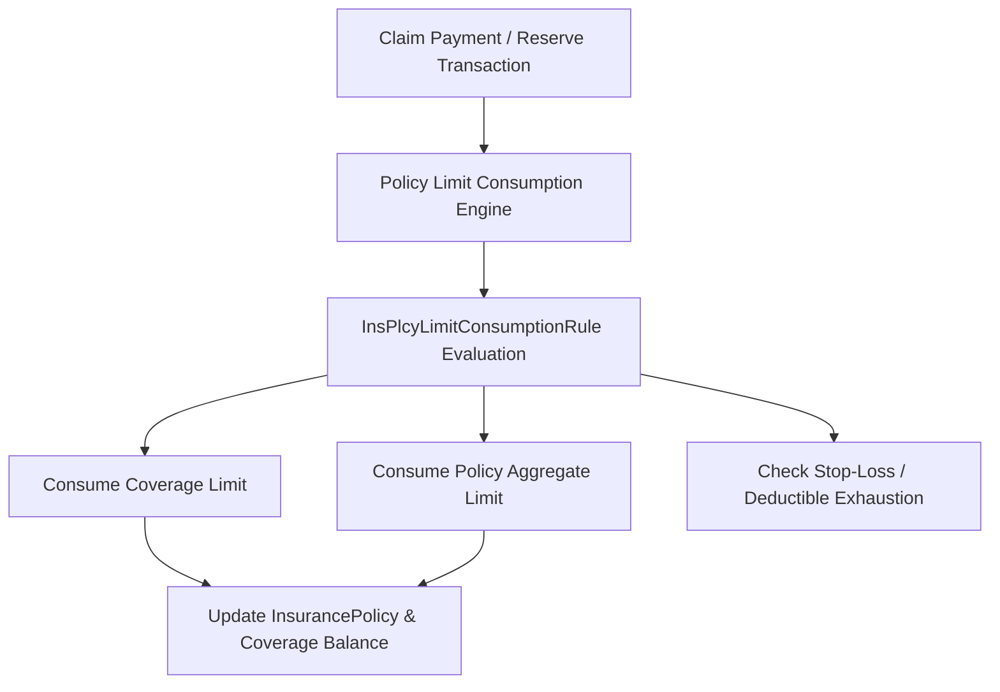

## Architectural Overview

The `InsPlcyLimitConsumptionRule` metadata type governs how insurance policy limits and deductibles are tracked, decremented, and consumed over the lifecycle of a policy term. In Insurance Cloud and Financial Services Cloud (FSC), managing aggregate limits, per-occurrence limits, and shared deductibles across family members or commercial entity hierarchies requires rigorous rule-based execution.

Architecturally, `InsPlcyLimitConsumptionRule` decouples limit calculation logic from procedural code. When claims adjusters approve payments or reserves, the policy limit consumption engine evaluates these metadata rules to determine whether payouts consume coverage-level limits, policy-level aggregate limits, or umbrella terms.



## Directory and File Conventions

In Salesforce DX source format, `InsPlcyLimitConsumptionRule` files are stored in individual XML files within the `insPlcyLimitConsumptionRules` directory:

| Property | Value |
| :--- | :--- |
| **Metadata Type Name** | `InsPlcyLimitConsumptionRule` |
| **SFDX Source Folder** | `force-app/main/default/insPlcyLimitConsumptionRules/` |
| **File Suffix** | `.insPlcyLimitConsumptionRule-meta.xml` |
| **Packaging / Manifest Type** | `InsPlcyLimitConsumptionRule` |

## Key Metadata Fields

The XML schema for `InsPlcyLimitConsumptionRule` includes properties that define the evaluation scope, consumption order, and associated policy fields:

| Field Name | Type | Required | Description |
| :--- | :--- | :--- | :--- |
| `masterLabel` | `string` | Yes | Human-readable label for the consumption rule. |
| `description` | `string` | No | Architectural description of the rule and coverage applicability. |
| `consumptionType` | `string` | Yes | Specifies whether consumption applies to Coverage, Policy Aggregate, or Umbrella. |
| `evaluationOrder` | `integer` | Yes | Sequence order in which multiple rules are evaluated against a claim item. |
| `isActive` | `boolean` | Yes | Indicates whether the rule is actively enforced during claim transaction processing. |
| `policyType` | `string` | No | The insurance line of business (e.g., Commercial Property, Health, Auto Liability). |

> [!NOTE]
> `InsPlcyLimitConsumptionRule` requires Financial Services Cloud Insurance or Insurance Cloud licenses enabled in the target org.

## Declarative XML and Package Manifest Examples

### Source XML (`CommercialPropertyAggLimit.insPlcyLimitConsumptionRule-meta.xml`)

```xml title="force-app/main/default/insPlcyLimitConsumptionRules/CommercialPropertyAggLimit.insPlcyLimitConsumptionRule-meta.xml"
<?xml version="1.0" encoding="UTF-8"?>
<InsPlcyLimitConsumptionRule xmlns="http://soap.sforce.com/2006/04/metadata">
    <masterLabel>Commercial Property Aggregate Limit Rule</masterLabel>
    <description>Consumes aggregate policy limit upon approved property damage claim payment.</description>
    <consumptionType>PolicyAggregate</consumptionType>
    <evaluationOrder>1</evaluationOrder>
    <isActive>true</isActive>
    <policyType>CommercialProperty</policyType>
</InsPlcyLimitConsumptionRule>
```

### Package Manifest (`package.xml`)

```xml title="manifest/package.xml"
<?xml version="1.0" encoding="UTF-8"?>
<Package xmlns="http://soap.sforce.com/2006/04/metadata">
    <types>
        <members>*</members>
        <name>InsPlcyLimitConsumptionRule</name>
    </types>
    <version>68.0</version>
</Package>
```

## Retrieval and Deployment

To retrieve all policy limit consumption rules from an org:

```bash
# Retrieve all rules
sf project retrieve start --metadata InsPlcyLimitConsumptionRule

# Retrieve specific rule
sf project retrieve start --metadata InsPlcyLimitConsumptionRule:CommercialPropertyAggLimit
```

To deploy rules in a CI/CD build pipeline:

```bash
# Deploy to insurance test org
sf project deploy start \
  --metadata InsPlcyLimitConsumptionRule \
  --target-org insurance-uat \
  --wait 10
```

## Senior Architect Deployment Best Practices and Gotchas

### Dependency on Product Model and Policy Schema

Consumption rules reference standard Insurance data model objects (`InsurancePolicy`, `InsurancePolicyCoverage`, `Claim`, `ClaimCoverage`). Ensure that insurance policy features are provisioned and prerequisite custom fields or picklist values on `policyType` are deployed prior to or alongside these rules.

> [!WARNING]
> If a rule specifies a `policyType` picklist value that has not been deployed to the target org's `InsurancePolicy.PolicyType` picklist, deployment of the rule will fail with an invalid picklist value error.

### Evaluation Sequence Integrity

When deploying a bundle of rules, audit `evaluationOrder` numbers across your metadata repository to guarantee deterministic processing:

1. **Per-Claim Deductibles**: Evaluated first (`evaluationOrder: 1`).
2. **Sub-limit Coverages**: Evaluated second (`evaluationOrder: 2`).
3. **Aggregate Policy Limits**: Evaluated third (`evaluationOrder: 3`).
4. **Umbrella & Reinsurance**: Evaluated last (`evaluationOrder: 4`).

> [!TIP]
> Maintain unit test classes that simulate multiple sequential claim transactions to verify that `InsPlcyLimitConsumptionRule` metadata produces the expected aggregate balance decrements without rounding discrepancies.
