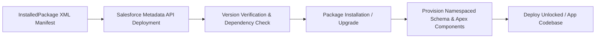

## Architectural Overview

The `InstalledPackage` metadata type represents an installed 1GP (First-Generation Managed Package) or 2GP (Second-Generation Managed Package) within a Salesforce environment. In enterprise architectures, external applications, AppExchange solutions, and modular internal packages (such as common logging frameworks or billing engines) must be installed and upgraded systematically across the environment pipeline.

Architecturally, `InstalledPackage` provides a declarative, version-controlled mechanism to trigger package installations and upgrades via Metadata API deployments. Rather than relying on manual installation URLs, enterprise CI/CD workflows leverage `InstalledPackage` manifests to enforce exact package version alignment between scratch orgs, sandboxes, and production environments.



## Directory and File Conventions

In Salesforce DX source format, `InstalledPackage` files are stored in the `installedPackages` directory with the filename corresponding to the package namespace:

| Property | Value |
| :--- | :--- |
| **Metadata Type Name** | `InstalledPackage` |
| **SFDX Source Folder** | `force-app/main/default/installedPackages/` |
| **File Suffix** | `.installedPackage-meta.xml` |
| **Packaging / Manifest Type** | `InstalledPackage` |

## Key Metadata Fields

The XML definition of `InstalledPackage` defines version parameters and installation behavior:

| Field Name | Type | Required | Description |
| :--- | :--- | :--- | :--- |
| `versionNumber` | `string` | Yes | The major and minor version numbers of the package (e.g., `2.15`). |
| `password` | `string` | No | Installation password if the package author protected the package version. |
| `activateRSS` | `boolean` | No | When true, automatically activates Remote Site Settings bundled with the package. |
| `securityType` | `string` | No | Defines default access level (`AllUsers`, `Custom`, or `FullAccess`). |

> [!NOTE]
> In modern SFDX 2GP workflows, package dependencies are typically declared in `sfdx-project.json` under `dependencies`. However, `InstalledPackage` metadata remains essential when using Metadata API deployments or orchestrating 1GP AppExchange packages in CI/CD pipelines.

## Declarative XML and Package Manifest Examples

### Source XML (`sf_chttr_apps.installedPackage-meta.xml`)

```xml title="force-app/main/default/installedPackages/sf_chttr_apps.installedPackage-meta.xml"
<?xml version="1.0" encoding="UTF-8"?>
<InstalledPackage xmlns="http://soap.sforce.com/2006/04/metadata">
    <versionNumber>1.17</versionNumber>
    <activateRSS>false</activateRSS>
    <securityType>AllUsers</securityType>
</InstalledPackage>
```

### Package Manifest (`package.xml`)

```xml title="manifest/package.xml"
<?xml version="1.0" encoding="UTF-8"?>
<Package xmlns="http://soap.sforce.com/2006/04/metadata">
    <types>
        <members>sf_chttr_apps</members>
        <name>InstalledPackage</name>
    </types>
    <version>68.0</version>
</Package>
```

## Retrieval and Deployment

To retrieve all installed packages from an existing organization:

```bash
# Retrieve all installed packages
sf project retrieve start --metadata InstalledPackage

# Retrieve a specific package by namespace
sf project retrieve start --metadata InstalledPackage:sf_chttr_apps
```

To install or upgrade an installed package via CLI deployment:

```bash
# Deploy InstalledPackage to install in target sandbox
sf project deploy start \
  --metadata InstalledPackage:sf_chttr_apps \
  --target-org uat \
  --wait 20
```

You can also inspect installed packages using SOQL via the Tooling API:

```bash
# Query installed packages via Tooling API
sf data query \
  --query "SELECT Id, SubscriberPackageId, SubscriberPackage.NamespacePrefix, SubscriberPackageVersion.Name, SubscriberPackageVersion.MajorVersion, SubscriberPackageVersion.MinorVersion FROM InstalledSubscriberPackage" \
  --target-org uat \
  --use-tooling-api
```

## Senior Architect Deployment Best Practices and Gotchas

### CI/CD Deployment Sequencing

Managed packages must always be deployed and compiled before deploying any custom code, layouts, or flows that reference namespaced objects (`namespace__CustomField__c`):

1. **Step 1**: Install Managed Packages via `sf package install` or `InstalledPackage` metadata deployment.
2. **Step 2**: Apply Package Licenses and Permission Set Assignments.
3. **Step 3**: Deploy core project source code referencing the package components.

> [!WARNING]
> If custom metadata or Apex classes referencing package components are deployed simultaneously with the `InstalledPackage` file in a single deployment, the deployment will fail because the package installation operates in a separate transactional phase.

### Downgrade Restrictions

Salesforce prohibits downgrading managed package versions in persistent environments (production and sandboxes). If your repository's `InstalledPackage` XML references an older version than what is currently installed in the target org, deployment will fail with a version downgrade error.

> [!TIP]
> For automated scratch org creation, use `sf package install --package <04t_version_id> --wait 15 --no-prompt` in your provisioning shell script, or maintain `sfdx-project.json` package dependencies to let `sf project deploy start` resolve package installation prerequisites automatically.
