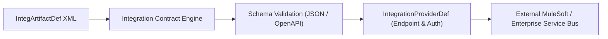

## Architectural Overview

The `IntegArtifactDef` (Integration Artifact Definition) metadata type represents declarative specifications for integration message artifacts, data contract schemas, and API bindings within Salesforce. Used extensively in MuleSoft Direct, Industries Integration Framework, and Event-Driven Architectures, `IntegArtifactDef` establishes typed data contracts between Salesforce and external Enterprise Resource Planning (ERP) or core banking platforms.

Architecturally, `IntegArtifactDef` abstracts the low-level JSON/XML schema definition away from hardcoded Apex models. When an integration procedure, Flow, or Agentforce agent triggers an external system action, the integration runtime validates request and response payloads against the contract defined in `IntegArtifactDef`.



## Directory and File Conventions

In Salesforce DX source format, `IntegArtifactDef` records are maintained as individual XML files in the `integArtifactDefs` directory:

| Property | Value |
| :--- | :--- |
| **Metadata Type Name** | `IntegArtifactDef` |
| **SFDX Source Folder** | `force-app/main/default/integArtifactDefs/` |
| **File Suffix** | `.integArtifactDef-meta.xml` |
| **Packaging / Manifest Type** | `IntegArtifactDef` |

## Key Metadata Fields

The XML schema for `IntegArtifactDef` defines the schema definitions, protocol formats, and provider associations:

| Field Name | Type | Required | Description |
| :--- | :--- | :--- | :--- |
| `masterLabel` | `string` | Yes | Human-readable name for the integration artifact definition. |
| `description` | `string` | No | Architectural description of the payload or API contract. |
| `artifactType` | `string` | Yes | The format or specification type (e.g., `OpenApi`, `JsonSchema`, `Avro`). |
| `integrationProviderDef` | `string` | No | Reference to the associated `IntegrationProviderDef` providing connection endpoints. |
| `schemaDefinition` | `string` | Yes | The contract specification, schema payload, or serializable definition body. |
| `status` | `string` | Yes | Lifecycle status of the artifact definition (`Draft`, `Active`, `Deprecated`). |

> [!NOTE]
> `IntegArtifactDef` is part of Salesforce's modern unified integration layer. Ensure the target org has MuleSoft Direct or Industries Integration Framework enabled.

## Declarative XML and Package Manifest Examples

### Source XML (`BillingSyncArtifact.integArtifactDef-meta.xml`)

```xml title="force-app/main/default/integArtifactDefs/BillingSyncArtifact.integArtifactDef-meta.xml"
<?xml version="1.0" encoding="UTF-8"?>
<IntegArtifactDef xmlns="http://soap.sforce.com/2006/04/metadata">
    <masterLabel>Billing Synchronisation Artifact</masterLabel>
    <description>OpenAPI 3.0 schema definition for SAP Billing sync.</description>
    <artifactType>OpenApi</artifactType>
    <integrationProviderDef>MuleSoftDirectSap</integrationProviderDef>
    <schemaDefinition>{"type":"object","properties":{"invoiceId":{"type":"string"},"amount":{"type":"number"}}}</schemaDefinition>
    <status>Active</status>
</IntegArtifactDef>
```

### Package Manifest (`package.xml`)

```xml title="manifest/package.xml"
<?xml version="1.0" encoding="UTF-8"?>
<Package xmlns="http://soap.sforce.com/2006/04/metadata">
    <types>
        <members>*</members>
        <name>IntegArtifactDef</name>
    </types>
    <version>68.0</version>
</Package>
```

## Retrieval and Deployment

To retrieve integration artifact definitions from an org:

```bash
# Retrieve all integration artifact definitions
sf project retrieve start --metadata IntegArtifactDef

# Retrieve a specific artifact
sf project retrieve start --metadata IntegArtifactDef:BillingSyncArtifact
```

To deploy integration artifact definitions to a target sandbox:

```bash
# Deploy artifact definitions
sf project deploy start \
  --metadata IntegArtifactDef \
  --target-org integration-sandbox \
  --wait 10
```

## Senior Architect Deployment Best Practices and Gotchas

### Dependency Sequencing with Integration Providers

`IntegArtifactDef` references its underlying `IntegrationProviderDef` to bind authentication and network transport. When packaging or deploying, always deploy `IntegrationProviderDef` ahead of or concurrently with `IntegArtifactDef`.

> [!WARNING]
> Deploying an `IntegArtifactDef` that references a non-existent or inactive `IntegrationProviderDef` will result in unresolved relationship validation errors during deployment.

### Schema Escaping in XML Files

The `schemaDefinition` tag frequently contains serialized JSON schemas or OpenAPI strings. Ensure that special XML characters (`<`, `>`, `&`, `"`) within the schema payload are properly escaped or wrapped in standard XML entities to prevent XML parser syntax errors during metadata compilation.

> [!TIP]
> In enterprise continuous delivery, generate `IntegArtifactDef` XML files from source OpenAPI YAML/JSON files using a pre-commit script to keep API specifications in lockstep with enterprise architecture repositories.
