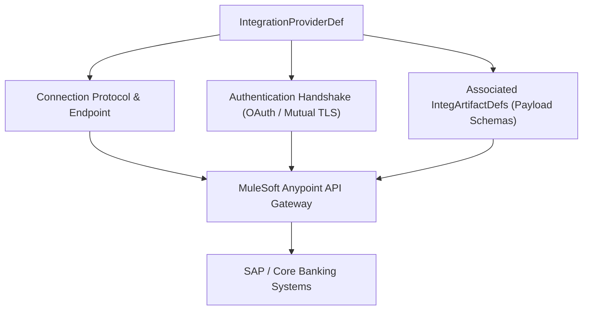

## Architectural Overview

The `IntegrationProviderDef` (Integration Provider Definition) metadata type models external integration connection providers, middleware gateways, and service adapters within Salesforce. In modern enterprise IT environments, Salesforce connects with MuleSoft Anypoint Platform, AWS API Gateways, Microsoft Azure Service Bus, and third-party SaaS platforms to orchestrate mission-critical business transactions.

Architecturally, `IntegrationProviderDef` centralizes the connectivity contract, transport protocol specifications, security handshake mechanisms, and capability metadata for an integration platform. Subordinate metadata types, such as `IntegArtifactDef`, bind to `IntegrationProviderDef` to invoke authenticated APIs without hardcoding endpoints or environment-specific URLs into procedural code.



## Directory and File Conventions

In Salesforce DX source format, `IntegrationProviderDef` files are stored in individual XML documents within the `integrationProviderDefs` directory:

| Property | Value |
| :--- | :--- |
| **Metadata Type Name** | `IntegrationProviderDef` |
| **SFDX Source Folder** | `force-app/main/default/integrationProviderDefs/` |
| **File Suffix** | `.integrationProviderDef-meta.xml` |
| **Packaging / Manifest Type** | `IntegrationProviderDef` |

## Key Metadata Fields

The XML schema for `IntegrationProviderDef` defines service provider properties and adapter connectivity:

| Field Name | Type | Required | Description |
| :--- | :--- | :--- | :--- |
| `masterLabel` | `string` | Yes | Human-readable label for the integration provider. |
| `description` | `string` | No | Architectural description of the provider and target external system. |
| `providerType` | `string` | Yes | The provider type category (e.g., `MuleSoftDirect`, `CustomHttp`, `AwsAppSync`). |
| `serviceEndpoint` | `string` | No | Base URL or URI template for the integration service gateway. |
| `authProvider` | `string` | No | Reference to an `AuthProvider` or authentication credential record. |
| `isActive` | `boolean` | Yes | Toggles whether this integration provider is active for outbound/inbound traffic. |

> [!NOTE]
> `IntegrationProviderDef` serves as the foundation for MuleSoft Direct connectivity in Financial Services Cloud, Health Cloud, and Communications Cloud.

## Declarative XML and Package Manifest Examples

### Source XML (`MuleSoftDirectSap.integrationProviderDef-meta.xml`)

```xml title="force-app/main/default/integrationProviderDefs/MuleSoftDirectSap.integrationProviderDef-meta.xml"
<?xml version="1.0" encoding="UTF-8"?>
<IntegrationProviderDef xmlns="http://soap.sforce.com/2006/04/metadata">
    <masterLabel>MuleSoft Direct SAP Provider</masterLabel>
    <description>MuleSoft Anypoint integration gateway connecting to SAP S/4HANA.</description>
    <providerType>MuleSoftDirect</providerType>
    <serviceEndpoint>https://api.anypoint.mulesoft.com/sap/v1</serviceEndpoint>
    <isActive>true</isActive>
</IntegrationProviderDef>
```

### Package Manifest (`package.xml`)

```xml title="manifest/package.xml"
<?xml version="1.0" encoding="UTF-8"?>
<Package xmlns="http://soap.sforce.com/2006/04/metadata">
    <types>
        <members>*</members>
        <name>IntegrationProviderDef</name>
    </types>
    <version>68.0</version>
</Package>
```

## Retrieval and Deployment

To retrieve integration provider definitions:

```bash
# Retrieve all integration provider definitions
sf project retrieve start --metadata IntegrationProviderDef

# Retrieve specific provider definition
sf project retrieve start --metadata IntegrationProviderDef:MuleSoftDirectSap
```

To deploy integration provider definitions to a sandbox or production org:

```bash
# Deploy to specified target environment
sf project deploy start \
  --metadata IntegrationProviderDef \
  --target-org uat-environment \
  --wait 10
```

## Senior Architect Deployment Best Practices and Gotchas

### Environmental Endpoint Configuration

Integration providers contain endpoints that vary between development, UAT, staging, and production environments. Hardcoding production URLs in Git repository manifests will lead to sandboxes accidentally transmitting requests to production endpoints.

> [!WARNING]
> Use environment substitution in CI/CD pipelines (e.g., GitHub Actions secrets or environment variables) or external Named Credentials references to swap URLs during automated pipeline deployment.

### Circular Dependency Considerations

Ensure deployment pipelines sequence `AuthProvider` and `NamedCredential` metadata before `IntegrationProviderDef`, and `IntegrationProviderDef` before `IntegArtifactDef`.

1. **Phase 1**: `AuthProvider`, `ExternalDataConnector`, Certificates.
2. **Phase 2**: `IntegrationProviderDef`.
3. **Phase 3**: `IntegArtifactDef` and Flow Actions.

> [!TIP]
> Validate integration health in post-deployment automated tests using synthetic transactions against non-production Mock API Gateways to confirm network egress before executing end-to-end integration test suites.
