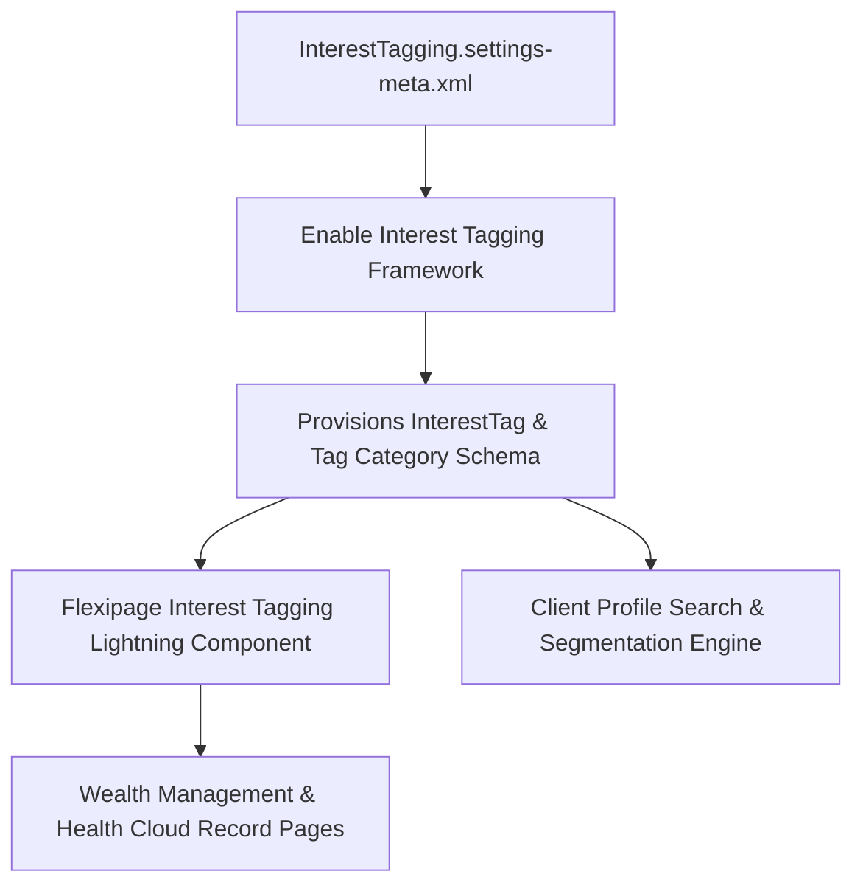

## Architectural Overview

The `InterestTaggingSettings` metadata type controls organization-wide configuration for the Interest Tagging framework in Salesforce Financial Services Cloud (FSC) and Health Cloud. Relationship managers, wealth advisors, and care coordinators require granular mechanisms to capture personal, financial, and lifestyle interests of clients (e.g., Sustainable Investing, Philanthropy, Marathon Running, Estate Planning).

Architecturally, `InterestTaggingSettings` provisions standard schema components—including `InterestTag`, `Topic`, and associated junction objects—enabling structured tag assignment across `Account`, `Contact`, and `PersonAccount` records. Deploying this setting unlocks the Lightning components and tag management services needed to display and search interest tags within Actionable Relationship Center (ARC) and client record pages.



## Directory and File Conventions

In Salesforce DX source format, `InterestTaggingSettings` is defined as a singleton settings XML file within the `settings` directory:

| Property | Value |
| :--- | :--- |
| **Metadata Type Name** | `Settings` (member: `InterestTagging`) |
| **SFDX Source Folder** | `force-app/main/default/settings/` |
| **File Name** | `InterestTagging.settings-meta.xml` |
| **Packaging / Manifest Type** | `Settings` |

## Key Metadata Fields

The XML schema for `InterestTaggingSettings` exposes flags governing tag creation and user interaction:

| Field Name | Type | Required | Description |
| :--- | :--- | :--- | :--- |
| `enableInterestTagging` | `boolean` | No | Master toggle that activates the interest tagging framework across the organization. |
| `enableInterestTagHierarchy` | `boolean` | No | Enables hierarchical category structures for classifying and nesting interest tags. |
| `enableUserCreatedTags` | `boolean` | No | Permits standard end-users to author new tags versus restricting authoring to admins. |

> [!NOTE]
> Interest Tagging requires either Financial Services Cloud or Health Cloud license entitlements. Deploying this setting to a core Sales Cloud org without these licenses will result in deployment failure.

## Declarative XML and Package Manifest Examples

### Source XML (`InterestTagging.settings-meta.xml`)

```xml title="force-app/main/default/settings/InterestTagging.settings-meta.xml"
<?xml version="1.0" encoding="UTF-8"?>
<InterestTaggingSettings xmlns="http://soap.sforce.com/2006/04/metadata">
    <enableInterestTagging>true</enableInterestTagging>
    <enableInterestTagHierarchy>true</enableInterestTagHierarchy>
    <enableUserCreatedTags>false</enableUserCreatedTags>
</InterestTaggingSettings>
```

### Package Manifest (`package.xml`)

```xml title="manifest/package.xml"
<?xml version="1.0" encoding="UTF-8"?>
<Package xmlns="http://soap.sforce.com/2006/04/metadata">
    <types>
        <members>InterestTagging</members>
        <name>Settings</name>
    </types>
    <version>68.0</version>
</Package>
```

## Retrieval and Deployment

To retrieve `InterestTaggingSettings` using the Salesforce CLI:

```bash
# Retrieve interest tagging settings
sf project retrieve start --metadata Settings:InterestTagging

# Retrieve using manifest
sf project retrieve start --manifest manifest/package.xml
```

To deploy `InterestTaggingSettings` to a target environment:

```bash
# Deploy to designated org
sf project deploy start \
  --metadata Settings:InterestTagging \
  --target-org fsc-sandbox \
  --wait 10
```

## Senior Architect Deployment Best Practices and Gotchas

### UI and Page Layout Dependencies

Lightning record pages (`FlexiPage`) incorporating the Interest Tagging component (`runtime_industries_interesttags:interestTags`) will fail validation during deployment if `InterestTagging.settings-meta.xml` is not already enabled in the target environment.

> [!WARNING]
> When executing a full org metadata deployment, ensure `Settings:InterestTagging` is deployed before or alongside `CustomField` and `FlexiPage` definitions to prevent missing component compilation errors.

### Governance on User-Created Tags

In wealth management and healthcare compliance environments, uncontrolled user tag creation can lead to compliance violations regarding sensitive data classification. Keep `enableUserCreatedTags` set to `false` in production settings and manage tag taxonomies via controlled administrative workflows or centralized CSV/Data Cloud data loading.

> [!TIP]
> In scratch org definition files, include `FinancialServicesCloud` under `features` and activate `interestTaggingSettings` in the `settings` block for consistent CI test environments:
>
> ```json
> {
>   "orgName": "FSC Interest Tagging Org",
>   "edition": "Enterprise",
>   "features": ["FinancialServicesCloud"],
>   "settings": {
>     "interestTaggingSettings": {
>       "enableInterestTagging": true
>     }
>   }
> }
> ```
