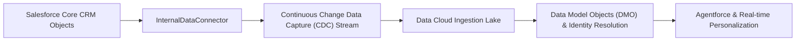

## Architectural Overview

The `InternalDataConnector` metadata type configures internal data integration pipelines between the Salesforce CRM transactional database and Salesforce Data Cloud (formerly Genie / Customer Data Platform). In modern enterprise architectures, real-time customer data unification, identity resolution, and Agentforce autonomous reasoning require continuous data streams from standard and custom CRM entities.

Architecturally, `InternalDataConnector` provisions zero-copy and continuous streaming pipelines directly from the underlying Salesforce core infrastructure into Data Cloud's data lakehouse without requiring external middleware, ETL tools, or API pollers. Configuring this metadata type ensures that source CRM tables (such as `Account`, `Contact`, `Opportunity`, or custom transactional objects) are ingested into Data Model Objects (DMOs) with minimal latency.



## Directory and File Conventions

In Salesforce DX source format, `InternalDataConnector` records are maintained as individual XML files in the `internalDataConnectors` directory:

| Property | Value |
| :--- | :--- |
| **Metadata Type Name** | `InternalDataConnector` |
| **SFDX Source Folder** | `force-app/main/default/internalDataConnectors/` |
| **File Suffix** | `.internalDataConnector-meta.xml` |
| **Packaging / Manifest Type** | `InternalDataConnector` |

## Key Metadata Fields

The XML schema for `InternalDataConnector` configures connector parameters, source objects, and ingestion modes:

| Field Name | Type | Required | Description |
| :--- | :--- | :--- | :--- |
| `masterLabel` | `string` | Yes | Human-readable name for the internal data connector instance. |
| `description` | `string` | No | Architectural description of the connector and streaming scope. |
| `sourceType` | `string` | Yes | Specifies the source origin (e.g., `SalesforceCRM`, `SalesforceMarketing`). |
| `status` | `string` | Yes | State of the connector (`Active`, `Inactive`, `Draft`). |
| `syncMode` | `string` | Yes | Ingestion mode (e.g., `ContinuousStreaming`, `IncrementalSync`, `FullRefresh`). |

> [!NOTE]
> `InternalDataConnector` requires an active Salesforce Data Cloud license and provisioned Data Cloud instance connected to the Salesforce CRM tenant.

## Declarative XML and Package Manifest Examples

### Source XML (`SalesforceCrmConnector.internalDataConnector-meta.xml`)

```xml title="force-app/main/default/internalDataConnectors/SalesforceCrmConnector.internalDataConnector-meta.xml"
<?xml version="1.0" encoding="UTF-8"?>
<InternalDataConnector xmlns="http://soap.sforce.com/2006/04/metadata">
    <masterLabel>Core CRM Ingestion Connector</masterLabel>
    <description>Streams core CRM Account and Contact events directly to Data Cloud lakehouse.</description>
    <sourceType>SalesforceCRM</sourceType>
    <status>Active</status>
    <syncMode>ContinuousStreaming</syncMode>
</InternalDataConnector>
```

### Package Manifest (`package.xml`)

```xml title="manifest/package.xml"
<?xml version="1.0" encoding="UTF-8"?>
<Package xmlns="http://soap.sforce.com/2006/04/metadata">
    <types>
        <members>*</members>
        <name>InternalDataConnector</name>
    </types>
    <version>68.0</version>
</Package>
```

## Retrieval and Deployment

To retrieve all internal data connectors:

```bash
# Retrieve all internal data connectors
sf project retrieve start --metadata InternalDataConnector

# Retrieve a specific connector
sf project retrieve start --metadata InternalDataConnector:SalesforceCrmConnector
```

To deploy the connector to a Data Cloud enabled environment:

```bash
# Deploy to designated org
sf project deploy start \
  --metadata InternalDataConnector \
  --target-org data-cloud-prod \
  --wait 10
```

## Senior Architect Deployment Best Practices and Gotchas

### Data Cloud Ingestion Dependencies

Deploying `InternalDataConnector` must be coordinated with Data Cloud Data Stream definitions and Data Model Object (DMO) mappings. If downstream Data Streams reference objects or fields that are restricted by Field-Level Security (FLS) for the Data Cloud Integration User, stream creation will fail.

> [!WARNING]
> Ensure the `Data Cloud Salesforce Connector` integration user profile or permission set has read permissions on all objects and fields mapped through the connector.

### Sandbox Masking and Tenant Isolation

When deploying `InternalDataConnector` metadata into sandboxes refreshed from production, verify that the connector points to the sandbox's dedicated Data Cloud instance rather than an existing production Data Cloud tenant.

> [!TIP]
> Use post-sandbox refresh scripts to validate that `InternalDataConnector` connections are scoped strictly to the refreshed sandbox CRM instance to safeguard production data lakes against test data contamination.
