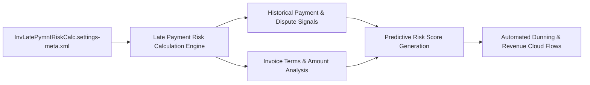

## Architectural Overview

The `InvLatePymntRiskCalcSettings` (Invoice Late Payment Risk Calculation Settings) metadata type manages configuration parameters for predictive payment scoring and automated cash flow risk models in Salesforce Revenue Cloud and Salesforce Billing. In enterprise financial architectures, uncollected accounts receivable degrade working capital and impair operational planning.

Architecturally, `InvLatePymntRiskCalcSettings` activates machine learning pipelines and statistical scoring algorithms that evaluate historical customer payment tendencies, dispute frequencies, macroeconomic indicators, and invoice amounts. The engine computes risk probability scores directly on standard `Invoice` records, allowing finance teams to trigger proactive dunning workflows and automated collection actions before invoices become delinquent.



## Directory and File Conventions

In Salesforce DX source format, this setting is represented as a singleton settings XML file located in the `settings` directory:

| Property | Value |
| :--- | :--- |
| **Metadata Type Name** | `Settings` (member: `InvLatePymntRiskCalc`) |
| **SFDX Source Folder** | `force-app/main/default/settings/` |
| **File Name** | `InvLatePymntRiskCalc.settings-meta.xml` |
| **Packaging / Manifest Type** | `Settings` |

## Key Metadata Fields

The XML definition of `InvLatePymntRiskCalcSettings` includes flags and scoring thresholds for automated calculation:

| Field Name | Type | Required | Description |
| :--- | :--- | :--- | :--- |
| `enableLatePaymentRiskCalc` | `boolean` | No | Master toggle that enables automated invoice late payment risk calculations. |
| `enableModelRetraining` | `boolean` | No | Activates periodic automated retraining of the predictive scoring model based on new billing history. |
| `riskThresholdHigh` | `integer` | No | Score threshold (e.g., 75-100) that marks an invoice as high probability of late payment. |
| `calculationFrequency` | `string` | No | Execution schedule for risk scoring (e.g., `Daily`, `OnInvoiceCreation`). |

> [!NOTE]
> This setting requires Salesforce Billing or Revenue Cloud licensing. Enabling it in an org without billing entitlements will trigger deployment failure.

## Declarative XML and Package Manifest Examples

### Source XML (`InvLatePymntRiskCalc.settings-meta.xml`)

```xml title="force-app/main/default/settings/InvLatePymntRiskCalc.settings-meta.xml"
<?xml version="1.0" encoding="UTF-8"?>
<InvLatePymntRiskCalcSettings xmlns="http://soap.sforce.com/2006/04/metadata">
    <enableLatePaymentRiskCalc>true</enableLatePaymentRiskCalc>
    <enableModelRetraining>true</enableModelRetraining>
    <riskThresholdHigh>75</riskThresholdHigh>
    <calculationFrequency>Daily</calculationFrequency>
</InvLatePymntRiskCalcSettings>
```

### Package Manifest (`package.xml`)

```xml title="manifest/package.xml"
<?xml version="1.0" encoding="UTF-8"?>
<Package xmlns="http://soap.sforce.com/2006/04/metadata">
    <types>
        <members>InvLatePymntRiskCalc</members>
        <name>Settings</name>
    </types>
    <version>68.0</version>
</Package>
```

## Retrieval and Deployment

To retrieve `InvLatePymntRiskCalcSettings` using the Salesforce CLI:

```bash
# Retrieve settings directly
sf project retrieve start --metadata Settings:InvLatePymntRiskCalc

# Retrieve using manifest
sf project retrieve start --manifest manifest/package.xml
```

To deploy `InvLatePymntRiskCalcSettings` to a target environment:

```bash
# Deploy to billing sandbox
sf project deploy start \
  --metadata Settings:InvLatePymntRiskCalc \
  --target-org billing-sandbox \
  --wait 10
```

## Senior Architect Deployment Best Practices and Gotchas

### Downstream Flow and Automation Dependencies

Automated dunning flows and collection tasks often evaluate the risk score output generated by this engine. Deploying collection flows before `InvLatePymntRiskCalc.settings-meta.xml` is active can cause runtime exceptions if invoice risk score fields are unpopulated or calculation triggers are disabled.

> [!WARNING]
> Always deploy `Settings:InvLatePymntRiskCalc` before deploying billing triggers, Apex controllers, or Flows that evaluate late payment risk scores.

### Scratch Org and CI Test Suites

When preparing scratch org definition files for billing and revenue management test automation, configure the settings block accordingly:

```json title="config/project-scratch-def.json"
{
  "orgName": "Revenue Cloud Billing Test Org",
  "edition": "Enterprise",
  "features": ["RevenueCloud", "SalesforceBilling"],
  "settings": {
    "invLatePymntRiskCalcSettings": {
      "enableLatePaymentRiskCalc": true,
      "riskThresholdHigh": 75
    }
  }
}
```

> [!TIP]
> In testing environments where invoice data is synthetically populated, ensure unit test factories populate payment dates and dispute statuses across account history so the calculation model can generate non-zero risk score distributions.
