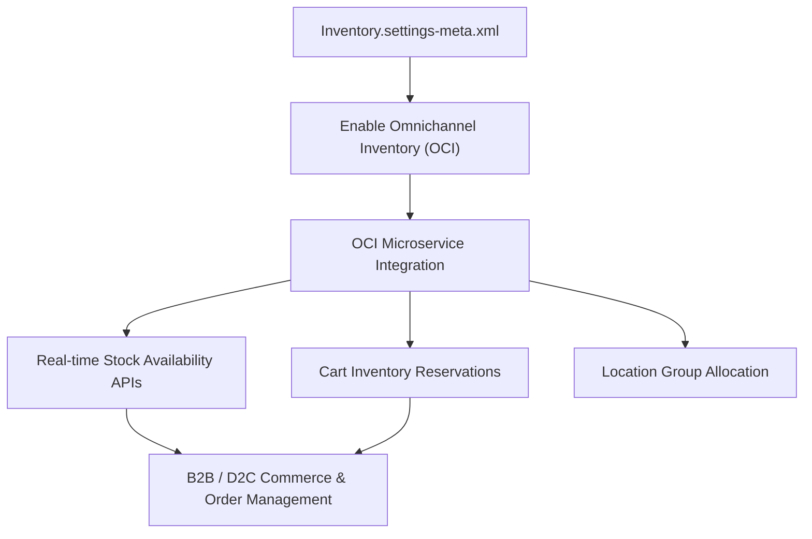

## Architectural Overview

The `InventorySettings` metadata type represents organization-wide settings for Omnichannel Inventory (OCI) and Salesforce B2B/D2C Commerce. In modern unified commerce architectures, inventory availability must be computed instantaneously across fulfillment centers, retail stores, and third-party dropshippers while shoppers add items to digital shopping carts.

Architecturally, `InventorySettings` switches the organization between basic single-location stock counters and high-scale Omnichannel Inventory microservices. Enabling this metadata activates real-time reservation APIs, location group aggregations, safety stock buffers, and asynchronous inventory sync engines that power Salesforce Order Management (SOM) routing.



## Directory and File Conventions

In Salesforce DX source format, `InventorySettings` is stored as a single XML file in the `settings` directory:

| Property | Value |
| :--- | :--- |
| **Metadata Type Name** | `Settings` (member: `Inventory`) |
| **SFDX Source Folder** | `force-app/main/default/settings/` |
| **File Name** | `Inventory.settings-meta.xml` |
| **Packaging / Manifest Type** | `Settings` |

## Key Metadata Fields

The XML schema for `InventorySettings` contains configuration parameters for inventory availability and reservation durations:

| Field Name | Type | Required | Description |
| :--- | :--- | :--- | :--- |
| `enableOmnichannelInventory` | `boolean` | No | Enables the Omnichannel Inventory microservice engine for scalable stock counts. |
| `enableInventoryReservation` | `boolean` | No | Allows checkout flows to place temporary holds on stock before payment capture. |
| `defaultReservationDuration` | `integer` | No | The default lifetime (in minutes) of an unfulfilled shopping cart stock reservation. |
| `enableLocationGrouping` | `boolean` | No | Permits aggregating individual warehouses into regional fulfillment location groups. |

> [!NOTE]
> Omnichannel Inventory requires an active Salesforce Commerce or Salesforce Order Management license. Deploying this setting to an unlicensed core org triggers `FeatureNotEnabled` faults.

## Declarative XML and Package Manifest Examples

### Source XML (`Inventory.settings-meta.xml`)

```xml title="force-app/main/default/settings/Inventory.settings-meta.xml"
<?xml version="1.0" encoding="UTF-8"?>
<InventorySettings xmlns="http://soap.sforce.com/2006/04/metadata">
    <enableOmnichannelInventory>true</enableOmnichannelInventory>
    <enableInventoryReservation>true</enableInventoryReservation>
    <defaultReservationDuration>15</defaultReservationDuration>
    <enableLocationGrouping>true</enableLocationGrouping>
</InventorySettings>
```

### Package Manifest (`package.xml`)

```xml title="manifest/package.xml"
<?xml version="1.0" encoding="UTF-8"?>
<Package xmlns="http://soap.sforce.com/2006/04/metadata">
    <types>
        <members>Inventory</members>
        <name>Settings</name>
    </types>
    <version>68.0</version>
</Package>
```

## Retrieval and Deployment

To retrieve `InventorySettings` using the Salesforce CLI:

```bash
# Retrieve settings directly
sf project retrieve start --metadata Settings:Inventory

# Retrieve using manifest
sf project retrieve start --manifest manifest/package.xml
```

To deploy `InventorySettings` to a target environment:

```bash
# Deploy to commerce target org
sf project deploy start \
  --metadata Settings:Inventory \
  --target-org commerce-sandbox \
  --wait 10
```

## Senior Architect Deployment Best Practices and Gotchas

### Order Management Routing Sequencing

Salesforce Order Management routing flows rely heavily on Omnichannel Inventory actions (such as `Find Routes with Fewest Splits` or `Ensure Inventory Availability`). Deploying these Flow definitions prior to deploying `Inventory.settings-meta.xml` will fail with missing action definition errors.

> [!WARNING]
> Always enforce deployment order in CI/CD pipelines: deploy `Settings:Inventory` first, followed by Location and LocationGroup records, and finally Commerce Checkout Flows and Order Management routing rules.

### Scratch Org Provisioning for Commerce Tests

When configuring scratch orgs for commerce test suites, specify Omnichannel Inventory features in your scratch org definition file:

```json title="config/project-scratch-def.json"
{
  "orgName": "Omnichannel Inventory Dev Org",
  "edition": "Enterprise",
  "features": ["B2BCommerce", "OmnichannelInventory"],
  "settings": {
    "inventorySettings": {
      "enableOmnichannelInventory": true,
      "enableInventoryReservation": true,
      "defaultReservationDuration": 15
    }
  }
}
```

> [!TIP]
> Keep `defaultReservationDuration` synchronized with your digital storefront session timeout (typically 15 to 30 minutes) to avoid releasing inventory while a shopper is actively completing credit card payment processing.
