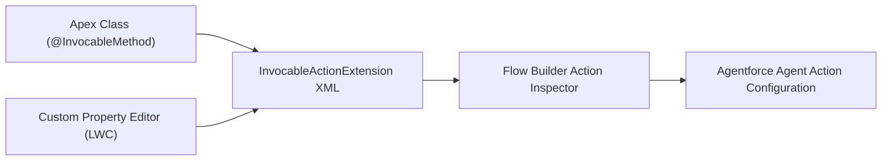

## Architectural Overview

The `InvocableActionExtension` metadata type enables developers and enterprise architects to author rich, customized configuration experiences for Invocable Actions within Flow Builder and Agentforce agent workflows. While standard invocable Apex methods provide basic parameter entry boxes, enterprise integrations often require dynamic dropdowns, dependent field selection, real-time external schema inspection, or graphical wizards.

Architecturally, `InvocableActionExtension` creates a declarative bridge between an `@InvocableMethod` Apex class and a custom property editor (CPE) Lightning Web Component (LWC). When an administrator configures the action inside Flow Builder, the platform loads the registered extension LWC, allowing dynamic client-side validation and rich parameter rendering.



## Directory and File Conventions

In Salesforce DX source format, `InvocableActionExtension` files are organized in the `invocableActionExtensions` directory:

| Property | Value |
| :--- | :--- |
| **Metadata Type Name** | `InvocableActionExtension` |
| **SFDX Source Folder** | `force-app/main/default/invocableActionExtensions/` |
| **File Suffix** | `.invocableActionExtension-meta.xml` |
| **Packaging / Manifest Type** | `InvocableActionExtension` |

## Key Metadata Fields

The XML schema for `InvocableActionExtension` declares the targeted action, the extension component, and descriptive metadata:

| Field Name | Type | Required | Description |
| :--- | :--- | :--- | :--- |
| `masterLabel` | `string` | Yes | Display label for the extension component in builder tooling. |
| `description` | `string` | No | Architectural description of the extension and UI behavior. |
| `actionName` | `string` | Yes | The API name of the target invocable action or Apex class name. |
| `actionType` | `string` | Yes | The type of action (e.g., `Apex`, `ExternalService`, `StandardAction`). |
| `extensionComponent` | `string` | Yes | The Lightning Web Component name used as the Custom Property Editor. |
| `isActive` | `boolean` | Yes | Indicates whether this extension is active and surfaced in builder tools. |

> [!NOTE]
> Custom property editor LWCs referenced in `extensionComponent` must implement standard builder custom property editor events (`configuration_editor_input`).

## Declarative XML and Package Manifest Examples

### Source XML (`SapPaymentActionExt.invocableActionExtension-meta.xml`)

```xml title="force-app/main/default/invocableActionExtensions/SapPaymentActionExt.invocableActionExtension-meta.xml"
<?xml version="1.0" encoding="UTF-8"?>
<InvocableActionExtension xmlns="http://soap.sforce.com/2006/04/metadata">
    <masterLabel>SAP Payment Invocable Action Extension</masterLabel>
    <description>Provides custom property editor LWC for SAP invoice payment action.</description>
    <actionName>SapPaymentProcessor</actionName>
    <actionType>Apex</actionType>
    <extensionComponent>c/sapPaymentPropertyEditor</extensionComponent>
    <isActive>true</isActive>
</InvocableActionExtension>
```

### Package Manifest (`package.xml`)

```xml title="manifest/package.xml"
<?xml version="1.0" encoding="UTF-8"?>
<Package xmlns="http://soap.sforce.com/2006/04/metadata">
    <types>
        <members>*</members>
        <name>InvocableActionExtension</name>
    </types>
    <version>68.0</version>
</Package>
```

## Retrieval and Deployment

To retrieve invocable action extensions from your org:

```bash
# Retrieve all invocable action extensions
sf project retrieve start --metadata InvocableActionExtension

# Retrieve specific extension
sf project retrieve start --metadata InvocableActionExtension:SapPaymentActionExt
```

To deploy the extension alongside its Apex and LWC dependencies:

```bash
# Deploy extension bundle to target org
sf project deploy start \
  --metadata InvocableActionExtension,ApexClass:SapPaymentProcessor,LightningComponentBundle:sapPaymentPropertyEditor \
  --target-org uat-org \
  --wait 10
```

## Senior Architect Deployment Best Practices and Gotchas

### Dependency Triad Sequencing

An `InvocableActionExtension` relies directly on both an Apex class (`ApexClass`) and a Lightning Web Component (`LightningComponentBundle`). Attempting to deploy the extension without its underlying Apex class or LWC will trigger validation failures during deployment:

1. **Prerequisite 1**: The Apex class annotated with `@InvocableMethod` must exist or be deployed in the same transaction.
2. **Prerequisite 2**: The LWC custom property editor bundle must exist or be deployed in the same transaction.

> [!WARNING]
> If the `actionName` does not match an active invocable Apex method or external service action in the target org, metadata deployment will fail with an invalid action target error.

### LWC Property Editor Best Practices

Ensure the custom property editor LWC is tagged with the appropriate targets in its `js-meta.xml`:

```xml
<targets>
    <target>lightning__FlowScreen</target>
</targets>
```

> [!TIP]
> Package the Apex action, LWC property editor, and `InvocableActionExtension` into a single unlocked package module to ensure atomic versioning and eliminate mismatched parameter bugs in production.
