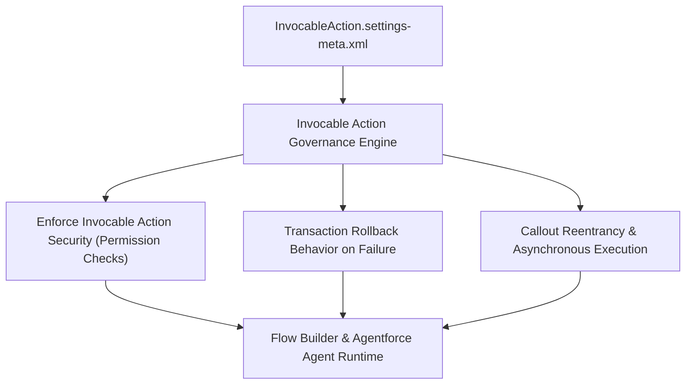

## Architectural Overview

The `InvocableActionSettings` metadata type represents organization-level configuration for Invocable Action execution, transaction governance, and security enforcement across Salesforce Flow, Process Automation, and Agentforce. When Flows invoke external services, custom Apex code, or standard platform actions, the runtime behavior is governed by policies defined in this setting.

Architecturally, `InvocableActionSettings` enables enterprise architects to enforce granular security on Apex invocable methods. Traditionally, any user who could execute a Flow could invoke any underlying Apex class called by that Flow. With invocable action security enabled, the platform requires explicit class-level access granted through Profiles or Permission Sets.



## Directory and File Conventions

In Salesforce DX source format, `InvocableActionSettings` is stored as a singleton settings XML file within the `settings` directory:

| Property | Value |
| :--- | :--- |
| **Metadata Type Name** | `Settings` (member: `InvocableAction`) |
| **SFDX Source Folder** | `force-app/main/default/settings/` |
| **File Name** | `InvocableAction.settings-meta.xml` |
| **Packaging / Manifest Type** | `Settings` |

## Key Metadata Fields

The XML schema for `InvocableActionSettings` controls security enforcement and transaction management:

| Field Name | Type | Required | Description |
| :--- | :--- | :--- | :--- |
| `isCalloutInvocableActionEnabled` | `boolean` | No | Allows invocable actions to execute HTTP callouts directly within transactional flow contexts. |
| `enableInvocableActionSecurity` | `boolean` | No | Restricts execution of Apex invocable methods to users with explicit class access. |
| `enablePartialRollbackOnError` | `boolean` | No | Governs whether batch invocations rollback failed records individually or the entire batch. |

> [!NOTE]
> Enabling `enableInvocableActionSecurity` is a critical security hardening step. However, it can disrupt running flows if existing users lack explicit permission set assignments to the underlying invocable Apex classes.

## Declarative XML and Package Manifest Examples

### Source XML (`InvocableAction.settings-meta.xml`)

```xml title="force-app/main/default/settings/InvocableAction.settings-meta.xml"
<?xml version="1.0" encoding="UTF-8"?>
<InvocableActionSettings xmlns="http://soap.sforce.com/2006/04/metadata">
    <isCalloutInvocableActionEnabled>true</isCalloutInvocableActionEnabled>
    <enableInvocableActionSecurity>true</enableInvocableActionSecurity>
    <enablePartialRollbackOnError>true</enablePartialRollbackOnError>
</InvocableActionSettings>
```

### Package Manifest (`package.xml`)

```xml title="manifest/package.xml"
<?xml version="1.0" encoding="UTF-8"?>
<Package xmlns="http://soap.sforce.com/2006/04/metadata">
    <types>
        <members>InvocableAction</members>
        <name>Settings</name>
    </types>
    <version>68.0</version>
</Package>
```

## Retrieval and Deployment

To retrieve `InvocableActionSettings` via the Salesforce CLI:

```bash
# Retrieve settings directly
sf project retrieve start --metadata Settings:InvocableAction

# Retrieve using manifest
sf project retrieve start --manifest manifest/package.xml
```

To deploy `InvocableActionSettings` to a target sandbox:

```bash
# Deploy to designated org
sf project deploy start \
  --metadata Settings:InvocableAction \
  --target-org uat-sandbox \
  --wait 10
```

## Senior Architect Deployment Best Practices and Gotchas

### Impact of Enabling Invocable Action Security

When flipping `enableInvocableActionSecurity` from `false` to `true` in production:

1. **Permission Audit**: Identify every Apex class with `@InvocableMethod`.
2. **Permission Sets**: Ensure those Apex classes are granted in Permission Sets assigned to standard users who run Flows or Agentforce agents.
3. **Execution Verification**: Test screen flows and record-triggered flows under non-admin personas before deploying the setting to production.

> [!WARNING]
> Deploying `enableInvocableActionSecurity = true` without pre-deploying Apex class permissions in Permission Sets will immediately cause `CANNOT_EXECUTE_FLOW_TRIGGER` or security exception faults for end-users running flows.

### Scratch Org Settings Alignment

Ensure CI/CD test orgs emulate production security posture by including the setting in `project-scratch-def.json`:

```json title="config/project-scratch-def.json"
{
  "orgName": "Invocable Action CI Org",
  "edition": "Enterprise",
  "settings": {
    "invocableActionSettings": {
      "enableInvocableActionSecurity": true,
      "isCalloutInvocableActionEnabled": true
    }
  }
}
```

> [!TIP]
> Group Apex class access in task-based Permission Sets (e.g., `Payment_Processing_Invocables`) to ensure clean deployment alongside the corresponding Flows and settings.
