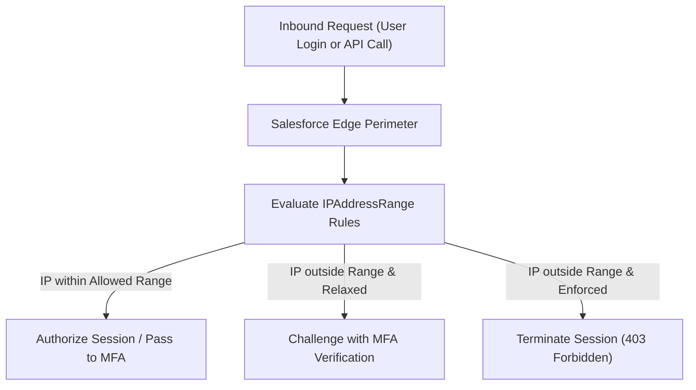

## Architectural Overview

The `IPAddressRange` metadata type defines trusted network perimeters, IP whitelist boundaries, and login IP address restrictions within the Salesforce platform. In enterprise zero-trust architectures and corporate security governance, restricting access to corporate Virtual Private Networks (VPNs), secure office gateways, and continuous integration (CI/CD) runners prevents credential theft and brute-force intrusion attacks.

Architecturally, `IPAddressRange` is used in multiple platform contexts: org-wide Network Access (`SecuritySettings`), Profile and Permission Set Login IP Ranges (`Profile`, `PermissionSet`), Connected App IP relaxation policies (`ConnectedApp`), and Experience Cloud Community access controls (`Network`). When an inbound API or interactive user requests a session, the platform security filter validates the client IP address against these configured ranges.



## Directory and File Conventions

`IPAddressRange` is typically deployed either as a component nested inside parent metadata files (such as `SecuritySettings` or `ConnectedApp`) or as an independent metadata representation depending on the API target:

| Property | Value |
| :--- | :--- |
| **Metadata Type Name** | `IPAddressRange` |
| **Parent Metadata Contexts** | `SecuritySettings`, `ConnectedApp`, `Network` |
| **SFDX Storage Folder** | `force-app/main/default/settings/` or `connectedApps/` |
| **Packaging / Manifest Type** | `SecuritySettings` or `ConnectedApp` |

## Key Metadata Fields

The XML schema for `IPAddressRange` defines the start and end IP boundaries and administrative documentation:

| Field Name | Type | Required | Description |
| :--- | :--- | :--- | :--- |
| `startAddress` | `string` | Yes | The beginning IPv4 or IPv6 address of the trusted network block. |
| `endAddress` | `string` | Yes | The ending IPv4 or IPv6 address of the trusted network block. |
| `description` | `string` | No | Architectural description of the IP range (e.g., Corporate London Gateway). |

> [!NOTE]
> When defining a single IP address (rather than a range), set both `startAddress` and `endAddress` to the exact same IP string.

## Declarative XML and Package Manifest Examples

### Embedded in SecuritySettings (`Security.settings-meta.xml`)

```xml title="force-app/main/default/settings/Security.settings-meta.xml"
<?xml version="1.0" encoding="UTF-8"?>
<SecuritySettings xmlns="http://soap.sforce.com/2006/04/metadata">
    <networkAccess>
        <ipRanges>
            <description>Corporate Primary Egress VPN</description>
            <startAddress>198.51.100.1</startAddress>
            <endAddress>198.51.100.254</endAddress>
        </ipRanges>
        <ipRanges>
            <description>CI/CD Build Runner Dedicated Elastic IP</description>
            <startAddress>203.0.113.45</startAddress>
            <endAddress>203.0.113.45</endAddress>
        </ipRanges>
    </networkAccess>
</SecuritySettings>
```

### Embedded in ConnectedApp (`DataIntegrationApp.connectedApp-meta.xml`)

```xml title="force-app/main/default/connectedApps/DataIntegrationApp.connectedApp-meta.xml"
<?xml version="1.0" encoding="UTF-8"?>
<ConnectedApp xmlns="http://soap.sforce.com/2006/04/metadata">
    <label>Data Integration App</label>
    <oauthConfig>
        <callbackUrl>https://integration.company.com/oauth/callback</callbackUrl>
        <consumerKey>3MVG9lKcPeChIK5...</consumerKey>
        <scopes>Api</scopes>
    </oauthConfig>
    <ipRanges>
        <description>Integration Gateway Whitelist</description>
        <startAddress>192.0.2.10</startAddress>
        <endAddress>192.0.2.20</endAddress>
    </ipRanges>
</ConnectedApp>
```

### Package Manifest (`package.xml`)

```xml title="manifest/package.xml"
<?xml version="1.0" encoding="UTF-8"?>
<Package xmlns="http://soap.sforce.com/2006/04/metadata">
    <types>
        <members>Security</members>
        <name>Settings</name>
    </types>
    <version>68.0</version>
</Package>
```

## Retrieval and Deployment

To retrieve network access and IP ranges from your organization:

```bash
# Retrieve SecuritySettings containing networkAccess IP ranges
sf project retrieve start --metadata Settings:Security

# Retrieve ConnectedApp with associated IP ranges
sf project retrieve start --metadata ConnectedApp:DataIntegrationApp
```

To deploy IP ranges across your staging environments:

```bash
# Deploy security settings to target org
sf project deploy start \
  --metadata Settings:Security \
  --target-org production \
  --wait 10
```

## Senior Architect Deployment Best Practices and Gotchas

### Preventing Accidental CI/CD Lockouts

A frequent catastrophe in automated deployments occurs when `Security.settings-meta.xml` is deployed to production without including the IP address of the deployment pipeline's build server (e.g., GitHub Actions, Azure DevOps, Jenkins).

> [!WARNING]
> If your CI/CD runner operates from dynamic cloud IP pools without static egress proxies, deploying strict IP login ranges will lock out the build agent mid-deployment. Always reserve static egress CIDR blocks for build agents before enforcing IP ranges.

### Production Parity and VPN Alignment

Do not hardcode developer home IP addresses into version-controlled `Security.settings-meta.xml` files. All remote engineers should route through corporate VPN egress pools with static addresses declared in version control.

> [!TIP]
> Periodically audit obsolete IP ranges using SOQL queries against `LoginHistory` to identify ranges that have experienced zero authentication traffic over 180 days.
