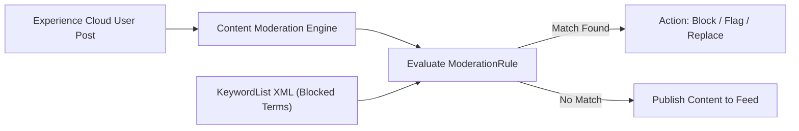

## Architectural Overview

The `KeywordList` metadata type defines dictionaries of keywords, terms, profanities, and sensitive expressions used by Experience Cloud (formerly Salesforce Communities) moderation rules. In public-facing customer service portals, partner portals, and member forums, organizations must enforce brand safety, regulatory compliance, and community standards.

Architecturally, `KeywordList` acts as a lookup dictionary for `ModerationRule` metadata. When an external portal user authors a post, question, comment, or direct message, the Salesforce Community moderation engine inspects the content against the active `KeywordList`. Depending on the configured rule action, the system can automatically block the submission, replace offensive terms with asterisks, flag the post for moderator review, or freeze the offending user.



## Directory and File Conventions

In Salesforce DX source format, `KeywordList` metadata is stored in individual XML files within the `keywordLists` directory:

| Property | Value |
| :--- | :--- |
| **Metadata Type Name** | `KeywordList` |
| **SFDX Source Folder** | `force-app/main/default/keywordLists/` |
| **File Suffix** | `.keywords-meta.xml` |
| **Packaging / Manifest Type** | `KeywordList` |

## Key Metadata Fields

The XML schema for `KeywordList` contains the list label, description, and an array of individual keyword strings:

| Field Name | Type | Required | Description |
| :--- | :--- | :--- | :--- |
| `masterLabel` | `string` | Yes | Human-readable name for the keyword list in community administration. |
| `description` | `string` | No | Architectural description of the keyword collection. |
| `keywords` | `Keyword[]` | Yes | Array of terms, phrases, or regular expressions to be filtered. |
| `keywords.keyword` | `string` | Yes | Individual word or phrase targeted for moderation. |

> [!NOTE]
> Digital Experiences (Communities) must be enabled in the target org before `KeywordList` metadata can be deployed.

## Declarative XML and Package Manifest Examples

### Source XML (`BannedTerms.keywords-meta.xml`)

```xml title="force-app/main/default/keywordLists/BannedTerms.keywords-meta.xml"
<?xml version="1.0" encoding="UTF-8"?>
<KeywordList xmlns="http://soap.sforce.com/2006/04/metadata">
    <masterLabel>Banned Terms & Competitor Names</masterLabel>
    <description>Terms prohibited in customer community posts and public discussion forums.</description>
    <keywords>
        <keyword>CompetitorCorp</keyword>
    </keywords>
    <keywords>
        <keyword>UnapprovedCryptoOffer</keyword>
    </keywords>
    <keywords>
        <keyword>SpamDomainName</keyword>
    </keywords>
</KeywordList>
```

### Package Manifest (`package.xml`)

```xml title="manifest/package.xml"
<?xml version="1.0" encoding="UTF-8"?>
<Package xmlns="http://soap.sforce.com/2006/04/metadata">
    <types>
        <members>*</members>
        <name>KeywordList</name>
    </types>
    <version>68.0</version>
</Package>
```

## Retrieval and Deployment

To retrieve keyword lists from an org:

```bash
# Retrieve all keyword lists
sf project retrieve start --metadata KeywordList

# Retrieve specific keyword list
sf project retrieve start --metadata KeywordList:BannedTerms
```

To deploy keyword lists to a target sandbox:

```bash
# Deploy to community staging org
sf project deploy start \
  --metadata KeywordList \
  --target-org community-uat \
  --wait 10
```

## Senior Architect Deployment Best Practices and Gotchas

### Dependency Sequencing with Moderation Rules

`ModerationRule` metadata has a strict foreign-key dependency on `KeywordList`. If you deploy a moderation rule before its referenced `KeywordList` exists in the org, the deployment will fail:

1. **Step 1**: Deploy `KeywordList` definitions.
2. **Step 2**: Deploy `ModerationRule` definitions referencing those lists.
3. **Step 3**: Deploy `Network` (Community) configuration linking the rules to specific digital experiences.

> [!WARNING]
> Attempting to delete a `KeywordList` file from an org will fail if an active `ModerationRule` continues to reference it. Decommission the moderation rule first before removing the keyword list.

### Git Merge Conflict Management

Because `KeywordList` XML files contain repetitive `<keywords><keyword>term</keyword></keywords>` blocks, multiple administrators or developers adding terms to the same file often trigger Git merge conflicts.

> [!TIP]
> Keep keywords sorted alphabetically in your XML files and group terms into domain-specific files (e.g., `ProfanityList`, `CompetitorKeywords`, `ComplianceTerms`) rather than maintaining a monolithic list.
