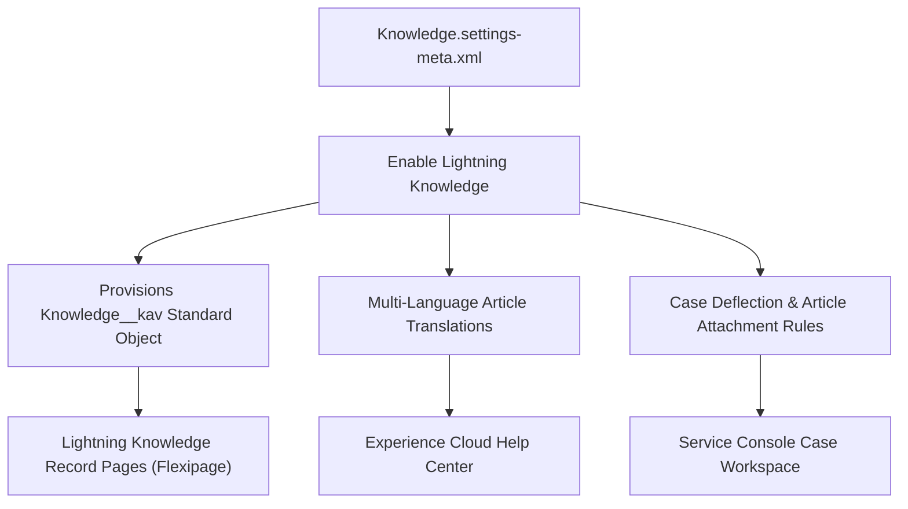

## Architectural Overview

The `KnowledgeSettings` metadata type controls foundational configuration and feature activation for Salesforce Lightning Knowledge. In enterprise customer support operations, technical documentation, agent case deflection, and self-service community portals revolve around curated knowledge articles.

Architecturally, `KnowledgeSettings` is an essential foundational setting: deploying it provisions the consolidated standard `Knowledge__kav` object (or custom article types in Classic Knowledge), article versioning tables, translation workflows, and case-to-article deflection triggers. Without configuring `KnowledgeSettings`, downstream deployments containing custom fields on `Knowledge__kav`, Knowledge-dependent Flexipages, or article sharing rules will fail during metadata compilation.



## Directory and File Conventions

In Salesforce DX source format, `KnowledgeSettings` is stored as a single XML file in the `settings` directory:

| Property | Value |
| :--- | :--- |
| **Metadata Type Name** | `Settings` (member: `Knowledge`) |
| **SFDX Source Folder** | `force-app/main/default/settings/` |
| **File Name** | `Knowledge.settings-meta.xml` |
| **Packaging / Manifest Type** | `Settings` |

## Key Metadata Fields

The XML schema for `KnowledgeSettings` contains switches governing language configuration, voting, and article lifecycles:

| Field Name | Type | Required | Description |
| :--- | :--- | :--- | :--- |
| `enableKnowledge` | `boolean` | No | Master toggle that enables Salesforce Knowledge in the organization. |
| `enableLightningKnowledge` | `boolean` | No | Enables the modern unified Lightning Knowledge architecture (`Knowledge__kav`). |
| `defaultLanguage` | `string` | No | Default language code for new knowledge articles (e.g., `en_US`). |
| `enableArticleVoting` | `boolean` | No | Enables thumbs-up / thumbs-down user ratings on published articles. |
| `showArticleSummariesCustomerPortal` | `boolean` | No | Exposes article summary fields to authenticated portal community users. |

> [!NOTE]
> Enabling Lightning Knowledge is an irreversible operation in Salesforce orgs. Once enabled in an environment, it cannot be toggled back to disabled.

## Declarative XML and Package Manifest Examples

### Source XML (`Knowledge.settings-meta.xml`)

```xml title="force-app/main/default/settings/Knowledge.settings-meta.xml"
<?xml version="1.0" encoding="UTF-8"?>
<KnowledgeSettings xmlns="http://soap.sforce.com/2006/04/metadata">
    <enableKnowledge>true</enableKnowledge>
    <enableLightningKnowledge>true</enableLightningKnowledge>
    <defaultLanguage>en_US</defaultLanguage>
    <enableArticleVoting>true</enableArticleVoting>
    <showArticleSummariesCustomerPortal>true</showArticleSummariesCustomerPortal>
</KnowledgeSettings>
```

### Package Manifest (`package.xml`)

```xml title="manifest/package.xml"
<?xml version="1.0" encoding="UTF-8"?>
<Package xmlns="http://soap.sforce.com/2006/04/metadata">
    <types>
        <members>Knowledge</members>
        <name>Settings</name>
    </types>
    <version>68.0</version>
</Package>
```

## Retrieval and Deployment

To retrieve `KnowledgeSettings` via the Salesforce CLI:

```bash
# Retrieve settings directly
sf project retrieve start --metadata Settings:Knowledge

# Retrieve using manifest
sf project retrieve start --manifest manifest/package.xml
```

To deploy `KnowledgeSettings` to a target environment:

```bash
# Deploy to service sandbox
sf project deploy start \
  --metadata Settings:Knowledge \
  --target-org service-uat \
  --wait 10
```

## Senior Architect Deployment Best Practices and Gotchas

### Dependency Sequencing in CI/CD Pipelines

Deploy `Knowledge.settings-meta.xml` in the initial settings phase of automated pipeline deployments. The `Knowledge__kav` object does not exist until Knowledge is enabled:

1. **Phase 1**: `Settings:Knowledge` (provisions `Knowledge__kav`).
2. **Phase 2**: Custom fields, record types, and validation rules on `Knowledge__kav`.
3. **Phase 3**: FlexiPages, layouts, and Experience Cloud components referencing Knowledge.

> [!WARNING]
> Deploying custom fields on `Knowledge__kav` before `Knowledge.settings-meta.xml` is deployed will cause fatal errors indicating that the object does not exist.

### Scratch Org Automation

In CI/CD pipelines that dynamically spin up scratch orgs, configure both the `features` and `settings` blocks in `project-scratch-def.json`:

```json title="config/project-scratch-def.json"
{
  "orgName": "Service Cloud Knowledge CI Org",
  "edition": "Enterprise",
  "features": ["Knowledge"],
  "settings": {
    "knowledgeSettings": {
      "enableKnowledge": true,
      "enableLightningKnowledge": true,
      "defaultLanguage": "en_US"
    }
  }
}
```

> [!TIP]
> Ensure user permissions for Knowledge User (`User.UserPermissionsKnowledgeUser = true`) are assigned via automation scripts during post-scratch-org setup so test users can create and publish articles.
