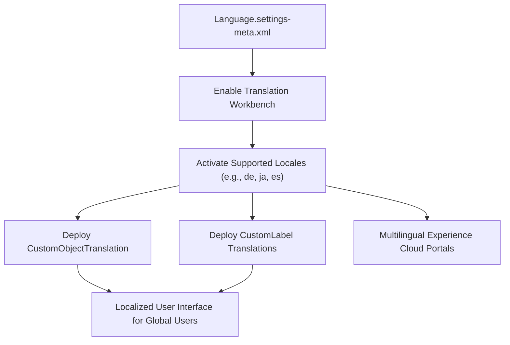

## Architectural Overview

The `LanguageSettings` metadata type manages internationalization (i18n), Translation Workbench activation, and supported organizational languages in Salesforce. In multinational enterprises, global user bases operate across diverse native languages—such as Japanese, German, Spanish, French, and Simplified Chinese—requiring localized field labels, picklist values, and help text.

Architecturally, `LanguageSettings` is the foundational prerequisite for all translation and localization metadata. Enabling Translation Workbench through this setting unlocks the deployment of `Translations`, `CustomObjectTranslation`, and localized `CustomLabel` records. Without first applying `LanguageSettings`, any CI/CD pipeline attempting to deploy localized metadata will fail with `TranslationWorkbenchNotEnabled` errors.



## Directory and File Conventions

In Salesforce DX source format, `LanguageSettings` is represented as a single XML file within the `settings` directory:

| Property | Value |
| :--- | :--- |
| **Metadata Type Name** | `Settings` (member: `Language`) |
| **SFDX Source Folder** | `force-app/main/default/settings/` |
| **File Name** | `Language.settings-meta.xml` |
| **Packaging / Manifest Type** | `Settings` |

## Key Metadata Fields

The XML schema for `LanguageSettings` controls Translation Workbench and data translation switches:

| Field Name | Type | Required | Description |
| :--- | :--- | :--- | :--- |
| `enableTranslationWorkbench` | `boolean` | No | Master toggle that enables Translation Workbench in the Salesforce org. |
| `enableDataTranslation` | `boolean` | No | Enables translation of data stored in custom fields on products and categories. |
| `enableEndUserLanguages` | `boolean` | No | Enables tier-2 end-user languages in addition to fully supported platform languages. |

> [!NOTE]
> Translation Workbench cannot be disabled once translations have been actively assigned to translators in an organization.

## Declarative XML and Package Manifest Examples

### Source XML (`Language.settings-meta.xml`)

```xml title="force-app/main/default/settings/Language.settings-meta.xml"
<?xml version="1.0" encoding="UTF-8"?>
<LanguageSettings xmlns="http://soap.sforce.com/2006/04/metadata">
    <enableTranslationWorkbench>true</enableTranslationWorkbench>
    <enableDataTranslation>true</enableDataTranslation>
    <enableEndUserLanguages>true</enableEndUserLanguages>
</LanguageSettings>
```

### Package Manifest (`package.xml`)

```xml title="manifest/package.xml"
<?xml version="1.0" encoding="UTF-8"?>
<Package xmlns="http://soap.sforce.com/2006/04/metadata">
    <types>
        <members>Language</members>
        <name>Settings</name>
    </types>
    <version>68.0</version>
</Package>
```

## Retrieval and Deployment

To retrieve `LanguageSettings` using the Salesforce CLI:

```bash
# Retrieve settings directly
sf project retrieve start --metadata Settings:Language

# Retrieve using manifest
sf project retrieve start --manifest manifest/package.xml
```

To deploy `LanguageSettings` to a target environment:

```bash
# Deploy to designated org
sf project deploy start \
  --metadata Settings:Language \
  --target-org uat \
  --wait 10
```

## Senior Architect Deployment Best Practices and Gotchas

### Dependency Ordering in Global Deployments

Translation metadata has an uncompromising dependency on `LanguageSettings`. In continuous delivery pipelines:

1. **Phase 1**: Deploy `Settings:Language` to activate Translation Workbench.
2. **Phase 2**: Deploy `CustomObject`, `CustomField`, and `GlobalValueSet` metadata.
3. **Phase 3**: Deploy `CustomObjectTranslation` and `Translations` language files.

> [!WARNING]
> Attempting to deploy `CustomObjectTranslation` or language-specific translations in the same package transaction as `Language.settings-meta.xml` in an unconfigured org will trigger compilation errors stating that the language is not enabled for translation.

### Scratch Org Configuration

For automated regression testing of multi-language implementations, enable Translation Workbench in `project-scratch-def.json`:

```json title="config/project-scratch-def.json"
{
  "orgName": "Global Multilingual Scratch Org",
  "edition": "Enterprise",
  "features": ["TranslationWorkbench"],
  "settings": {
    "languageSettings": {
      "enableTranslationWorkbench": true,
      "enableDataTranslation": true,
      "enableEndUserLanguages": true
    }
  }
}
```

> [!TIP]
> After enabling `LanguageSettings`, ensure deployment automation provisions translators for each target locale so developers and CI pipelines can deploy translation files without permission errors.
