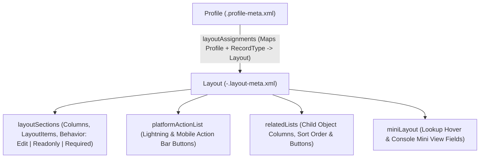

## Overview

The `Layout` metadata type (`layouts/<ObjectName>-<LayoutName>.layout-meta.xml`) represents a Salesforce Page Layout. It defines the arrangement of field sections (`layoutSections`), field editability/requirement behaviors (`behavior`), Lightning and Mobile quick actions (`platformActionList`), related lists (`relatedLists`), and hover mini-layouts (`miniLayout`).

Even in orgs that have migrated record detail fields to Dynamic Forms on [FlexiPage](/docs/metadata/flexipage-metadata-type/), `Layout` metadata remains an essential architectural dependency. The `Related Lists` and `Related List - Single` Lightning components require the child relationship to be present on the user's assigned `Layout`, and lookup hover popups (`miniLayout`) and Global/Object Quick Actions still pull defaults from the assigned `Layout`.



As shown in the diagram above, the `.layout-meta.xml` file defines four structural UI zones (`layoutSections`, `platformActionList`, `relatedLists`, and `miniLayout`), while the mapping of which [Profile](/docs/metadata/profile-metadata-type/) and [RecordType](/docs/metadata/record-type-metadata-type/) sees which `Layout` lives in `Profile` metadata.

## Prerequisites

- **Permissions:** "Customize Application" permission to deploy layouts; "View Setup and Configuration" to query via Tooling API.
- **Field & Button Dependencies:** Every field, custom button (`WebLink`), quick action, or child related list referenced in the layout XML must exist in the target org.
- **API Version:** Verified against API version `68.0` (Winter '27).

## Key Layout XML Elements

| XML Element | Purpose & Deployment Rules |
| :--- | :--- |
| `layoutSections` | Ordered sections containing one or two `<layoutColumns>`. Each `<layoutItems>` entry sets `<field>` and `<behavior>` (`Edit`, `Readonly`, or `Required`). |
| `platformActionList` | Overrides default buttons in the Lightning Experience and Salesforce Mobile action bar (`actionListContext` = `Record`). |
| `quickActionList` | Legacy Chatter publisher / Classic quick actions. Always configure `platformActionList` alongside it for Lightning Experience. |
| `relatedLists` | Ordered child related lists (`<relatedList>`, `<fields>`, `<sortField>`, `<sortOrder>`, `<excludeButtons>`). |
| `excludeButtons` | Hides standard buttons such as `<excludeButtons>Delete</excludeButtons>` or `<excludeButtons>ChangeOwnerOne</excludeButtons>`. |
| `showRunAssignmentRulesCheckbox` | Available on `Account`, `Case`, and `Lead` layouts to display the assignment rules checkbox on edit. |

> [!WARNING]
> Special characters in layout names (such as parentheses `( )`, slashes `/`, or ampersands `&`) are URL-encoded in the `.layout-meta.xml` file name on disk by Salesforce CLI (for example, `Account-Customer %28Enterprise%29 Layout.layout-meta.xml`). Avoid special characters in layout labels to prevent cross-platform file system and Git issues.

## Querying Layouts and Profile Assignments via Tooling API

Both `Layout` and `ProfileLayout` are available through the **Tooling API** (`sf data query --use-tooling-api`).

### 1. List All Page Layouts for an Object (Tooling API)
```soql
SELECT Id, Name, EntityDefinition.QualifiedApiName,
       LayoutType, ManageableState, LastModifiedDate
FROM Layout
WHERE EntityDefinition.QualifiedApiName = 'Account'
ORDER BY Name ASC
```

### 2. Audit Profile and RecordType Layout Assignments (Tooling API)
Query `ProfileLayout` via Tooling API to see exactly which Page Layout is assigned to each Profile and Record Type on an object:

```soql
SELECT Profile.Name, RecordType.DeveloperName, Layout.Name, TableEnumOrId
FROM ProfileLayout
WHERE TableEnumOrId = 'Account'
ORDER BY Profile.Name ASC, RecordType.DeveloperName ASC
```

## Example

The following `Invoice__c-Enterprise Invoice Layout.layout-meta.xml` configures a two-column field layout, Lightning action bar buttons (`platformActionList`), and an Activity History related list.

```xml title="force-app/main/default/layouts/Invoice__c-Enterprise Invoice Layout.layout-meta.xml"
<?xml version="1.0" encoding="UTF-8"?>
<Layout xmlns="http://soap.sforce.com/2006/04/metadata">
    <excludeButtons>Submit</excludeButtons>
    <layoutSections>
        <customLabel>false</customLabel>
        <detailHeading>true</detailHeading>
        <editHeading>true</editHeading>
        <label>Information</label>
        <layoutColumns>
            <layoutItems>
                <behavior>Readonly</behavior>
                <field>Name</field>
            </layoutItems>
            <layoutItems>
                <behavior>Required</behavior>
                <field>Billing_Account__c</field>
            </layoutItems>
        </layoutColumns>
        <layoutColumns>
            <layoutItems>
                <behavior>Edit</behavior>
                <field>OwnerId</field>
            </layoutItems>
            <layoutItems>
                <behavior>Edit</behavior>
                <field>ERP_External_Id__c</field>
            </layoutItems>
        </layoutColumns>
        <style>TwoColumnsTopToBottom</style>
    </layoutSections>
    <platformActionList>
        <actionListContext>Record</actionListContext>
        <platformActionListItems>
            <actionName>Edit</actionName>
            <actionType>StandardButton</actionType>
            <sortOrder>0</sortOrder>
        </platformActionListItems>
        <platformActionListItems>
            <actionName>Clone</actionName>
            <actionType>StandardButton</actionType>
            <sortOrder>1</sortOrder>
        </platformActionListItems>
    </platformActionList>
    <relatedLists>
        <fields>TASK.SUBJECT</fields>
        <fields>TASK.WHO_NAME</fields>
        <fields>ACTIVITY.TASK</fields>
        <fields>TASK.DUE_DATE</fields>
        <fields>TASK.STATUS</fields>
        <relatedList>RelatedActivityList</relatedList>
    </relatedLists>
    <showEmailCheckbox>false</showEmailCheckbox>
    <showHighlightsPanel>false</showHighlightsPanel>
    <showInteractionLogPanel>false</showInteractionLogPanel>
    <showRunAssignmentRulesCheckbox>false</showRunAssignmentRulesCheckbox>
    <showSubmitAndAttachButton>false</showSubmitAndAttachButton>
</Layout>
```

Retrieve a specific layout and its profile assignments with the `sf` CLI:

```bash
sf project retrieve start \
  --metadata "Layout:Invoice__c-Enterprise Invoice Layout" "Profile:Admin"
```

## Limits and Gotchas

- **Database Required Fields Must Be on Layout:** Removing a database-required field (`<required>true</required>` on [CustomField](/docs/metadata/custom-field-metadata-type/) or a Master-Detail field) from `<layoutSections>` causes the deployment to fail.
- **Related List Columns Limit:** A `<relatedLists>` item supports up to **10 `<fields>` columns**.
- **Formula and AutoNumber Fields Must Be `Readonly`:** Setting `<behavior>Edit</behavior>` or `<behavior>Required</behavior>` on an AutoNumber, Formula, Roll-Up Summary, or system audit field (`CreatedById`) causes a metadata deployment error.

## Related Official Documentation

- [Layout Metadata API Reference](https://developer.salesforce.com/docs/atlas.en-us.api_meta.meta/api_meta/meta_layouts.htm): Complete XML specification for `Layout`, `LayoutSection`, and `RelatedListItem`.
- [ProfileLayout Tooling API Object](https://developer.salesforce.com/docs/atlas.en-us.api_tooling.meta/api_tooling/tooling_api_objects_profilelayout.htm): Querying Profile-to-Layout mappings by Record Type.
