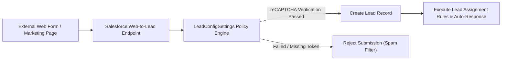

## Architectural Overview

The `LeadConfigSettings` metadata type controls organizational configuration for inbound lead intake, Web-to-Lead anti-spam defenses, and sales lead intelligence in Salesforce Sales Cloud. For sales and marketing architectures, maintaining pristine lead data hygiene and guarding against automated web form spam submissions is critical for pipeline velocity.

Architecturally, `LeadConfigSettings` enforces security policies at the Salesforce edge layer for Web-to-Lead submissions—specifically requiring reCAPTCHA API verification before any external HTTP POST request can generate a `Lead` record. Furthermore, it manages switches governing lead assignment rules and automated notification behavior when leads enter the CRM.



## Directory and File Conventions

In Salesforce DX source format, `LeadConfigSettings` is represented as a single XML file located within the `settings` directory:

| Property | Value |
| :--- | :--- |
| **Metadata Type Name** | `Settings` (member: `LeadConfig`) |
| **SFDX Source Folder** | `force-app/main/default/settings/` |
| **File Name** | `LeadConfig.settings-meta.xml` |
| **Packaging / Manifest Type** | `Settings` |

## Key Metadata Fields

The XML schema for `LeadConfigSettings` includes security toggles and lead capture controls:

| Field Name | Type | Required | Description |
| :--- | :--- | :--- | :--- |
| `doesRequireRecaptcha` | `boolean` | No | Mandates Google reCAPTCHA verification on all inbound Web-to-Lead form posts. |
| `enableLeadIntelligence` | `boolean` | No | Enables Einstein Lead Intelligence and predictive score displays. |
| `enableWebToLead` | `boolean` | No | Master switch allowing public Web-to-Lead endpoints to accept submissions. |

> [!NOTE]
> Requiring reCAPTCHA (`doesRequireRecaptcha = true`) will immediately block all public web forms that do not transmit valid reCAPTCHA tokens.

## Declarative XML and Package Manifest Examples

### Source XML (`LeadConfig.settings-meta.xml`)

```xml title="force-app/main/default/settings/LeadConfig.settings-meta.xml"
<?xml version="1.0" encoding="UTF-8"?>
<LeadConfigSettings xmlns="http://soap.sforce.com/2006/04/metadata">
    <doesRequireRecaptcha>true</doesRequireRecaptcha>
    <enableLeadIntelligence>true</enableLeadIntelligence>
    <enableWebToLead>true</enableWebToLead>
</LeadConfigSettings>
```

### Package Manifest (`package.xml`)

```xml title="manifest/package.xml"
<?xml version="1.0" encoding="UTF-8"?>
<Package xmlns="http://soap.sforce.com/2006/04/metadata">
    <types>
        <members>LeadConfig</members>
        <name>Settings</name>
    </types>
    <version>68.0</version>
</Package>
```

## Retrieval and Deployment

To retrieve `LeadConfigSettings` using the Salesforce CLI:

```bash
# Retrieve settings directly
sf project retrieve start --metadata Settings:LeadConfig

# Retrieve using manifest
sf project retrieve start --manifest manifest/package.xml
```

To deploy `LeadConfigSettings` to a target sandbox:

```bash
# Deploy to designated org
sf project deploy start \
  --metadata Settings:LeadConfig \
  --target-org uat \
  --wait 10
```

## Senior Architect Deployment Best Practices and Gotchas

### Production Rollout of reCAPTCHA Verification

Enabling `doesRequireRecaptcha` in production without prior coordination with website engineering teams is a common cause of lead generation outages. Web forms submitting directly to `webtolead` endpoints without generating reCAPTCHA responses will receive HTTP errors and fail silently.

> [!WARNING]
> Coordinate the deployment of `doesRequireRecaptcha = true` with frontend web developers so reCAPTCHA v2/v3 widgets and API tokens are deployed to marketing sites concurrently.

### Scratch Org Settings Alignment

Ensure testing scratch orgs reflect your security settings by including `leadConfigSettings` in `project-scratch-def.json`:

```json title="config/project-scratch-def.json"
{
  "orgName": "Lead Management Scratch Org",
  "edition": "Enterprise",
  "settings": {
    "leadConfigSettings": {
      "doesRequireRecaptcha": true,
      "enableWebToLead": true
    }
  }
}
```

> [!TIP]
> Combine `Settings:LeadConfig` with `AssignmentRules` in your CI/CD repository to ensure lead routing rules and spam filtering are tested as an integrated unit.
