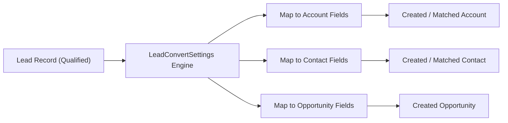

## Architectural Overview

The `LeadConvertSettings` metadata type represents declarative Lead conversion configurations and custom field mapping definitions in Salesforce Sales Cloud. When sales representatives qualify a prospect and click **Convert**, the platform converts the uncommitted `Lead` record into persistent relational entities: `Account`, `Contact`, and optionally `Opportunity`.

Architecturally, `LeadConvertSettings` decouples lead field mapping from brittle Apex triggers or Flow workarounds. By defining declarative mapping pairs between source Lead custom fields and target custom fields on Account, Contact, or Opportunity, architects ensure atomic, transactional data migration during conversion while enforcing data type compatibility and referential integrity.



## Directory and File Conventions

In Salesforce DX source format, `LeadConvertSettings` is stored in individual XML files within the `leadConvertSettings` directory:

| Property | Value |
| :--- | :--- |
| **Metadata Type Name** | `LeadConvertSettings` |
| **SFDX Source Folder** | `force-app/main/default/leadConvertSettings/` |
| **File Suffix** | `.leadConvertSetting-meta.xml` |
| **Packaging / Manifest Type** | `LeadConvertSettings` |

## Key Metadata Fields

The XML schema for `LeadConvertSettings` declares individual mapping definitions linking source and target fields:

| Field Name | Type | Required | Description |
| :--- | :--- | :--- | :--- |
| `masterLabel` | `string` | Yes | Human-readable name for the lead convert setting record. |
| `description` | `string` | No | Architectural description of the conversion mapping logic. |
| `objectMapping` | `LeadConvertObjectMapping[]` | Yes | Collection of mapping rules for Account, Contact, and Opportunity targets. |
| `objectMapping.inputObject` | `string` | Yes | Source object (typically `Lead`). |
| `objectMapping.outputObject` | `string` | Yes | Target object (`Account`, `Contact`, or `Opportunity`). |
| `objectMapping.mappingFields` | `MappingField[]` | Yes | Field-level pairs defining source `inputField` and target `outputField`. |

> [!NOTE]
> Source and target fields must share identical data types and compatible lengths (e.g., text to text, number to number). Mapping incompatible types will cause deployment failure.

## Declarative XML and Package Manifest Examples

### Source XML (`LeadConvertSetting.leadConvertSetting-meta.xml`)

```xml title="force-app/main/default/leadConvertSettings/LeadConvertSetting.leadConvertSetting-meta.xml"
<?xml version="1.0" encoding="UTF-8"?>
<LeadConvertSettings xmlns="http://soap.sforce.com/2006/04/metadata">
    <masterLabel>Standard Enterprise Lead Convert Mapping</masterLabel>
    <description>Maps prospect industry tags and budget fields to Account and Opportunity.</description>
    <objectMapping>
        <inputObject>Lead</inputObject>
        <outputObject>Account</outputObject>
        <mappingFields>
            <inputField>Industry_Segment__c</inputField>
            <outputField>Industry_Segment__c</outputField>
        </mappingFields>
    </objectMapping>
    <objectMapping>
        <inputObject>Lead</inputObject>
        <outputObject>Opportunity</outputObject>
        <mappingFields>
            <inputField>Estimated_Budget__c</inputField>
            <outputField>Amount</outputField>
        </mappingFields>
    </objectMapping>
</LeadConvertSettings>
```

### Package Manifest (`package.xml`)

```xml title="manifest/package.xml"
<?xml version="1.0" encoding="UTF-8"?>
<Package xmlns="http://soap.sforce.com/2006/04/metadata">
    <types>
        <members>*</members>
        <name>LeadConvertSettings</name>
    </types>
    <version>68.0</version>
</Package>
```

## Retrieval and Deployment

To retrieve lead conversion settings from an organization:

```bash
# Retrieve all lead conversion settings
sf project retrieve start --metadata LeadConvertSettings

# Retrieve using manifest
sf project retrieve start --manifest manifest/package.xml
```

To deploy `LeadConvertSettings` to a target environment:

```bash
# Deploy to designated org
sf project deploy start \
  --metadata LeadConvertSettings \
  --target-org uat \
  --wait 10
```

## Senior Architect Deployment Best Practices and Gotchas

### Strict Field Dependency Sequencing

`LeadConvertSettings` has a bidirectional schema dependency on custom fields across four objects: `Lead`, `Account`, `Contact`, and `Opportunity`. If any referenced custom field is missing in the target org or not included in the deployment manifest, the deployment will fail:

1. **Step 1**: Deploy all custom fields (`CustomField`) on `Lead`, `Account`, `Contact`, and `Opportunity`.
2. **Step 2**: Deploy `LeadConvertSettings` referencing those fields.

> [!WARNING]
> If a developer modifies a custom field data type (e.g., converting a Text field to a Picklist) on either the source or target object, the existing `LeadConvertSettings` mapping must be updated or redeployed to match the new type, otherwise deployment fails.

### Managing Conversion Trigger Logic

Remember that lead conversion executes standard and custom triggers on all affected objects. When writing Apex triggers or Flows on `Account` or `Contact`, check `isLeadConvert` or inspect execution context to avoid executing redundant creation logic during conversion.

> [!TIP]
> Include end-to-end Apex unit tests that invoke `Database.convertLead()` to validate that declarative mappings execute cleanly without hitting trigger recursion limits or validation rule conflicts.
