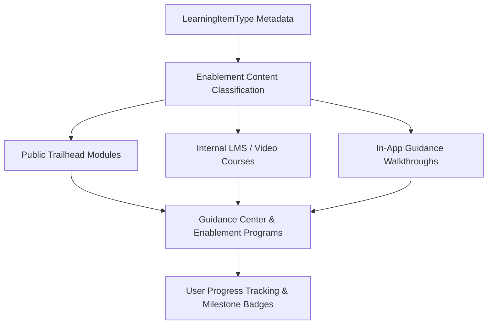

## Architectural Overview

The `LearningItemType` metadata type represents content classification definitions, asset schemas, and content formats for Salesforce Enablement and the in-app Guidance Center. In modern enterprise digital adoption strategies, onboarding sales reps, service agents, and channel partners requires contextual learning materials delivered directly inside the Salesforce Lightning Experience.

Architecturally, `LearningItemType` categorizes different learning media types—such as Public Trailhead Modules, myTrailhead / Sales Enablement pathways, internal corporate wiki links, videos, and external Learning Management System (LMS) modules. When enablement teams author Learning Programs or assign milestone badges, `LearningItemType` provides the metadata schema that governs how completion tracking, URL parameters, and milestone verifications operate.



## Directory and File Conventions

In Salesforce DX source format, `LearningItemType` definitions are maintained as individual XML files in the `learningItemTypes` directory:

| Property | Value |
| :--- | :--- |
| **Metadata Type Name** | `LearningItemType` |
| **SFDX Source Folder** | `force-app/main/default/learningItemTypes/` |
| **File Suffix** | `.learningItemType-meta.xml` |
| **Packaging / Manifest Type** | `LearningItemType` |

## Key Metadata Fields

The XML schema for `LearningItemType` configures the asset category, provider handler, and descriptive metadata:

| Field Name | Type | Required | Description |
| :--- | :--- | :--- | :--- |
| `masterLabel` | `string` | Yes | Human-readable name for the learning item type in Guidance Center. |
| `description` | `string` | No | Architectural description of the content type and learning format. |
| `contentProvider` | `string` | Yes | Content provider identifier (e.g., `Trailhead`, `CustomUrl`, `SalesforceCMS`). |
| `isActive` | `boolean` | Yes | Indicates whether this learning item type is available for program authoring. |
| `trackingType` | `string` | No | Completion verification mechanism (e.g., `AutomaticSync`, `UserAttestation`). |

> [!NOTE]
> Salesforce Sales Enablement (formerly myTrailhead) licenses are required to create and track custom learning programs that leverage non-standard `LearningItemType` definitions.

## Declarative XML and Package Manifest Examples

### Source XML (`ExternalLmsCourse.learningItemType-meta.xml`)

```xml title="force-app/main/default/learningItemTypes/ExternalLmsCourse.learningItemType-meta.xml"
<?xml version="1.0" encoding="UTF-8"?>
<LearningItemType xmlns="http://soap.sforce.com/2006/04/metadata">
    <masterLabel>External LMS Certification Course</masterLabel>
    <description>Enterprise learning management system course link with completion tracking.</description>
    <contentProvider>CustomUrl</contentProvider>
    <isActive>true</isActive>
    <trackingType>UserAttestation</trackingType>
</LearningItemType>
```

### Package Manifest (`package.xml`)

```xml title="manifest/package.xml"
<?xml version="1.0" encoding="UTF-8"?>
<Package xmlns="http://soap.sforce.com/2006/04/metadata">
    <types>
        <members>*</members>
        <name>LearningItemType</name>
    </types>
    <version>68.0</version>
</Package>
```

## Retrieval and Deployment

To retrieve learning item types from an organization:

```bash
# Retrieve all learning item types
sf project retrieve start --metadata LearningItemType

# Retrieve specific learning item type
sf project retrieve start --metadata LearningItemType:ExternalLmsCourse
```

To deploy learning item types to a target environment:

```bash
# Deploy to designated org
sf project deploy start \
  --metadata LearningItemType \
  --target-org uat \
  --wait 10
```

## Senior Architect Deployment Best Practices and Gotchas

### Enablement Program Sequencing

When deploying full Enablement solutions consisting of learning programs, badges, and learning items:

1. **Step 1**: Deploy `LearningItemType` metadata to register content formats.
2. **Step 2**: Deploy `Prompt` (In-App Guidance) and learning link assets.
3. **Step 3**: Deploy `LearningProgram` and milestone evaluation logic.

> [!WARNING]
> Deploying enablement programs referencing a custom `LearningItemType` that does not exist in the target org will cause metadata resolution failures during compilation.

### User Permissions and License Entitlements

Ensure that users configuring or assigned to learning programs have the `ManageSalesEnablement` or `ViewEnablementPrograms` permission set licenses. In automated scratch org CI pipelines, assign these permission sets during post-creation provisioning.

> [!TIP]
> Use `LearningItemType` to standardize corporate training content formats, ensuring all external URLs adhere to approved corporate security domains (e.g., internal intranet or single sign-on portals).
