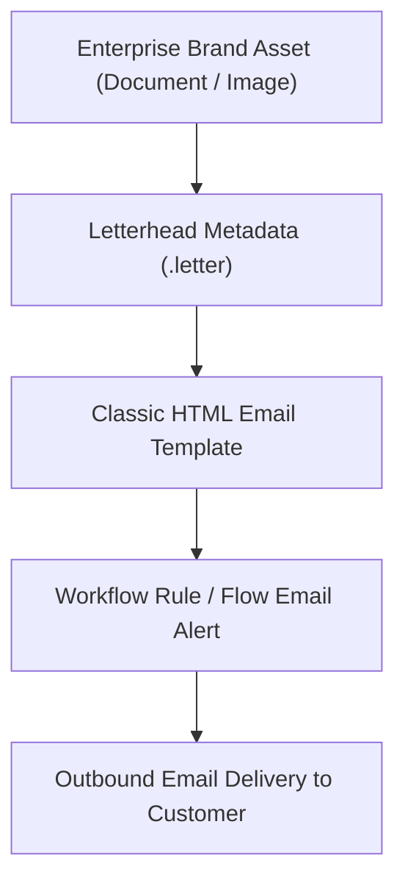

## Architectural Overview

`Letterhead` represents the declarative styling envelope used by Classic HTML email templates. It establishes standard visual headers, footers, brand logos, body background colors, and horizontal divider rules across enterprise communications. While modern implementations frequently use Lightning email templates with Enhanced Letterheads (which exist as standard runtime records), thousands of enterprise Service and Sales Cloud instances continue to rely on `Letterhead` metadata for automated system notices, workflow alerts, and Case auto-response notifications.

From an architecture perspective, `Letterhead` metadata abstracts HTML email presentation from content. Developers and administrators create communication templates that bind to a central `Letterhead`, ensuring that global brand updates—such as corporate rebrandings, legal disclaimers, or logo swaps—can be executed centrally without updating individual email templates.



## Directory and File Conventions

In the Salesforce DX source format, Letterhead configurations are stored in the `letterheads` folder at the root of your package directory.

| Property | Value |
| :--- | :--- |
| **Directory Name** | `letterheads` |
| **File Extension** | `.letter` |
| **Root XML Element** | `<Letterhead>` |
| **API Version** | `68.0` |

## Key Metadata Fields

The `Letterhead` XML definition exposes several styling tags that structure the email layout:

| Field Name | Type | Description |
| :--- | :--- | :--- |
| `available` | `boolean` | Indicates whether the letterhead is available for use in new email templates. |
| `description` | `string` | An optional administrative description of the letterhead branding purpose. |
| `name` | `string` | The user-facing label of the letterhead. |
| `backgroundColor` | `string` | Hex code for the primary email canvas background (for example, `#FFFFFF`). |
| `header` | `LetterheadHeader` | Contains logo asset alignment, height, and background color properties. |
| `footer` | `LetterheadFooter` | Defines footer height, background color, and alignment for legal disclosures. |
| `top` | `LetterheadLine` | Configures horizontal separator lines dividing header and email body. |
| `middle` | `LetterheadLine` | Configures separator lines separating body segments. |
| `bottom` | `LetterheadLine` | Configures separator lines dividing email body from footer. |

> [!NOTE]
> The `logo` sub-element inside `header` references the developer name of an asset stored in the classic `Document` metadata type. Ensure document assets are deployed before deploying the letterhead.

## Declarative XML and Package Manifest Examples

Below is an example of an enterprise `Corporate_Branding.letter` metadata file:

```xml title="force-app/main/default/letterheads/Corporate_Branding.letter"
<?xml version="1.0" encoding="UTF-8"?>
<Letterhead xmlns="http://soap.sforce.com/2006/04/metadata">
    <available>true</available>
    <backgroundColor>#F4F6F9</backgroundColor>
    <description>Standard corporate letterhead for customer support emails</description>
    <name>Corporate Support Letterhead</name>
    <header>
        <backgroundColor>#001E2B</backgroundColor>
        <height>80</height>
        <horizontalAlignment>Left</horizontalAlignment>
        <logo>Shared_Documents/Corporate_Logo_PNG</logo>
        <verticalAlignment>Middle</verticalAlignment>
    </header>
    <top>
        <color>#00A4E4</color>
        <height>3</height>
    </top>
    <middle>
        <color>#CCCCCC</color>
        <height>1</height>
    </middle>
    <bottom>
        <color>#00A4E4</color>
        <height>2</height>
    </bottom>
    <footer>
        <backgroundColor>#001E2B</backgroundColor>
        <height>60</height>
        <horizontalAlignment>Center</horizontalAlignment>
        <verticalAlignment>Middle</verticalAlignment>
    </footer>
</Letterhead>
```

### Manifest Definition (`package.xml`)

To retrieve or deploy `Letterhead` via Metadata API, include the type in `package.xml`:

```xml title="manifest/package.xml"
<?xml version="1.0" encoding="UTF-8"?>
<Package xmlns="http://soap.sforce.com/2006/04/metadata">
    <types>
        <members>Corporate_Branding</members>
        <name>Letterhead</name>
    </types>
    <types>
        <members>Shared_Documents/Corporate_Logo_PNG</members>
        <name>Document</name>
    </types>
    <version>68.0</version>
</Package>
```

## CLI Retrieval and Deployment Commands

Use the Salesforce CLI to retrieve and deploy `Letterhead` metadata components:

```bash
# Retrieve all Letterhead metadata files
sf project retrieve start --metadata Letterhead

# Deploy a specific Letterhead file with its supporting Document asset
sf project deploy start --source-dir force-app/main/default/letterheads/Corporate_Branding.letter force-app/main/default/documents/Shared_Documents
```

## Senior Architect Deployment Best Practices and Gotchas

- **Document Dependency Ordering:** `Letterhead` files reference image assets in Classic Documents. If the referenced `Document` does not exist in the target org prior to deployment, the deployment will fail with a dependency resolution error.
- **Classic vs. Enhanced Letterheads:** Do not confuse Classic `Letterhead` metadata with Enhanced Letterheads in Lightning Experience. Enhanced Letterheads are stored as runtime data records (`EnhancedLetterhead` sObject) and cannot be deployed through the `Letterhead` metadata type.
- **Decommissioning Legacy Letterheads:** A `Letterhead` cannot be deleted if any active `EmailTemplate` references it. To retire a letterhead, you must first update dependent email templates to point to a new letterhead or detach them entirely.

> [!WARNING]
> If `<available>false</available>` is deployed, existing automated email alerts will continue firing, but business users will not be able to select the letterhead when drafting ad-hoc communications.
