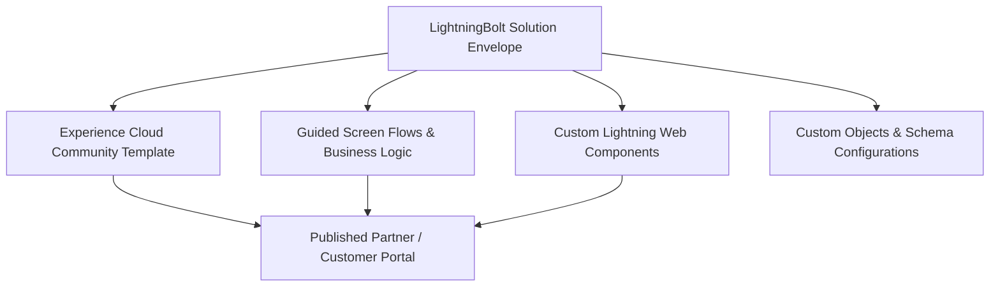

## Architectural Overview

`LightningBolt` is the packaging envelope for Salesforce Lightning Bolt Solutions. A Lightning Bolt solution bundles Experience Cloud templates, community page layouts, custom Lightning Web Components, business process Flows, and industry-specific business logic into a single cohesive starter solution. Independent Software Vendors (ISVs) and System Integrators (SIs) use Lightning Bolt to deliver vertical solutions—such as patient onboarding portals, franchise management consoles, or insurance claim workflows—directly to AppExchange.

Architecturally, `LightningBolt` serves as an orchestrator. Rather than forcing administrators to install dozens of disparate components and manually configure Experience Builder sites, installing a Bolt Solution provisions an end-to-end community experience with pre-wired navigation menus, theme layouts, and screen flows.



## Directory and File Conventions

Lightning Bolt configurations are stored in the `lightningBolts` directory within your Salesforce DX workspace.

| Property | Value |
| :--- | :--- |
| **Directory Name** | `lightningBolts` |
| **File Extension** | `.lightningBolt` |
| **Root XML Element** | `<LightningBolt>` |
| **API Version** | `68.0` |

## Key Metadata Fields

The `LightningBolt` metadata type contains configuration pointers connecting the bundled artifacts:

| Field Name | Type | Description |
| :--- | :--- | :--- |
| `masterLabel` | `string` | The display name of the Lightning Bolt solution shown in Community Creation Wizards. |
| `description` | `string` | A detailed technical summary of the solution for administrators. |
| `category` | `string` | The industry vertical or business function classification (for example, `FinancialServices`, `Healthcare`). |
| `communityTemplate` | `string` | API name of the target Experience Cloud template packaged with the solution. |
| `publisher` | `string` | Name of the authoring organization or consulting partner. |
| `highlights` | `string` | Key features and capabilities presented during solution discovery. |
| `packageItems` | `LightningBoltPackageItem[]` | Array of references to packaged metadata components like Flows, Custom Apps, and Pages. |

> [!TIP]
> Always define explicit dependency graphs across your package manifest when assembling a Bolt solution. Flows that reference custom fields must have those fields deployed concurrently.

## Declarative XML and Package Manifest Examples

Below is an example of an enterprise `Patient_Portal_Bolt.lightningBolt` configuration:

```xml title="force-app/main/default/lightningBolts/Patient_Portal_Bolt.lightningBolt"
<?xml version="1.0" encoding="UTF-8"?>
<LightningBolt xmlns="http://soap.sforce.com/2006/04/metadata">
    <masterLabel>Healthcare Patient Portal Accelerator</masterLabel>
    <description>Turnkey patient intake and telehealth scheduling solution</description>
    <category>Healthcare</category>
    <communityTemplate>Patient_Intake_Community_Template</communityTemplate>
    <publisher>Enterprise Health Systems</publisher>
    <highlights>Automated intake flows, telehealth calendar integration, secure record access</highlights>
</LightningBolt>
```

### Manifest Definition (`package.xml`)

Include `LightningBolt` alongside related community components in `package.xml`:

```xml title="manifest/package.xml"
<?xml version="1.0" encoding="UTF-8"?>
<Package xmlns="http://soap.sforce.com/2006/04/metadata">
    <types>
        <members>Patient_Portal_Bolt</members>
        <name>LightningBolt</name>
    </types>
    <types>
        <members>Patient_Intake_Community_Template</members>
        <name>CommunityTemplateDefinition</name>
    </types>
    <version>68.0</version>
</Package>
```

## CLI Retrieval and Deployment Commands

Retrieve and deploy Lightning Bolt solutions using standard Salesforce CLI commands:

```bash
# Retrieve the Lightning Bolt definition
sf project retrieve start --metadata LightningBolt:Patient_Portal_Bolt

# Deploy the entire Bolt solution bundle
sf project deploy start --metadata LightningBolt,CommunityTemplateDefinition,CommunityThemeDefinition
```

## Senior Architect Deployment Best Practices and Gotchas

- **Template Activation Prerequisite:** Deploying a `LightningBolt` metadata file requires that the referenced `communityTemplate` exists and is valid in the target environment. Deploy the `CommunityTemplateDefinition` before or concurrently with the Bolt definition.
- **Managed Package Locking:** When distributing a Bolt solution via managed package, once a community template is bound to a published `LightningBolt`, changing template bindings can require package version deprecation cycles.
- **Org Feature Licenses:** Ensure target subscriber orgs have Digital Experiences enabled (`ExperienceBundle` or `CommunitiesSettings`) before deploying Lightning Bolt solutions.

> [!WARNING]
> Bolt solutions cannot be fully instantiated in scratch orgs unless the scratch org definition file (`project-scratch-def.json`) enables `Communities` and `ServiceCloud` features.
