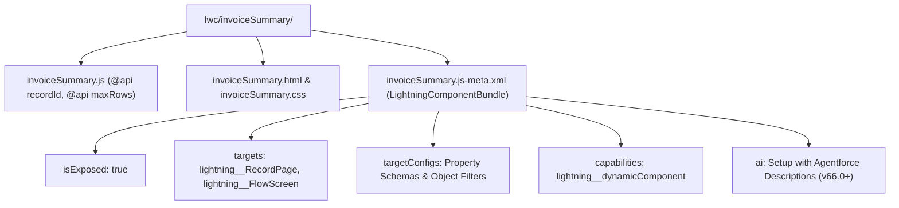

## Overview

The `LightningComponentBundle` metadata type represents a Lightning Web Component (LWC) bundle stored in `force-app/main/default/lwc/<componentName>/`. A bundle groups the component's JavaScript controller (`.js`), HTML template (`.html`), optional CSS stylesheet (`.css`), optional SVG icon (`.svg`), Jest unit tests (`__tests__/`), and the required XML configuration descriptor (`<componentName>.js-meta.xml`).

As a Salesforce architect or developer, the `.js-meta.xml` file is your contract between the component's `@api` properties and declarative platform builders (Lightning App Builder, Flow Builder, Experience Builder, and Agentforce). Without properly configuring `isExposed`, `targets`, and `targetConfigs`, a component remains private and can only be embedded as a child inside another LWC.



As shown in the architecture diagram above, `LightningComponentBundle` links your `@api` decorated JavaScript properties to `targetConfigs` schemas, controls container placement via `targets`, unlocks runtime privileges via `capabilities`, and exposes natural-language metadata to Agentforce via the `ai` tag.

## Prerequisites

- **Permissions:** "Customize Application" and "Modify Metadata Through Metadata API Functions" permissions to deploy bundles; "View Setup and Configuration" to query via Tooling API.
- **Naming Convention:** Bundle folder and file names must use `camelCase` starting with a lowercase letter (`invoiceSummary`), containing only alphanumeric characters and non-consecutive underscores.
- **API Version:** Introduced in API version 45.0. Verified against API version `68.0` (Winter '27).

## Key XML Elements in `.js-meta.xml`

| Element | Required | Purpose & Configuration Rules |
| :--- | :--- | :--- |
| `apiVersion` | No (Recommended) | Binds the LWC to a specific Salesforce API version (`68.0`). Determines LWC compiler features and Lightning Web Security (LWS) behavior. |
| `isExposed` | ✅ Yes | Set to `true` to expose the component to Lightning App Builder, Flow Builder, Experience Builder, or other namespaces. |
| `masterLabel` | No | Friendly title displayed in Setup and builder component palettes. Defaults to the camelCase folder name if omitted. |
| `description` | No | Tooltip description displayed in builders when hovering over the component. |
| `targets` | No | Container types where the component can be dragged (`lightning__RecordPage`, `lightning__AppPage`, `lightning__HomePage`, `lightning__FlowScreen`, `lightning__RecordAction`, `lightningCommunity__Page`). |
| `targetConfigs` | No | Configures `@api` input/output properties, supported `objects`, `supportedFormFactors` (`Large`, `Small`), and `actionType` (`ScreenAction`, `Action`) per target. |
| `capabilities` | No | Enables specialized capabilities such as `lightning__dynamicComponent`, `lightning__ServerRenderable`, `lightning__ServiceCloudVoiceToolkitApi`, or `lightningCommunity__RelaxedCSP`. |
| `ai` | No | Provides `<description>` and `<property name="..." aiDescription="..."/>` tags for **Setup with Agentforce** (API `66.0`+). |

> [!RELEASE] Spring '26
> Starting in API version `66.0`, the `<ai>` tag in `LightningComponentBundle` allows Setup with Agentforce to understand what your custom LWC does and automatically place and configure it on agent-generated [FlexiPage](/docs/metadata/flexipage-metadata-type/) layouts.

## Querying LightningComponentBundle via Tooling API

`LightningComponentBundle` and its child `LightningComponentResource` are available exclusively through the **Tooling API** (`sf data query --use-tooling-api`).

### 1. List All Exposed LWC Bundles and Their API Versions
Identify components exposed to App Builder or running on outdated API versions:

```soql
SELECT Id, DeveloperName, MasterLabel, ApiVersion,
       IsExposed, ManageableState, Description, LastModifiedDate
FROM LightningComponentBundle
WHERE ManageableState = 'unmanaged'
ORDER BY ApiVersion ASC, DeveloperName ASC
```

### 2. Search Inside LWC Source Files (JS, HTML, XML) via Tooling API
Query `LightningComponentResource` to inspect file paths, formats (`js`, `html`, `css`), and source code across all LWC bundles:

```soql
SELECT Id, LightningComponentBundle.DeveloperName, FilePath, Format, LastModifiedDate
FROM LightningComponentResource
WHERE LightningComponentBundle.ManageableState = 'unmanaged'
ORDER BY LightningComponentBundle.DeveloperName ASC
```

## Example

The following `.js-meta.xml` configures an `invoiceSummary` LWC for three distinct contexts: an Account/Invoice Record Page (restricted to Desktop and Mobile form factors), a Screen Flow (with input and output variables), and a headless Quick Action, plus Agentforce AI metadata.

```xml title="force-app/main/default/lwc/invoiceSummary/invoiceSummary.js-meta.xml"
<?xml version="1.0" encoding="UTF-8"?>
<LightningComponentBundle xmlns="http://soap.sforce.com/2006/04/metadata">
    <apiVersion>68.0</apiVersion>
    <isExposed>true</isExposed>
    <masterLabel>Invoice Summary Card</masterLabel>
    <description>Displays overdue and open invoices with one-click payment actions.</description>
    <capabilities>
        <capability>lightning__dynamicComponent</capability>
    </capabilities>
    <targets>
        <target>lightning__RecordPage</target>
        <target>lightning__AppPage</target>
        <target>lightning__FlowScreen</target>
        <target>lightning__RecordAction</target>
    </targets>
    <targetConfigs>
        <targetConfig targets="lightning__RecordPage">
            <objects>
                <object>Account</object>
                <object>Invoice__c</object>
            </objects>
            <property name="maxRows" type="Integer" label="Max Invoices Shown" default="5" min="1" max="50"
                      description="Maximum number of recent invoices to display in the table." />
            <property name="showOverdueOnly" type="Boolean" label="Show Overdue Only" default="false" />
            <supportedFormFactors>
                <supportedFormFactor type="Large" />
                <supportedFormFactor type="Small" />
            </supportedFormFactors>
        </targetConfig>
        <targetConfig targets="lightning__FlowScreen">
            <property name="recordId" type="String" label="Account or Invoice ID" role="inputOnly" required="true" />
            <property name="selectedInvoiceId" type="String" label="Selected Invoice ID" role="outputOnly" />
        </targetConfig>
        <targetConfig targets="lightning__RecordAction">
            <actionType>ScreenAction</actionType>
        </targetConfig>
    </targetConfigs>
</LightningComponentBundle>
```

The corresponding JavaScript file must declare every property referenced in `<targetConfigs>` with the `@api` decorator:

```javascript title="force-app/main/default/lwc/invoiceSummary/invoiceSummary.js"
import { LightningElement, api } from 'lwc';

export default class InvoiceSummary extends LightningElement {
    @api recordId;
    @api maxRows = 5;
    @api showOverdueOnly = false;
    @api selectedInvoiceId;

    @api invoke() {
        // Executed when actionType is Action (headless quick action)
    }
}
```

## Limits and Gotchas

- **Every `<property>` Requires `@api`:** If you define `<property name="maxRows" .../>` in `.js-meta.xml` without declaring `@api maxRows` in the `.js` file, the deployment fails immediately with a compilation error.
- **Boolean Properties Cannot Default to Unset in Builders:** For `type="Boolean"` properties in `targetConfig`, always explicitly provide `default="true"` or `default="false"`.
- **Deleting a Property Referenced on a FlexiPage:** You cannot remove a `<property>` from `.js-meta.xml` or set `<isExposed>false</isExposed>` while any active [FlexiPage](/docs/metadata/flexipage-metadata-type/) or [Flow](/docs/metadata/flow-metadata-type/) in the target org references that component or property.
- **Case Sensitivity Warning:** Deploying `lwc/myComponent` when `lwc/MyComponent` or an Aura component named `myComponent` already exists in the org will fail due to namespace collision.

## Related Official Documentation

- [LightningComponentBundle Metadata API Reference](https://developer.salesforce.com/docs/atlas.en-us.api_meta.meta/api_meta/meta_lightningcomponentbundle.htm): Official XML structure and `Capabilities` enumeration.
- [LWC XML Configuration File Elements](https://developer.salesforce.com/docs/platform/lwc/guide/reference-configuration-tags.html): Complete guide to `targets` and `targetConfigs` for every page type.
- [Configure a Component for Setup with Agentforce](https://developer.salesforce.com/docs/platform/lwc/guide/use-config-for-agentforce.html): Using the `<ai>` tag in API v66.0+.
