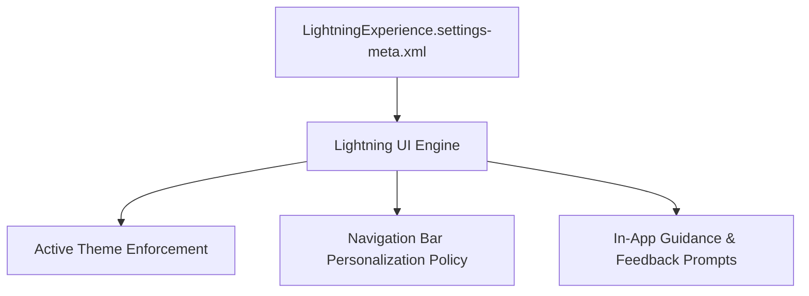

## Architectural Overview

`LightningExperienceSettings` manages organization-wide operational flags that control Lightning Experience adoption, navigation policies, in-app feedback collection, and active branding themes. In enterprise Salesforce governance, maintaining uniform user interface behavior across hundreds or thousands of business users is critical for supportability and compliance.

From a DevOps and release architecture standpoint, deploying `LightningExperienceSettings` ensures that scratch orgs, sandboxes, and production environments adhere to the same user interface policies—such as restricting end-user navigation tampering, enforcing corporate brand themes, and suppressing intrusive Salesforce standard switch prompts.



## Directory and File Conventions

`LightningExperienceSettings` is a singleton Settings metadata type stored in the `settings` directory.

| Property | Value |
| :--- | :--- |
| **Directory Name** | `settings` |
| **File Name** | `LightningExperience.settings-meta.xml` |
| **Root XML Element** | `<LightningExperienceSettings>` |
| **API Version** | `68.0` |

## Key Metadata Fields

The `LightningExperienceSettings` metadata type contains governance toggles:

| Field Name | Type | Description |
| :--- | :--- | :--- |
| `activeThemeName` | `string` | Developer name of the active `LightningExperienceTheme` applied org-wide. |
| `enableFeedbackPrompt` | `boolean` | Determines whether Salesforce prompts users for product feedback within Lightning. |
| `enableInAppTooltips` | `boolean` | Controls display of informational tooltips throughout standard Lightning layouts. |
| `enableLightningExperience` | `boolean` | Master toggle activating the Lightning Experience interface for authorized users. |
| `enableTryLightningPrompt` | `boolean` | Controls classic prompts nudging users to switch into Lightning Experience. |
| `enableUsersAreModifyingNav` | `boolean` | Allows or disallows end users from modifying app navigation tabs. |

> [!TIP]
> In heavily regulated industries (such as Banking or Life Sciences), set `<enableUsersAreModifyingNav>false</enableUsersAreModifyingNav>` to prevent users from hiding required compliance tabs or altering navigational hierarchies.

## Declarative XML and Package Manifest Examples

Below is an enterprise configuration of `LightningExperience.settings-meta.xml`:

```xml title="force-app/main/default/settings/LightningExperience.settings-meta.xml"
<?xml version="1.0" encoding="UTF-8"?>
<LightningExperienceSettings xmlns="http://soap.sforce.com/2006/04/metadata">
    <activeThemeName>Enterprise_Branded_Theme</activeThemeName>
    <enableFeedbackPrompt>false</enableFeedbackPrompt>
    <enableInAppTooltips>true</enableInAppTooltips>
    <enableLightningExperience>true</enableLightningExperience>
    <enableTryLightningPrompt>false</enableTryLightningPrompt>
    <enableUsersAreModifyingNav>false</enableUsersAreModifyingNav>
</LightningExperienceSettings>
```

### Manifest Definition (`package.xml`)

Include the settings file in your deployment manifest:

```xml title="manifest/package.xml"
<?xml version="1.0" encoding="UTF-8"?>
<Package xmlns="http://soap.sforce.com/2006/04/metadata">
    <types>
        <members>LightningExperience</members>
        <name>Settings</name>
    </types>
    <version>68.0</version>
</Package>
```

## CLI Retrieval and Deployment Commands

Manage settings using the Salesforce CLI:

```bash
# Retrieve LightningExperience settings
sf project retrieve start --metadata Settings:LightningExperience

# Deploy the updated settings to sandbox or production
sf project deploy start --source-dir force-app/main/default/settings/LightningExperience.settings-meta.xml
```

## Senior Architect Deployment Best Practices and Gotchas

- **Theme Dependency:** If `activeThemeName` references a custom `LightningExperienceTheme`, that theme metadata must be deployed prior to or in the same transaction as `LightningExperienceSettings`. Otherwise, deployment will fail with an unknown theme error.
- **Scratch Org Definitions:** Scratch orgs generated from standard scratch org definitions enable navigation modifications by default. Committing this settings file in source-driven CI/CD pipelines ensures scratch orgs accurately reflect production governance.
- **User Permission Layering:** Setting `<enableLightningExperience>true</enableLightningExperience>` does not automatically switch Classic-only users. Users must also have the `LightningExperienceUser` permission assigned via Profile or Permission Set.

> [!WARNING]
> Disabling `<enableLightningExperience>` in an active Lightning org will force users into Salesforce Classic upon next session refresh, potentially breaking access to custom Lightning Web Components.
