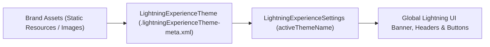

## Architectural Overview

`LightningExperienceTheme` controls corporate branding across the Salesforce Lightning interface. Rather than relying on standard Salesforce blue branding, enterprise organizations use themes to enforce visual identity standards, differentiate environment tiers (for example, applying high-contrast banners or distinct header tints in UAT versus Production to prevent accidental data modification), and improve user orientation.

At runtime, the Lightning Experience styling engine evaluates the active `LightningExperienceTheme` to inject CSS design tokens across global headers, page backgrounds, standard button accent colors, and user avatar placeholders.



## Directory and File Conventions

Theme files are organized in the `lightningExperienceThemes` directory:

| Property | Value |
| :--- | :--- |
| **Directory Name** | `lightningExperienceThemes` |
| **File Suffix** | `.lightningExperienceTheme-meta.xml` |
| **Root XML Element** | `<LightningExperienceTheme>` |
| **API Version** | `68.0` |

## Key Metadata Fields

The `LightningExperienceTheme` XML format specifies styling attributes and asset references:

| Field Name | Type | Description |
| :--- | :--- | :--- |
| `masterLabel` | `string` | Administrative display name of the theme. |
| `description` | `string` | Purpose and documentation notes for the theme. |
| `brandColor` | `string` | Hex code defining primary buttons, links, and accent elements (for example, `#0047BB`). |
| `pageBackgroundColor` | `string` | Hex code applied to the canvas background behind record flexipages. |
| `headerImage` | `string` | Identifier or URL pointer for the top-left navigation logo image. |
| `bannerImage` | `string` | Identifier or URL pointer for the global background banner header. |
| `defaultUserImage` | `string` | Fallback avatar graphic displayed for users without profile photos. |
| `shouldOverrideCatchAll` | `boolean` | When true, enforces theme color palette over legacy standard fallbacks. |

> [!TIP]
> Use distinct `brandColor` and `bannerImage` configurations between lower sandboxes (Dev/QA/UAT) and Production. This provides immediate visual cues that help prevent administrators and developers from accidentally executing production testing.

## Declarative XML and Package Manifest Examples

Below is an enterprise theme configuration `Enterprise_Branded_Theme.lightningExperienceTheme-meta.xml`:

```xml title="force-app/main/default/lightningExperienceThemes/Enterprise_Branded_Theme.lightningExperienceTheme-meta.xml"
<?xml version="1.0" encoding="UTF-8"?>
<LightningExperienceTheme xmlns="http://soap.sforce.com/2006/04/metadata">
    <masterLabel>Enterprise Corporate Theme</masterLabel>
    <description>Official corporate brand theme for production environments</description>
    <brandColor>#0047BB</brandColor>
    <pageBackgroundColor>#F3F5F8</pageBackgroundColor>
    <headerImage>Corporate_Logo_Resource</headerImage>
    <bannerImage>Corporate_Banner_Resource</bannerImage>
    <defaultUserImage>Default_Avatar_Resource</defaultUserImage>
    <shouldOverrideCatchAll>true</shouldOverrideCatchAll>
</LightningExperienceTheme>
```

### Manifest Definition (`package.xml`)

Include the theme and any supporting static resources in `package.xml`:

```xml title="manifest/package.xml"
<?xml version="1.0" encoding="UTF-8"?>
<Package xmlns="http://soap.sforce.com/2006/04/metadata">
    <types>
        <members>Enterprise_Branded_Theme</members>
        <name>LightningExperienceTheme</name>
    </types>
    <types>
        <members>Corporate_Logo_Resource</members>
        <members>Corporate_Banner_Resource</members>
        <name>StaticResource</name>
    </types>
    <version>68.0</version>
</Package>
```

## CLI Retrieval and Deployment Commands

Use the Salesforce CLI to deploy your custom theme assets:

```bash
# Retrieve all custom Lightning themes
sf project retrieve start --metadata LightningExperienceTheme

# Deploy a specific theme and activate it concurrently via settings
sf project deploy start --source-dir force-app/main/default/lightningExperienceThemes force-app/main/default/settings/LightningExperience.settings-meta.xml
```

## Senior Architect Deployment Best Practices and Gotchas

- **Activation vs Deployment:** Deploying a `LightningExperienceTheme` does not automatically activate it in the target org. To activate it in the same CI/CD deployment, include `LightningExperienceSettings` with `<activeThemeName>` matching your theme's developer name.
- **Image Asset Sizing:** Ensure `headerImage` and `bannerImage` assets conform to Salesforce recommended dimensions (header logo: 200x50px; banner: 1800x200px). Oversized assets will degrade initial page load performance and Cumulative Layout Shift (CLS).
- **Accessibility and Color Contrast:** When selecting `brandColor`, verify that contrast ratios against white text (#FFFFFF) satisfy WCAG 2.1 AA standards (minimum 4.5:1 contrast) to ensure accessible button and link rendering.

> [!WARNING]
> Deleting an active theme directly via metadata deployment will cause the target org to fall back to the standard Salesforce Lightning theme.
