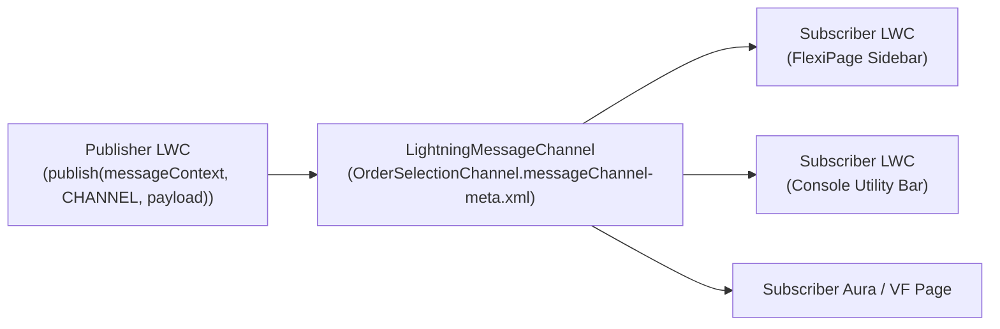

The `LightningMessageChannel` metadata type defines a **Lightning Message Service (LMS)** channel used to publish and subscribe to structured JSON messages across independent UI components on a page—including sibling [LightningComponentBundle](/docs/metadata/lightning-component-bundle-metadata-type/) instances on a [FlexiPage](/docs/metadata/flexipage-metadata-type/), Utility Bar widgets, Aura components, and Visualforce pages. Introduced in API version 47.0, LMS eliminates brittle `window.postMessage` hacks.

In Salesforce DX projects, message channels are stored in `force-app/main/default/messageChannels/` with the `.messageChannel-meta.xml` suffix.



## Key Metadata Fields

| Field | Location | Required | Description |
|---|---|---|---|
| `masterLabel` | Root | Yes | Display label of the Lightning Message Channel |
| `isExposed` | Root | No | Exposes the channel across namespaces when `true` (default `false`) |
| `description` | Root | No | Documents the channel's purpose and expected payload contract |
| `lightningMessageFields` | Root | No | List of payload keys (`fieldName` and `description`) |
| `fieldName` | `lightningMessageFields` | Yes | Property key name inside the published JSON message object |

## Production-Grade XML Example

Below is a `LightningMessageChannel` (`OrderSelectionChannel.messageChannel-meta.xml`) that broadcasts selected order details across components on an Order Command Center page:

```xml
<?xml version="1.0" encoding="UTF-8"?>
<LightningMessageChannel xmlns="http://soap.sforce.com/2006/04/metadata">
    <description>Broadcasts the currently selected Order Id and status across sibling LWCs on the Order Command Center App Page.</description>
    <isExposed>true</isExposed>
    <lightningMessageFields>
        <description>The 18-character Salesforce Id of the selected Order record.</description>
        <fieldName>orderId</fieldName>
    </lightningMessageFields>
    <lightningMessageFields>
        <description>The current Order Status code (for example, Activated, Fulfilled, Cancelled).</description>
        <fieldName>orderStatus</fieldName>
    </lightningMessageFields>
    <lightningMessageFields>
        <description>The source component that triggered the selection event.</description>
        <fieldName>sourceComponent</fieldName>
    </lightningMessageFields>
    <masterLabel>Order Selection Channel</masterLabel>
</LightningMessageChannel>
```

## Publishing and Subscribing in LWC

Notice that when importing a `LightningMessageChannel` in JavaScript, you append `__c` to the channel's file name (`@salesforce/messageChannel/OrderSelectionChannel__c`):

```javascript
import { LightningElement, wire } from 'lwc';
import { publish, subscribe, APPLICATION_SCOPE, MessageContext } from 'lightning/messageService';
import ORDER_SELECTION_CHANNEL from '@salesforce/messageChannel/OrderSelectionChannel__c';

export default class OrderDetailInspector extends LightningElement {
    @wire(MessageContext)
    messageContext;

    subscription = null;
    selectedOrderId;

    connectedCallback() {
        if (!this.subscription) {
            this.subscription = subscribe(
                this.messageContext,
                ORDER_SELECTION_CHANNEL,
                (message) => this.handleOrderSelected(message),
                { scope: APPLICATION_SCOPE }
            );
        }
    }

    handleOrderSelected(message) {
        this.selectedOrderId = message.orderId;
    }

    notifyOrderRefresh() {
        publish(this.messageContext, ORDER_SELECTION_CHANNEL, {
            orderId: this.selectedOrderId,
            orderStatus: 'Fulfilled',
            sourceComponent: 'OrderDetailInspector'
        });
    }
}
```

> [!WARNING]
> **AppExchange Security Review Requirement**: If you are building a managed package for the AppExchange, you **must** set `<isExposed>false</isExposed>` on every `LightningMessageChannel`. Setting `<isExposed>true</isExposed>` causes an automatic AppExchange Security Review failure, and once released as `true` in a managed package, it can never be changed back to `false`.

