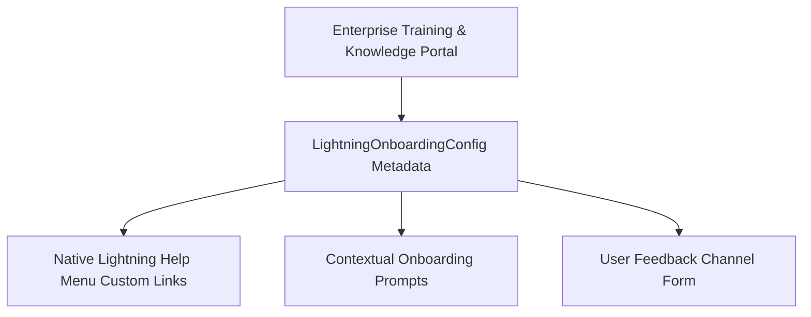

## Architectural Overview

`LightningOnboardingConfig` establishes organizational onboarding architectures for users working inside Lightning Experience. During major enterprise rollouts or cloud migrations, organizations need structured mechanisms to direct end users to corporate training wikis, contextual documentation, internal support desks, and feedback surveys.

Architecturally, `LightningOnboardingConfig` centralizes these adoption pathways. Instead of scattering documentation links across email announcements or custom home pages, this metadata binds custom help resources directly into the native Lightning Help Menu and powers targeted onboarding prompts throughout the user lifecycle.



## Directory and File Conventions

Onboarding configurations are stored in the `lightningOnboardingConfigs` folder:

| Property | Value |
| :--- | :--- |
| **Directory Name** | `lightningOnboardingConfigs` |
| **File Extension** | `.lightningOnboardingConfig` |
| **Root XML Element** | `<LightningOnboardingConfig>` |
| **API Version** | `68.0` |

## Key Metadata Fields

The `LightningOnboardingConfig` schema specifies custom assistance and feedback settings:

| Field Name | Type | Description |
| :--- | :--- | :--- |
| `masterLabel` | `string` | Display name of the onboarding configuration. |
| `customHelpResourceName` | `string` | Reference to the custom help menu resource grouping company learning links. |
| `isCustomHelpEnabled` | `boolean` | When true, renders the custom help section inside the Lightning Help Menu. |
| `feedbackForm` | `string` | External URL or internal flow endpoint capturing user feedback. |
| `promptResource` | `string` | Pointer to packaged prompt and walkthrough assets associated with onboarding. |

> [!TIP]
> Pair `LightningOnboardingConfig` with Salesforce In-App Guidance (`Prompt` metadata) to create comprehensive learning journeys that automatically trigger for new employees based on profile and role.

## Declarative XML and Package Manifest Examples

Below is an enterprise onboarding configuration `Global_Sales_Onboarding.lightningOnboardingConfig`:

```xml title="force-app/main/default/lightningOnboardingConfigs/Global_Sales_Onboarding.lightningOnboardingConfig"
<?xml version="1.0" encoding="UTF-8"?>
<LightningOnboardingConfig xmlns="http://soap.sforce.com/2006/04/metadata">
    <masterLabel>Global Enterprise Sales Onboarding</masterLabel>
    <customHelpResourceName>Sales_Enablement_Help_Menu</customHelpResourceName>
    <isCustomHelpEnabled>true</isCustomHelpEnabled>
    <feedbackForm>https://feedback.company.internal/salesforce-adoption</feedbackForm>
</LightningOnboardingConfig>
```

### Manifest Definition (`package.xml`)

Include the onboarding config in `package.xml`:

```xml title="manifest/package.xml"
<?xml version="1.0" encoding="UTF-8"?>
<Package xmlns="http://soap.sforce.com/2006/04/metadata">
    <types>
        <members>Global_Sales_Onboarding</members>
        <name>LightningOnboardingConfig</name>
    </types>
    <version>68.0</version>
</Package>
```

## CLI Retrieval and Deployment Commands

Use the Salesforce CLI to deploy onboarding configurations across sandboxes:

```bash
# Retrieve all onboarding configurations
sf project retrieve start --metadata LightningOnboardingConfig

# Deploy a specific onboarding file to UAT
sf project deploy start --source-dir force-app/main/default/lightningOnboardingConfigs/Global_Sales_Onboarding.lightningOnboardingConfig
```

## Senior Architect Deployment Best Practices and Gotchas

- **Cross-Environment Feedback URLs:** Hardcoding sandbox feedback URLs or development feedback surveys in `feedbackForm` will disrupt production feedback collection. Use environment-specific parameterization or variable injection during CI/CD promotion.
- **Help Menu Dependency:** If `customHelpResourceName` is specified, verify that any referenced custom help items or custom help menus exist in the target org before running automated release validation.
- **Permission Alignment:** Ensure standard end users have sufficient permissions to view custom help resources. If custom resources point to Salesforce Knowledge articles, verify that Data Categories and Knowledge user licenses are properly provisioned.

> [!WARNING]
> Setting `<isCustomHelpEnabled>false</isCustomHelpEnabled>` immediately suppresses custom help sections across the entire organization, leaving users with only standard Salesforce documentation.
