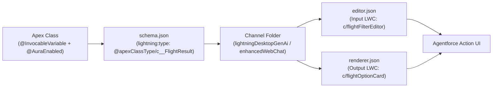

## Why `LightningTypeBundle` Is a Game-Changer for Agentforce

Available starting in **API version 64.0**, **`LightningTypeBundle`** bridges the gap between backend **Agentforce Actions** ([GenAiFunction](/docs/metadata/genai-function-metadata-type/)) and rich, interactive **Lightning Web Components** ([LightningComponentBundle](/docs/metadata/lightning-component-bundle-metadata-type/)).

Without `LightningTypeBundle`, an Agentforce agent responds only with plain markdown text. By defining a `LightningTypeBundle` mapped to an Apex class (`@apexClassType/c__FlightOption`), you can replace plain text prompts and responses with:

- **Custom Input Editors (`editor.json`):** Render an interactive date picker, seat map, or filter form inside the Agentforce chat window when the agent needs structured parameters.
- **Custom Output Renderers (`renderer.json`):** Render rich interactive LWC carousels, pricing comparison cards, or approval widgets when an Agentforce action returns structured Apex output.



---

## SFDX Directory Structure (`lightningTypes/`)

Unlike standard XML metadata types, a `LightningTypeBundle` is a JSON-driven folder inside `force-app/main/default/lightningTypes/<TypeName>/`:

```text
force-app/main/default/lightningTypes/flightSearchResponse/
├── schema.json
├── lightningDesktopGenAi/
│   ├── editor.json
│   └── renderer.json
└── enhancedWebChat/
    └── renderer.json
```

### Supported Channel Directories

| Folder Name | Target Experience / Channel | Supported Overrides |
|---|---|---|
| `lightningDesktopGenAi` | Agentforce (Default) / Employee Agent in Lightning Experience | `editor.json`, `renderer.json` |
| `enhancedWebChat` | Messaging for In-App and Web (MIAW) / Agentforce Service Agent | `editor.json`, `renderer.json` |
| `lightningMobileGenAi` | Agentforce on the Salesforce Mobile App | `editor.json`, `renderer.json` |
| `experienceBuilder` | Experience Builder Property Panel & Site Components | `editor.json`, `renderer.json` |

---

## Real-World Example: Custom Agentforce Output Card Linked to Apex

### 1. Apex Data Transfer Class (`classes/FlightQuoteResult.cls`)

Every property exposed to a `LightningTypeBundle` must carry **both** `@InvocableVariable` (for the Agentforce action) and `@AuraEnabled` (for the LWC renderer):

```java
public with sharing class FlightQuoteResult {
    @InvocableVariable(label='Flight Number')
    @AuraEnabled
    public String flightNumber;

    @InvocableVariable(label='Total Fare USD')
    @AuraEnabled
    public Decimal totalFare;
}
```

### 2. Schema Definition (`lightningTypes/flightQuoteResult/schema.json`)

```json
{
  "title": "Flight Quote Result",
  "description": "Structured flight quote returned by the booking Agentforce action",
  "lightning:type": "@apexClassType/c__FlightQuoteResult"
}
```

### 3. Desktop Agentforce Renderer (`lightningTypes/flightQuoteResult/lightningDesktopGenAi/renderer.json`)

```json
{
  "renderer": {
    "componentOverrides": {
      "$": {
        "definition": "c/flightQuoteCard"
      }
    }
  }
}
```

### 4. Exposing the LWC Target (`lwc/flightQuoteCard/flightQuoteCard.js-meta.xml`)

Your LWC must declare the corresponding capability (`lightning__AgentforceOutput` or `lightning__AgentforceInput`) and bind to the custom `LightningTypeBundle`:

```xml
<?xml version="1.0" encoding="UTF-8"?>
<LightningComponentBundle xmlns="http://soap.sforce.com/2006/04/metadata">
    <apiVersion>68.0</apiVersion>
    <isExposed>true</isExposed>
    <targets>
        <target>lightning__AgentforceOutput</target>
    </targets>
    <targetConfigs>
        <targetConfig targets="lightning__AgentforceOutput">
            <sourceType name="c__flightQuoteResult"/>
        </targetConfig>
    </targetConfigs>
</LightningComponentBundle>
```

---

## Deploying `LightningTypeBundle` with `package.xml`

```xml
<?xml version="1.0" encoding="UTF-8"?>
<Package xmlns="http://soap.sforce.com/2006/04/metadata">
    <types>
        <members>flightQuoteResult</members>
        <name>LightningTypeBundle</name>
    </types>
    <version>68.0</version>
</Package>
```

> [!WARNING]
> **Deploy Order Matters:** Because `schema.json` references `@apexClassType/c__FlightQuoteResult` and your LWC's `targetConfig` references `c__flightQuoteResult`, always deploy the `ApexClass` first (or in the same transaction) before deploying the `LightningTypeBundle` and `LightningComponentBundle`.
