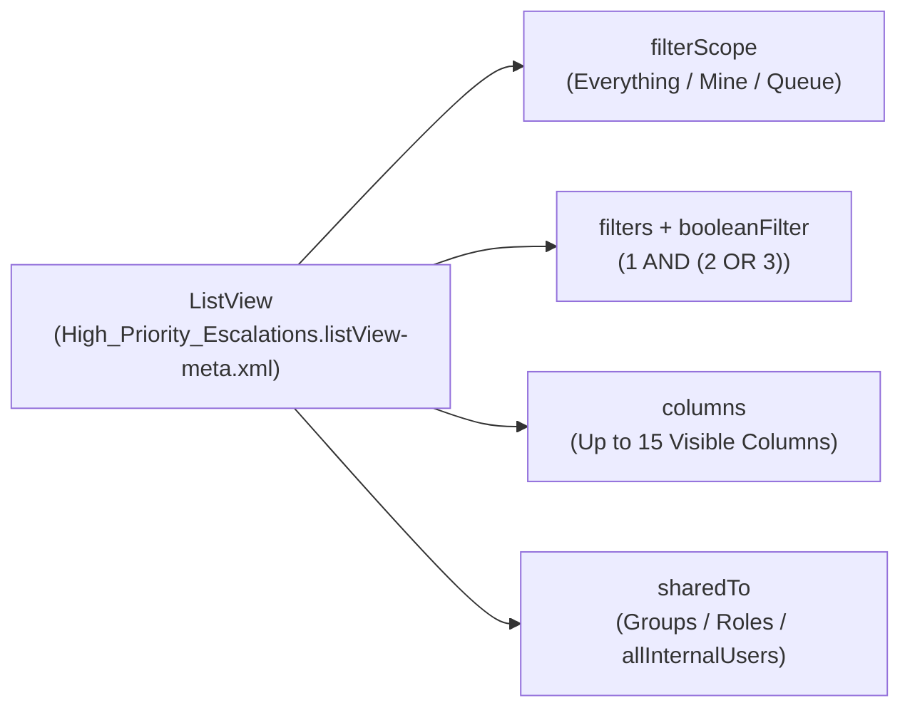

The `ListView` metadata type defines the columns, record ownership scope (`filterScope`), filter criteria (`filters` and `booleanFilter`), and audience sharing (`sharedTo`) for an object's list view in Lightning Experience and Salesforce Mobile. Introduced in API version 14.0, version-controlling `ListView` files ensures support teams, sales reps, and queue managers get standardized operational views immediately upon deployment.

In Salesforce DX projects, list views live inside their parent object folder at `force-app/main/default/objects/<ObjectName>/listViews/<ListViewName>.listView-meta.xml`.



## Key Metadata Fields

| Field | Type | Required | Description |
|---|---|---|---|
| `fullName` | `string` | Yes | Developer API name of the list view |
| `label` | `string` | Yes | Display name shown in the List View dropdown |
| `filterScope` | `FilterScope` | Yes | Ownership filter: `Everything`, `Mine`, `Queue`, `Delegated`, `MyTerritory`, or `MyTeamTerritory` |
| `queue` | `string` | Conditional | Queue developer name (required when `filterScope` is `Queue`) |
| `columns` | `string[]` | No | Ordered list of field column names (up to 15 columns displayed in UI) |
| `filters` | `ListViewFilter[]` | No | Up to 10 filter rows (`field`, `operation`, `value`) |
| `booleanFilter` | `string` | No | Custom filter logic such as `1 AND (2 OR 3)` |
| `sharedTo` | `SharedTo` | No | Audience visibility (`allInternalUsers`, `group`, `role`, `roleAndSubordinatesInternal`) |

## Production-Grade XML Example

Below is a Queue-backed `Case` list view (`force-app/main/default/objects/Case/listViews/Tier_3_Escalation_Queue_View.listView-meta.xml`) shared with a Public Group and Role:

```xml
<?xml version="1.0" encoding="UTF-8"?>
<ListView xmlns="http://soap.sforce.com/2006/04/metadata">
    <fullName>Tier_3_Escalation_Queue_View</fullName>
    <booleanFilter>1 AND (2 OR 3)</booleanFilter>
    <columns>CASES.CASE_NUMBER</columns>
    <columns>ACCOUNT.NAME</columns>
    <columns>CASES.SUBJECT</columns>
    <columns>CASES.STATUS</columns>
    <columns>CASES.PRIORITY</columns>
    <columns>CASES.CREATED_DATE</columns>
    <columns>CORE.USERS.ALIAS</columns>
    <filterScope>Queue</filterScope>
    <filters>
        <field>CASES.CLOSED</field>
        <operation>equals</operation>
        <value>0</value>
    </filters>
    <filters>
        <field>CASES.PRIORITY</field>
        <operation>equals</operation>
        <value>High,Critical</value>
    </filters>
    <filters>
        <field>CASES.ESCALATED</field>
        <operation>equals</operation>
        <value>1</value>
    </filters>
    <label>Tier 3 Escalation Queue</label>
    <queue>Tier_3_Engineering_Queue</queue>
    <sharedTo>
        <group>Tier_3_Support_Engineers</group>
        <roleAndSubordinatesInternal>VP_Customer_Support</roleAndSubordinatesInternal>
    </sharedTo>
</ListView>
```

> [!WARNING]
> **Standard Field Column Naming Quirk**: Standard object `ListView` metadata uses internal upper-snake-case column names (such as `CASES.CASE_NUMBER`, `ACCOUNT.NAME`, `OPPORTUNITY.STAGE_NAME`, `CORE.USERS.ALIAS`, and `CREATED_DATE`) rather than standard SOQL field API names. Always configure a list view on a standard object in a scratch org or sandbox first and run `sf project retrieve start -m ListView:Case.Tier_3_Escalation_Queue_View` to capture the exact column tokens.

## Querying `ListView` with SOQL

You can query `ListView` records directly in standard SOQL:

```sql
-- Find all ListViews on Case and check whether they are SOQL-compatible
SELECT Id, Name, DeveloperName, SobjectType, IsSoqlCompatible, LastViewedDate
FROM ListView
WHERE SobjectType = 'Case'
ORDER BY Name ASC
```

