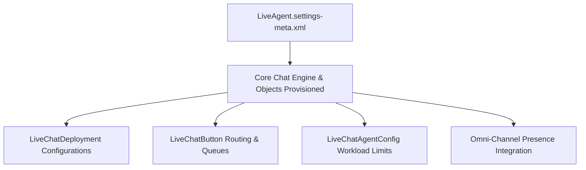

## Architectural Overview

`LiveAgentSettings` controls organizational enablement of Salesforce legacy Chat (formerly Live Agent). For high-volume contact centers, real-time web chat provides an essential channel for customer support, lead qualification, and immediate dispute resolution. Although Salesforce now offers modern Messaging for Web and In-App, legacy Chat remains active across thousands of enterprise deployments.

Architecturally, `LiveAgentSettings` serves as the foundation of the Chat infrastructure. Activating `enableLiveAgent` provisions core sObjects (such as `LiveChatTranscript`, `LiveChatVisitor`, and `LiveChatSession`), enables routing handshakes with Omni-Channel, and unlocks the deployment of downstream chat buttons, agent configurations, and sensitive data masking rules.



## Directory and File Conventions

`LiveAgentSettings` is a singleton Settings metadata asset stored in the `settings` directory.

| Property | Value |
| :--- | :--- |
| **Directory Name** | `settings` |
| **File Name** | `LiveAgent.settings-meta.xml` |
| **Root XML Element** | `<LiveAgentSettings>` |
| **API Version** | `68.0` |

## Key Metadata Fields

The `LiveAgentSettings` schema defines core chat switches:

| Field Name | Type | Description |
| :--- | :--- | :--- |
| `enableLiveAgent` | `boolean` | Master switch activating Live Agent chat functionality in the organization. |
| `enableTranscriptAutoSave` | `boolean` | Automatically persists transcripts to `LiveChatTranscript` records upon session close. |
| `enableVisualforcePages` | `boolean` | Permits hosting legacy Visualforce custom chat windows and pre-chat forms. |

> [!NOTE]
> Setting `<enableLiveAgent>true</enableLiveAgent>` is a strict prerequisite for deploying downstream metadata such as `LiveChatButton`, `LiveChatDeployment`, and `LiveChatAgentConfig`.

## Declarative XML and Package Manifest Examples

Below is a production-grade `LiveAgent.settings-meta.xml` configuration:

```xml title="force-app/main/default/settings/LiveAgent.settings-meta.xml"
<?xml version="1.0" encoding="UTF-8"?>
<LiveAgentSettings xmlns="http://soap.sforce.com/2006/04/metadata">
    <enableLiveAgent>true</enableLiveAgent>
    <enableTranscriptAutoSave>true</enableTranscriptAutoSave>
    <enableVisualforcePages>false</enableVisualforcePages>
</LiveAgentSettings>
```

### Manifest Definition (`package.xml`)

Include the setting in your deployment package:

```xml title="manifest/package.xml"
<?xml version="1.0" encoding="UTF-8"?>
<Package xmlns="http://soap.sforce.com/2006/04/metadata">
    <types>
        <members>LiveAgent</members>
        <name>Settings</name>
    </types>
    <version>68.0</version>
</Package>
```

## CLI Retrieval and Deployment Commands

Use the Salesforce CLI to deploy chat settings:

```bash
# Retrieve LiveAgent settings from the org
sf project retrieve start --metadata Settings:LiveAgent

# Deploy settings to enable chat in a newly created sandbox
sf project deploy start --source-dir force-app/main/default/settings/LiveAgent.settings-meta.xml
```

## Senior Architect Deployment Best Practices and Gotchas

- **Deployment Dependency Order:** Never attempt to deploy `LiveChatButton` or `LiveChatDeployment` into an org where `LiveAgentSettings` has not yet been deployed and activated. Always sequence `LiveAgentSettings` first in CI/CD pipeline stages.
- **Service Cloud Feature Licensing:** In scratch orgs, ensure the scratch org definition file (`project-scratch-def.json`) includes `"features": ["LiveAgent", "ServiceCloud"]`. Without these features enabled, deploying `LiveAgentSettings` will fail with an unsupported feature error.
- **Transcript Storage Sizing:** Enabling `enableTranscriptAutoSave` creates a record for every customer chat attempt (including missed or abandoned chats). Calculate data storage capacity requirements in advance for high-volume contact centers.

> [!WARNING]
> Disabling `<enableLiveAgent>` in an active contact center immediately terminates all active agent chat sessions and hides chat widgets from external customer sites.
