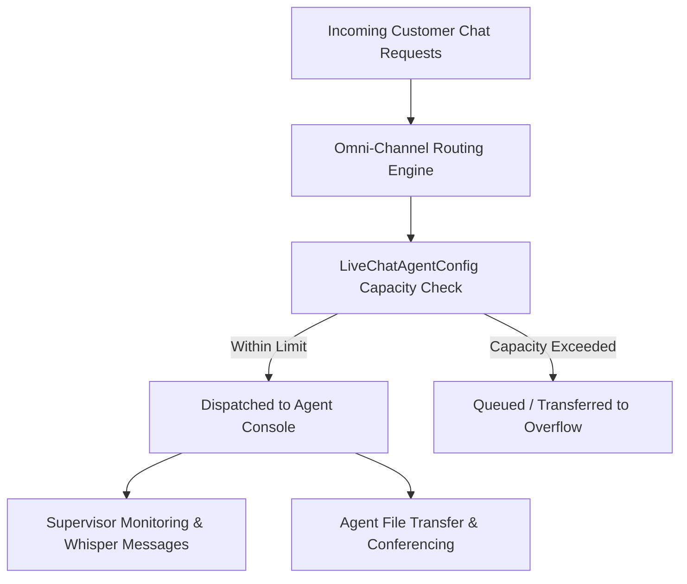

## Architectural Overview

`LiveChatAgentConfig` defines operational guardrails and capabilities for customer service agents handling live chat interactions. In large enterprise contact centers, tier-1 agents require different session concurrency limits, file transfer permissions, and supervisor escalation rules than specialized tier-3 technical agents or team leads.

Architecturally, `LiveChatAgentConfig` configures the agent experience within the Service Console. It determines concurrent chat capacity limits (preventing agent burnout), unlocks supervisor whisper coaching, enables real-time chat conferencing with other specialists, and authorizes bidirectional customer file transfers for proof-of-purchase or diagnostic screenshots.



## Directory and File Conventions

Live Chat Agent configurations are stored in the `liveChatAgentConfigs` directory:

| Property | Value |
| :--- | :--- |
| **Directory Name** | `liveChatAgentConfigs` |
| **File Extension** | `.liveChatAgentConfig` |
| **Root XML Element** | `<LiveChatAgentConfig>` |
| **API Version** | `68.0` |

## Key Metadata Fields

The `LiveChatAgentConfig` definition provides granular control over agent limits and capabilities:

| Field Name | Type | Description |
| :--- | :--- | :--- |
| `developerName` | `string` | Unique API identifier for the agent configuration. |
| `masterLabel` | `string` | Administrative display label. |
| `capacity` | `int` | Maximum simultaneous active chats an agent assigned to this configuration can hold. |
| `enableAgentFileTransfer` | `boolean` | Allows agents to send files to customers during an active chat session. |
| `enableChatConferencing` | `boolean` | Enables agents to invite other specialists into an active conference chat. |
| `enableChatMonitoring` | `boolean` | Allows supervisors to silently monitor active chats and whisper advice to agents. |
| `enableChatTransferToAgent` | `boolean` | Permits transferring chats directly to named individual agents. |
| `enableChatTransferToQueue` | `boolean` | Permits re-routing chats into another skill group or queue. |
| `enableWhisperMessage` | `boolean` | Enables supervisor-to-agent private coaching messages during customer interactions. |

> [!TIP]
> Keep `capacity` aligned with your Omni-Channel Routing Configuration units. When using Omni-Channel routing, ensure the agent capacity in `LiveChatAgentConfig` does not conflict with the capacity model defined in `PresenceUserConfig`.

## Declarative XML and Package Manifest Examples

Below is an enterprise configuration for tier-2 technical support agents:

```xml title="force-app/main/default/liveChatAgentConfigs/Tier2_Technical_Support.liveChatAgentConfig"
<?xml version="1.0" encoding="UTF-8"?>
<LiveChatAgentConfig xmlns="http://soap.sforce.com/2006/04/metadata">
    <developerName>Tier2_Technical_Support</developerName>
    <masterLabel>Tier 2 Technical Support Agent Config</masterLabel>
    <capacity>3</capacity>
    <enableAgentFileTransfer>true</enableAgentFileTransfer>
    <enableChatConferencing>true</enableChatConferencing>
    <enableChatMonitoring>true</enableChatMonitoring>
    <enableChatTransferToAgent>true</enableChatTransferToAgent>
    <enableChatTransferToQueue>true</enableChatTransferToQueue>
    <enableWhisperMessage>true</enableWhisperMessage>
</LiveChatAgentConfig>
```

### Manifest Definition (`package.xml`)

Include the agent config in `package.xml`:

```xml title="manifest/package.xml"
<?xml version="1.0" encoding="UTF-8"?>
<Package xmlns="http://soap.sforce.com/2006/04/metadata">
    <types>
        <members>Tier2_Technical_Support</members>
        <name>LiveChatAgentConfig</name>
    </types>
    <version>68.0</version>
</Package>
```

## CLI Retrieval and Deployment Commands

Retrieve and deploy agent configurations using the Salesforce CLI:

```bash
# Retrieve all agent configurations
sf project retrieve start --metadata LiveChatAgentConfig

# Deploy a specific configuration to production
sf project deploy start --source-dir force-app/main/default/liveChatAgentConfigs/Tier2_Technical_Support.liveChatAgentConfig
```

## Senior Architect Deployment Best Practices and Gotchas

- **Profile and User Assignments:** In legacy setups, `LiveChatAgentConfig` can embed `<assignments>` referencing specific Profile names or User IDs. Never deploy hardcoded sandbox User IDs in XML metadata; rely on Profile assignments or post-deployment automated permission set group scripts.
- **Supervisor Security Roles:** When enabling `enableChatMonitoring`, ensure your Service Console layouts and user role hierarchies allow supervisors to see and access team members across multiple queues.
- **File Transfer Network Policies:** If `enableAgentFileTransfer` is enabled, verify that Content Deliveries and Salesforce Files upload limits are configured according to your corporate network security policies.

> [!WARNING]
> Setting agent `capacity` too high (for example, above 4 concurrent chats) significantly elevates First Response Time (FRT) and degrades Customer Satisfaction (CSAT) scores in complex technical domains.
