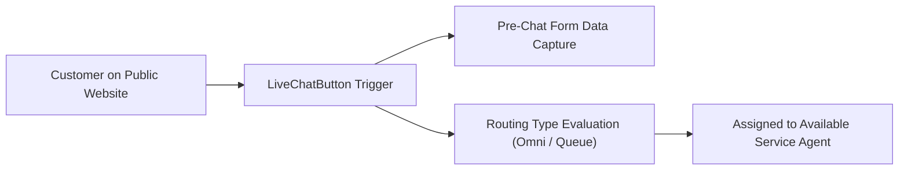

## Architectural Overview

`LiveChatButton` represents the customer-facing initiation point for live chat sessions. Whether embedded as a static "Chat with an Expert" banner on an e-commerce checkout page or triggered proactively as an automated invitation when a user spends more than 60 seconds on a pricing calculator, `LiveChatButton` links the client website with the contact center routing architecture.

From a solution architecture perspective, `LiveChatButton` binds three crucial tiers:
1. **Visual Presentation:** Online/offline button graphics, custom invitation animations, and window dimensions.
2. **Pre-Chat Intelligence:** Pre-chat forms and custom routing data mapping incoming visitor details to Cases or Contacts.
3. **Queue Distribution:** Determining how incoming requests route—either to legacy Live Agent queues or modern Omni-Channel skill queues.



## Directory and File Conventions

Live Chat Button definitions are stored in the `liveChatButtons` directory:

| Property | Value |
| :--- | :--- |
| **Directory Name** | `liveChatButtons` |
| **File Extension** | `.liveChatButton` |
| **Root XML Element** | `<LiveChatButton>` |
| **API Version** | `68.0` |

## Key Metadata Fields

The `LiveChatButton` schema defines display and routing mechanics:

| Field Name | Type | Description |
| :--- | :--- | :--- |
| `developerName` | `string` | Unique programmatic name for the chat button. |
| `masterLabel` | `string` | User-friendly label displayed in Setup. |
| `type` | `string` | Button interaction type: `ChatButton` (standard click) or `Invite` (automated popup). |
| `routingType` | `string` | Work distribution model: `Omni`, `Choice`, `LeastActive`, or `MostAvailable`. |
| `deployment` | `string` | API developer name of the parent `LiveChatDeployment`. |
| `queue` | `string` | Developer name of the fallback queue when legacy queue routing is utilized. |
| `onlineImage` | `string` | URL or static resource reference for the active online button state. |
| `offlineImage` | `string` | URL or static resource reference displayed when no agents are available. |
| `hasQueue` | `boolean` | Indicates whether queuing is enabled when agents are at maximum capacity. |

> [!TIP]
> Modern implementations should always set `<routingType>Omni</routingType>` to leverage Omni-Channel supervisor dashboards, presence status tracking, and unified routing across voice, chat, and messaging.

## Declarative XML and Package Manifest Examples

Below is a configuration for an enterprise technical support chat button:

```xml title="force-app/main/default/liveChatButtons/Technical_Support_Button.liveChatButton"
<?xml version="1.0" encoding="UTF-8"?>
<LiveChatButton xmlns="http://soap.sforce.com/2006/04/metadata">
    <developerName>Technical_Support_Button</developerName>
    <masterLabel>Technical Support Chat</masterLabel>
    <type>ChatButton</type>
    <routingType>Omni</routingType>
    <deployment>Global_Support_Deployment</deployment>
    <hasQueue>true</hasQueue>
    <onlineImage>https://assets.company.com/chat/btn-online.svg</onlineImage>
    <offlineImage>https://assets.company.com/chat/btn-offline.svg</offlineImage>
    <windowLanguage>en_US</windowLanguage>
</LiveChatButton>
```

### Manifest Definition (`package.xml`)

Include `LiveChatButton` along with its parent deployment in `package.xml`:

```xml title="manifest/package.xml"
<?xml version="1.0" encoding="UTF-8"?>
<Package xmlns="http://soap.sforce.com/2006/04/metadata">
    <types>
        <members>Technical_Support_Button</members>
        <name>LiveChatButton</name>
    </types>
    <types>
        <members>Global_Support_Deployment</members>
        <name>LiveChatDeployment</name>
    </types>
    <version>68.0</version>
</Package>
```

## CLI Retrieval and Deployment Commands

Use the Salesforce CLI to deploy chat buttons:

```bash
# Retrieve all LiveChatButton components
sf project retrieve start --metadata LiveChatButton

# Deploy the button alongside its deployment dependency
sf project deploy start --source-dir force-app/main/default/liveChatDeployments force-app/main/default/liveChatButtons
```

## Senior Architect Deployment Best Practices and Gotchas

- **Parent Deployment Dependency:** A `LiveChatButton` references a `LiveChatDeployment` via `<deployment>`. Deploying a button without its referenced deployment will fail with a metadata validation error.
- **External Asset URLs:** Avoid hardcoding test image URLs for `onlineImage` and `offlineImage`. Host production assets on a trusted CDN with HTTPS and configure appropriate Content Security Policy (CSP) headers.
- **Omni-Channel Queue Mappings:** When `<routingType>Omni</routingType>` is chosen, verify that the routing configuration, queue, and service presence statuses are deployed concurrently to avoid routing deadlocks.

> [!WARNING]
> If `<hasQueue>false</hasQueue>` is deployed and all available agents are at capacity, incoming customer chat clicks will be rejected immediately with an offline message.
