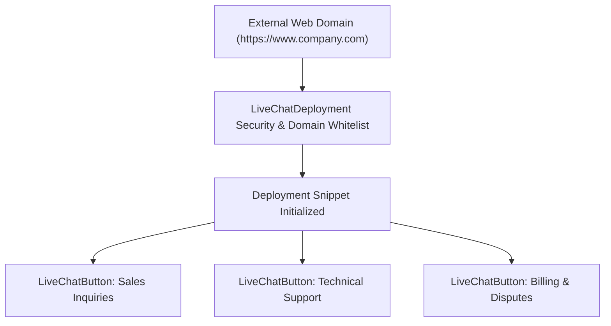

## Architectural Overview

`LiveChatDeployment` represents the security and container definition for embedding live chat on external web properties or customer portals. When an organization embeds Salesforce live chat into a corporate website, the deployment configuration governs the generated JavaScript bootstrap code, CORS and domain whitelisting, session timeout warnings, and transcript persistence behaviors.

Architecturally, `LiveChatDeployment` serves as the parent container for multiple `LiveChatButton` metadata items. For example, a single `Global_Support_Deployment` can host several regional buttons (such as English, French, and Japanese buttons), all sharing standard idle connection timeout rules, branded chat window dimensions, and strict domain whitelisting.



## Directory and File Conventions

Deployments are stored in the `liveChatDeployments` directory:

| Property | Value |
| :--- | :--- |
| **Directory Name** | `liveChatDeployments` |
| **File Extension** | `.liveChatDeployment` |
| **Root XML Element** | `<LiveChatDeployment>` |
| **API Version** | `68.0` |

## Key Metadata Fields

The `LiveChatDeployment` schema defines operational and security properties:

| Field Name | Type | Description |
| :--- | :--- | :--- |
| `developerName` | `string` | Unique API identifier for the deployment configuration. |
| `masterLabel` | `string` | Administrative display name. |
| `branding` | `string` | Name of the branding asset or static resource styling the chat container window. |
| `connectionTimeoutDuration` | `int` | Idle timeout in seconds before closing an inactive chat session. |
| `connectionWarningDuration` | `int` | Warning duration in seconds alerting users of impending disconnection. |
| `domainWhiteList` | `string[]` | Authorized external host domains permitted to host the deployment snippet. |
| `enablePrechat` | `boolean` | Requires visitors to complete pre-chat information prior to queue assignment. |
| `enableTranscriptSave` | `boolean` | Allows visitors to download or email a copy of their chat transcript. |
| `windowLanguage` | `string` | Localization language code applied to standard chat widget controls. |

> [!TIP]
> Always populate `domainWhiteList` with explicit domain names (for example, `https://support.company.com`) rather than wildcards. Restricting authorized origins prevents unauthorized third parties from initiating chats against your contact center licenses.

## Declarative XML and Package Manifest Examples

Below is a production `Global_Support_Deployment.liveChatDeployment` metadata file:

```xml title="force-app/main/default/liveChatDeployments/Global_Support_Deployment.liveChatDeployment"
<?xml version="1.0" encoding="UTF-8"?>
<LiveChatDeployment xmlns="http://soap.sforce.com/2006/04/metadata">
    <developerName>Global_Support_Deployment</developerName>
    <masterLabel>Global Enterprise Customer Support</masterLabel>
    <connectionTimeoutDuration>180</connectionTimeoutDuration>
    <connectionWarningDuration>30</connectionWarningDuration>
    <domainWhiteList>https://www.company.com</domainWhiteList>
    <domainWhiteList>https://support.company.com</domainWhiteList>
    <enablePrechat>true</enablePrechat>
    <enableTranscriptSave>true</enableTranscriptSave>
    <windowLanguage>en_US</windowLanguage>
</LiveChatDeployment>
```

### Manifest Definition (`package.xml`)

Include `LiveChatDeployment` in `package.xml`:

```xml title="manifest/package.xml"
<?xml version="1.0" encoding="UTF-8"?>
<Package xmlns="http://soap.sforce.com/2006/04/metadata">
    <types>
        <members>Global_Support_Deployment</members>
        <name>LiveChatDeployment</name>
    </types>
    <version>68.0</version>
</Package>
```

## CLI Retrieval and Deployment Commands

Retrieve and deploy deployments using the Salesforce CLI:

```bash
# Retrieve all LiveChatDeployment components
sf project retrieve start --metadata LiveChatDeployment

# Deploy the deployment to production
sf project deploy start --source-dir force-app/main/default/liveChatDeployments/Global_Support_Deployment.liveChatDeployment
```

## Senior Architect Deployment Best Practices and Gotchas

- **Domain Whitelist Variations:** Sandboxes typically require staging website origins (for example, `https://staging.company.com`), whereas production requires live corporate domains. Maintain environment-specific config files or automate domain replacement during CI/CD promotions.
- **Transcript Email Deliverability:** If `enableTranscriptSave` is enabled, verify that Org-Wide Email Addresses and SPF/DKIM authentication are configured so customer transcript emails are not blocked by corporate spam filters.
- **CORS vs. Domain Whitelist:** `domainWhiteList` within `LiveChatDeployment` restricts script execution, but you must also register your website domain in Salesforce **CORS (Cross-Origin Resource Sharing)** settings for pre-chat REST calls to function cleanly.

> [!WARNING]
> Omitting `domainWhiteList` entirely allows the chat deployment script to be invoked from any origin on the internet, creating a significant security vulnerability and exposing agents to automated spam attacks.
