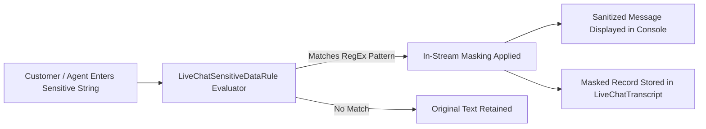

## Architectural Overview

`LiveChatSensitiveDataRule` is a compliance metadata asset in Salesforce Service Cloud. Organizations subject to industry security frameworks—such as PCI-DSS (Payment Card Industry Data Security Standard), HIPAA (Health Insurance Portability and Accountability Act), and GDPR—must ensure that personally identifiable information (PII) and cardholder data are not stored in plaintext across chat transcripts.

Architecturally, `LiveChatSensitiveDataRule` functions as an in-stream regex interceptor. When a customer or agent types a sensitive string (such as a 16-digit credit card number or national identity number), the rule intercepts the message payload before it is written to the `LiveChatTranscript` record or rendered on the supervisor monitoring console, replacing sensitive characters with mask strings (for example, `XXXX-XXXX-XXXX-1234`).



## Directory and File Conventions

Sensitive data rules are stored in the `liveChatSensitiveDataRules` directory:

| Property | Value |
| :--- | :--- |
| **Directory Name** | `liveChatSensitiveDataRules` |
| **File Extension** | `.liveChatSensitiveDataRule` |
| **Root XML Element** | `<LiveChatSensitiveDataRule>` |
| **API Version** | `68.0` |

## Key Metadata Fields

The `LiveChatSensitiveDataRule` schema exposes regular expression parsing fields:

| Field Name | Type | Description |
| :--- | :--- | :--- |
| `developerName` | `string` | Unique API name of the data masking rule. |
| `masterLabel` | `string` | Descriptive label displayed in the Setup audit trail. |
| `pattern` | `string` | Standard Regular Expression (RegEx) pattern used to match sensitive text. |
| `replacement` | `string` | Masking character string substituting matched sensitive sequences (for example, `[REDACTED]`). |
| `actionType` | `string` | Transformation action: `Remove` (strips pattern completely) or `Replace` (substitutes mask). |
| `enforceOn` | `string` | Participant context: `Agent`, `Visitor`, `Supervisor`, or combinations. |
| `isActive` | `boolean` | Master toggle activating the rule in the runtime engine. |
| `description` | `string` | Audit summary describing compliance scope (such as PCI-DSS requirement 3.4). |

> [!TIP]
> Rigorously test your RegEx `pattern` against varied formatting variations (such as credit card numbers written with dashes, spaces, or raw digits) to prevent evasion while avoiding catastrophic regex backtracking.

## Declarative XML and Package Manifest Examples

Below is a production `Credit_Card_Masking.liveChatSensitiveDataRule` configuration:

```xml title="force-app/main/default/liveChatSensitiveDataRules/Credit_Card_Masking.liveChatSensitiveDataRule"
<?xml version="1.0" encoding="UTF-8"?>
<LiveChatSensitiveDataRule xmlns="http://soap.sforce.com/2006/04/metadata">
    <developerName>Credit_Card_Masking</developerName>
    <masterLabel>Credit Card Number Masking Rule</masterLabel>
    <actionType>Replace</actionType>
    <description>Masks Visa, Mastercard, and Amex credit card numbers in real time</description>
    <enforceOn>Visitor</enforceOn>
    <enforceOn>Agent</enforceOn>
    <isActive>true</isActive>
    <pattern>\b(?:\d[ -]*?){13,16}\b</pattern>
    <replacement>[CARD REDACTED]</replacement>
</LiveChatSensitiveDataRule>
```

### Manifest Definition (`package.xml`)

Include the rule in `package.xml`:

```xml title="manifest/package.xml"
<?xml version="1.0" encoding="UTF-8"?>
<Package xmlns="http://soap.sforce.com/2006/04/metadata">
    <types>
        <members>Credit_Card_Masking</members>
        <name>LiveChatSensitiveDataRule</name>
    </types>
    <version>68.0</version>
</Package>
```

## CLI Retrieval and Deployment Commands

Use the Salesforce CLI to deploy sensitive data rules:

```bash
# Retrieve all sensitive data rules
sf project retrieve start --metadata LiveChatSensitiveDataRule

# Deploy the masking rule across test and production orgs
sf project deploy start --source-dir force-app/main/default/liveChatSensitiveDataRules/Credit_Card_Masking.liveChatSensitiveDataRule
```

## Senior Architect Deployment Best Practices and Gotchas

- **RegEx Escape Characters in XML:** Remember that backslashes must be properly escaped inside XML tag payloads (for example, `\b` for word boundaries and `\d` for numeric digits). Unescaped single slashes will cause metadata parsing failures during deployment.
- **Rule Ordering and Performance:** Keep the total number of active sensitive data rules reasonable (typically fewer than 10 rules). Because every incoming and outgoing keystroke is evaluated against active rules, overly complex regular expressions can introduce noticeable message rendering latency.
- **Historical Transcripts:** Deploying a `LiveChatSensitiveDataRule` only sanitizes **future** live chat sessions. It does not retroactively redact sensitive data from historical `LiveChatTranscript` records already committed to the database.

> [!WARNING]
> If `<actionType>Remove</actionType>` is selected, the matched characters are erased without leaving a placeholder, which can confuse agents reading fragmented sentences.
