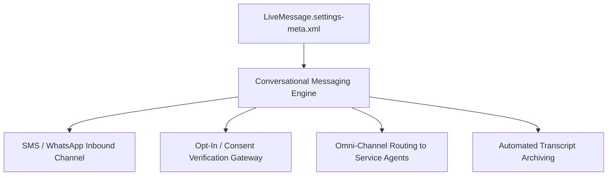

## Architectural Overview

`LiveMessageSettings` governs organization-level capabilities for asynchronous messaging channels (including SMS, WhatsApp, Facebook Messenger, and Apple Messages for Business). In omni-channel customer service architectures, asynchronous messaging allows customers to start conversations, pause, and resume hours later without losing conversational context or agent history.

From an enterprise governance perspective, `LiveMessageSettings` configures compliance mechanisms surrounding consent management (TCPA, GDPR, and carrier guidelines), automated session archiving, and bot handoff integrations. Enabling these settings provisions the foundation for conversational messaging components and Einstein Bots.



## Directory and File Conventions

`LiveMessageSettings` is stored in the `settings` directory as a singleton metadata asset.

| Property | Value |
| :--- | :--- |
| **Directory Name** | `settings` |
| **File Name** | `LiveMessage.settings-meta.xml` |
| **Root XML Element** | `<LiveMessageSettings>` |
| **API Version** | `68.0` |

## Key Metadata Fields

The `LiveMessageSettings` schema manages messaging features:

| Field Name | Type | Description |
| :--- | :--- | :--- |
| `enableLiveMessage` | `boolean` | Master toggle activating digital messaging capabilities. |
| `enableTranscriptAutoSave` | `boolean` | Automatically persists completed conversations to `MessagingSession` records. |
| `enableCustomerConsentTracking` | `boolean` | Enforces explicit opt-in consent checks prior to sending outbound SMS or messages. |
| `enableAutomatedNotification` | `boolean` | Permits automated outbound messaging via Flow or Apex triggers. |

> [!NOTE]
> Messaging channels require dedicated digital engagement licenses. Ensure licenses are provisioned in target orgs before deploying `LiveMessageSettings`.

## Declarative XML and Package Manifest Examples

Below is a production `LiveMessage.settings-meta.xml` configuration:

```xml title="force-app/main/default/settings/LiveMessage.settings-meta.xml"
<?xml version="1.0" encoding="UTF-8"?>
<LiveMessageSettings xmlns="http://soap.sforce.com/2006/04/metadata">
    <enableLiveMessage>true</enableLiveMessage>
    <enableTranscriptAutoSave>true</enableTranscriptAutoSave>
    <enableCustomerConsentTracking>true</enableCustomerConsentTracking>
    <enableAutomatedNotification>true</enableAutomatedNotification>
</LiveMessageSettings>
```

### Manifest Definition (`package.xml`)

Include the setting in `package.xml`:

```xml title="manifest/package.xml"
<?xml version="1.0" encoding="UTF-8"?>
<Package xmlns="http://soap.sforce.com/2006/04/metadata">
    <types>
        <members>LiveMessage</members>
        <name>Settings</name>
    </types>
    <version>68.0</version>
</Package>
```

## CLI Retrieval and Deployment Commands

Use the Salesforce CLI to deploy messaging settings:

```bash
# Retrieve LiveMessage settings
sf project retrieve start --metadata Settings:LiveMessage

# Deploy settings to enable messaging in a sandbox
sf project deploy start --source-dir force-app/main/default/settings/LiveMessage.settings-meta.xml
```

## Senior Architect Deployment Best Practices and Gotchas

- **Opt-In Regulatory Compliance:** Always set `<enableCustomerConsentTracking>true</enableCustomerConsentTracking>` in production environments. Telecommunication regulations (such as TCPA in North America and GDPR in Europe) levy severe penalties for unsolicited outbound commercial messages sent without verifiable opt-in records.
- **Scratch Org Definitions:** To enable messaging in scratch orgs, include `"Messaging"` in the scratch org definition features array. Without this license flag, deploying `LiveMessageSettings` will fail.
- **Session Lifecycle Transitions:** Unlike real-time chat sessions that terminate immediately when a browser tab closes, asynchronous messaging sessions remain open until an agent manually ends the session or an inactivity timeout expires.

> [!WARNING]
> Disabling `<enableLiveMessage>` in an active environment will instantly disable incoming webhook listeners from telecommunication carriers, resulting in dropped customer SMS messages.
