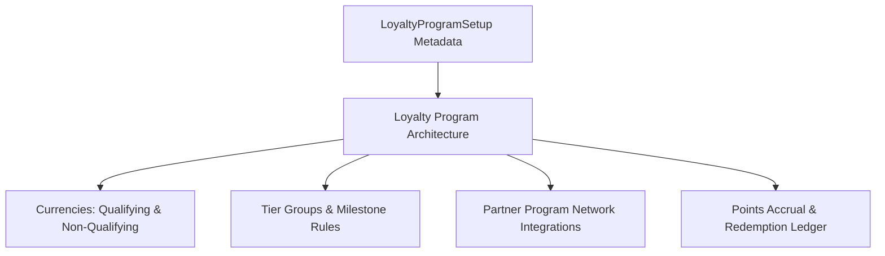

## Architectural Overview

`LoyaltyProgramSetup` represents the administrative foundation for Salesforce Loyalty Management. In modern customer experience architectures, loyalty programs incentivize customer retention through point accruals, tier upgrades, promotional vouchers, and partner co-branding arrangements (such as airline-hotel point partnerships).

Architecturally, `LoyaltyProgramSetup` acts as the root configuration node that binds together qualifying currencies, non-qualifying points, tier groups (such as Silver, Gold, Platinum), and partner accrual business rules. Deploying this metadata creates the declarative scaffolding required before transaction journals and member engagement flows can be processed.



## Directory and File Conventions

Loyalty Program Setup files are stored in the `loyaltyProgramSetups` folder:

| Property | Value |
| :--- | :--- |
| **Directory Name** | `loyaltyProgramSetups` |
| **File Extension** | `.loyaltyProgramSetup` |
| **Root XML Element** | `<LoyaltyProgramSetup>` |
| **API Version** | `68.0` |

## Key Metadata Fields

The `LoyaltyProgramSetup` metadata type encapsulates program governance attributes:

| Field Name | Type | Description |
| :--- | :--- | :--- |
| `developerName` | `string` | Unique API identifier of the loyalty program configuration. |
| `masterLabel` | `string` | Display label for the loyalty program. |
| `programName` | `string` | Target loyalty program name associated with this setup. |
| `isTierGroupEnabled` | `boolean` | Enables tiered membership structures and advancement thresholds. |
| `isPartnerProgramEnabled` | `boolean` | Allows external partner organizations to accrue and redeem points. |
| `accrualCalculationType` | `string` | Calculation model (such as `RealTime` or `Batch`) governing point balance evaluations. |
| `description` | `string` | Technical and business documentation for the program. |

> [!TIP]
> Combine `LoyaltyProgramSetup` deployments with Business Rules Engine (`ExpressionSet`) metadata to automate complex multi-variable point calculations (such as holiday multiplier bonuses).

## Declarative XML and Package Manifest Examples

Below is an enterprise loyalty configuration `Global_Retail_Rewards.loyaltyProgramSetup`:

```xml title="force-app/main/default/loyaltyProgramSetups/Global_Retail_Rewards.loyaltyProgramSetup"
<?xml version="1.0" encoding="UTF-8"?>
<LoyaltyProgramSetup xmlns="http://soap.sforce.com/2006/04/metadata">
    <developerName>Global_Retail_Rewards</developerName>
    <masterLabel>Global Enterprise Retail Rewards</masterLabel>
    <programName>Global_Retail_Rewards_Program</programName>
    <isTierGroupEnabled>true</isTierGroupEnabled>
    <isPartnerProgramEnabled>true</isPartnerProgramEnabled>
    <accrualCalculationType>RealTime</accrualCalculationType>
    <description>Omnichannel customer rewards program with partner accruals</description>
</LoyaltyProgramSetup>
```

### Manifest Definition (`package.xml`)

Include the setup in `package.xml`:

```xml title="manifest/package.xml"
<?xml version="1.0" encoding="UTF-8"?>
<Package xmlns="http://soap.sforce.com/2006/04/metadata">
    <types>
        <members>Global_Retail_Rewards</members>
        <name>LoyaltyProgramSetup</name>
    </types>
    <version>68.0</version>
</Package>
```

## CLI Retrieval and Deployment Commands

Use the Salesforce CLI to deploy loyalty program configurations:

```bash
# Retrieve all LoyaltyProgramSetup configurations
sf project retrieve start --metadata LoyaltyProgramSetup

# Deploy the loyalty setup to staging
sf project deploy start --source-dir force-app/main/default/loyaltyProgramSetups/Global_Retail_Rewards.loyaltyProgramSetup
```

## Senior Architect Deployment Best Practices and Gotchas

- **License and Permission Prerequisites:** Loyalty Management requires specific feature licenses (`LoyaltyManagementUser`). Attempting to deploy `LoyaltyProgramSetup` to an org without active loyalty licenses will result in metadata parsing errors.
- **Data Model Initialization:** `LoyaltyProgramSetup` creates the programmatic schema, but runtime currencies, partners, and member records must be created or seeded via data loading scripts post-deployment.
- **Real-Time vs. Batch Calculation:** If `<accrualCalculationType>RealTime</accrualCalculationType>` is configured, verify that Apex triggers and Flows processing transaction journals are optimized to avoid governor limit contention during high-volume checkout surges.

> [!WARNING]
> Disabling `<isTierGroupEnabled>` on an existing active loyalty program can invalidate member tier assignments and disrupt tier-based benefit entitlement checks.
